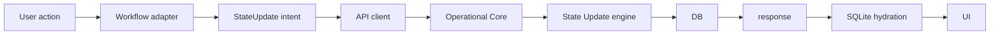
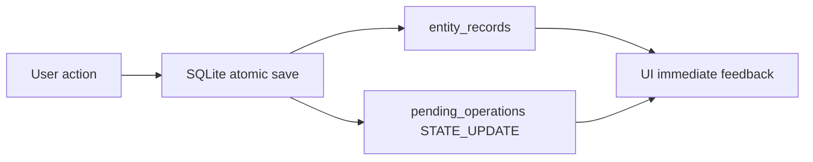
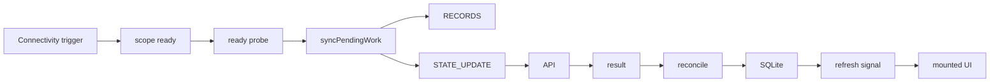
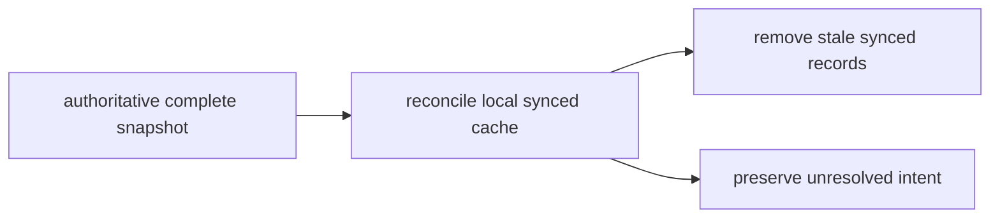

# State Update

This document is the canonical client-side reference for the current `STATE_UPDATE` architecture in Opco Client. It describes the code as it exists now, including implementation gaps against the newer Operational Core contract.

Read this before changing the state-update runtime, offline persistence, outbox, reconnect orchestration, reconciliation, conflicts, workflow adapters, or diagnostics.

## Model

Opco / Operational Core is the online source of truth. SQLite is a local cache plus durable storage for unresolved local intent. `pending_operations` is the shared outbox. `STATE_UPDATE` is the generic workflow primitive for operational state changes.

Attendance is an adapter/preset over `STATE_UPDATE`. It has workflow-specific UX, labels, status mapping, and legacy GET adaptation, but it does not own a separate sync engine, outbox, retry loop, conflict engine, or persistence engine.

Attendance day summaries and recent records are scoped by owner, contract, target entity, AppView,
and the selected attendance `date`. Local filtering uses the persisted logical attendance date in
`values_json`, never `cached_at`, creation time, or modification time. The remote Attendance endpoint
receives the same selected date. Recent results are limited (remote latest: 10; local page: 20) and
ordered newest-known first. A request that finishes after the user selects another date may finish
hydrating its own cache scope, but cannot update the visible day.

## Flow Diagrams

Online:



Offline:



Reconnect:



Timeout:


Remote deletion:



## Sources Of Truth

| Situation | Source of truth | Local behavior |
| --- | --- | --- |
| Online | Backend | Render backend response and hydrate SQLite. |
| Offline | SQLite snapshot | Render cached data and unresolved local intent. |
| Local pending | Local intent | Preserve the intent until sync, conflict, failure, or explicit user resolution. |
| Conflict | Backend remote snapshot plus local requested intent | Keep both snapshots and require explicit choice. |
| Timeout unknown | Unknown | Do not assume failure or success; verify remotely when possible. |
| Remote confirmed | Backend state | Complete the pending operation and mark local snapshot `synced`. |

Backend online state must not later be replaced by a stale or partial SQLite snapshot.

## StateUpdateIntent

A logical `StateUpdateIntent` includes:

- `appViewId`
- `subjectRecordId`
- optional `date`
- `stateValues`
- `extraValues`
- `clientRequestId`
- `overwrite`
- `expectedUpdatedAt`, when conflict resolution needs it
- `uniqueness` and `historyMode`, derived from the prepared AppView definition

The client uses `stateValues` internally. The wire payload to Operational Core uses `states` conceptually, while the current client API wrapper accepts `stateValues` and translates it at the API boundary. Do not mix internal and wire names outside that boundary.

For generic `GET workflow/state-update`, Operational Core's documented response uses `subjects` as the search result collection and `states` as the current/latest state map. The Client keeps its internal renderer model as `items` plus `stateValues`; `src/lib/opco-api.ts` is the boundary adapter that maps `subjects -> items`, `subjectEntityType -> sourceEntityType`, and `states -> stateValues`. SELECT state fields carry `optionId`; scalar state fields (`TEXT`, `INTEGER`, `DECIMAL`, `MONEY`, `DATE`, and `BOOLEAN`) carry `value`. Attendance keeps its separate endpoint and `items` response shape.

## Client Request ID

The official backend contract is that `clientRequestId` identifies one immutable intention:

- retrying the same intention uses the same ID;
- changing state uses a new ID;
- changing extra values uses a new ID;
- confirming overwrite uses a new ID;
- a new attempt after a stale conflict uses a new ID.

Current implementation:

- Online saves create a fresh `clientRequestId` for each explicit save action.
- Offline saves persist the ID in `pending_operations` and preserve it across retries.
- Repeated offline `update-current` saves for the same subject/date consolidate into the existing pending operation.
- If the consolidated payload is the same semantic intention, the existing `clientRequestId` is preserved.
- If the consolidated payload changes states, extras, overwrite, or expected version, the pending operation keeps one local row but rotates to a new `clientRequestId`.
- Confirming an online conflict calls a fresh save action and therefore creates a new `clientRequestId`.

## SQLite Persistence

Relevant tables:

- `entity_records`: renderable local snapshots, remote IDs, remote version, conflict snapshots, and `sync_status`.
- `pending_operations`: durable outbox for `CREATE`, `UPDATE`, and `STATE_UPDATE`.
- `app_metadata`: schema version, selected contract, remembered Attendance context selections, Attendance day hydration metadata, and persisted state-update diagnostics.
- `app_view_definitions`: prepared workflow/runtime metadata by `owner_key + contract_id + app_view_id`.
- `sync_telemetry`: sync phase and timestamps. `STATE_UPDATE` uses `workflow:<appViewId>` as the telemetry entity key.

Offline `STATE_UPDATE` save is atomic: the local `entity_records` snapshot and the `pending_operations` row are written in the same SQLite transaction.

Conflict persistence is also atomic: `markStateUpdateOperationConflict()` writes the pending operation error metadata and the associated local `entity_records` conflict snapshot in one SQLite transaction. The successful final shape is unchanged: pending operation has `last_error_code = CONFLICT`, and the local record has `sync_status = conflict` plus remote conflict metadata.

STATE_UPDATE uses the common per-connection SQLite coordinator described in
`CLIENT_ARCHITECTURE.md#sqlite`; it does not own a separate queue. Offline saves, remote snapshot
hydration, outbox completion/conflict, concurrent RECORDS work, prewarm metadata, and direct
telemetry/cache statements therefore cannot enter one another's transaction. Each transaction keeps
its original atomic boundary and propagates failures after SQLite rollback. The coordinator does not
retry or suppress operations, and a rejected operation does not prevent the next queued operation.

`local_id` is scoped. For `update-current` with `subject` or `subject-date` uniqueness, it is derived from `appViewId`, optional date, and `subjectRecordId`. For append/no-uniqueness records it is generated from the AppView plus time/randomness.

## Sync Statuses

| Status | Meaning for STATE_UPDATE | Auto-sync |
| --- | --- | --- |
| `pending_create` | Technical shared-infra name for pending intent. | Eligible. |
| `pending_update` | Technical shared-infra name for pending intent. | Eligible. |
| `syncing` | Operation was selected and may have been interrupted. | Eligible according to current retry/reconnect policy. |
| `synced` | Local snapshot matches last known remote state. | Not an outbox item. |
| `failed` | Non-auto-retryable failure or manual retry required. | Not automatic. |
| `conflict` | Backend returned a conflict snapshot. | Not automatic. |

`pending_create` and `pending_update` are inherited database names from the shared records infrastructure. Conceptually, both are pending state-update intent.

## Orchestration

All automatic state-update sync execution goes through `syncPendingStateUpdatesWithTelemetry()` in `SessionProvider`, which wraps the internal engine `syncPendingStateUpdatesOnce()`. Combined pending-work runs use `syncPendingWork()` to keep the global engine order as RECORDS first, then STATE_UPDATE; lifecycle decisions still belong to `SessionProvider`.

Current triggers:

- reconnect
- unknown-to-online
- startup-with-pending
- foreground/resume
- manual retry

The sync engine is single-flight. Failed and conflict rows are excluded from automatic retry by current policy; manual retry is explicit.

Each combined pending-work execution creates a local `syncRunId`. It is not sent to Operational Core. It exists to correlate lifecycle trigger, state-update sync telemetry, request diagnostics, and visible UI diagnostics.

Automatic reconnect-like triggers are gated by Operational Core readiness before POST sync begins. NetInfo `online` only says the client appears connected; it does not prove Railway/Operational Core is ready to accept authenticated business writes. For `reconnect`, `unknown-to-online`, `startup-with-pending`, and `foreground/resume`, the lifecycle hook first checks durable pending work and then probes `GET /api/v1/ready` with a short independent timeout of `2_500 ms`, at most three attempts, and bounded backoff of `500 ms` then `1_000 ms`. Each `READY_CHECK` attempt is recorded with an `attemptNumber` and the same local `syncRunId`. If readiness never confirms, the client does not send STATE_UPDATE/RECORDS POST requests, leaves pending intent durable and retryable, and records activity as `ready_failed` rather than a business sync failure. A readiness run that has been marked as `reconnecting` must later resolve to `ready_confirmed`, `sync_started`, `ready_failed`, `cancelled_scope_changed`, `interrupted`, or the terminal sync result; persisted orphan `reconnecting` activity without a matching `READY_CHECK` request is treated as `interrupted` on hydration and can be retried by the normal catch-up path.

After an exhausted readiness cycle, if connectivity is still `online`, the app is active, the same owner/contract/token scope is still current, durable pending work remains, and no run is active, the lifecycle schedules a bounded recovery catch-up. Recovery uses delays of `5_000 ms`, `15_000 ms`, `30_000 ms`, then `60_000 ms` as a maximum interval while those conditions remain true. It is cancelled when connectivity leaves `online`, when pending work disappears, when the app backgrounds, or when the session/contract scope changes. Each recovery catch-up creates a new local `syncRunId`; it does not consume business retry count, does not change `clientRequestId`, and does not send a business POST before readiness succeeds.

`GET /api/v1/ready` is public from the client perspective and must not touch session state. It does not send bearer auth, must not initiate refresh, and must not clear tokens. After readiness succeeds, the lifecycle treats auth readiness as a separate pre-business-write gate: if the local access token is expired or within the five minute refresh margin, it runs one `AUTH_REFRESH` with the same local `syncRunId` and a `30_000 ms` timeout before sending pending STATE_UPDATE/RECORDS POSTs. Opaque/unparseable tokens are not proactively refreshed; they fall through to the normal authenticated-request `401 TOKEN_EXPIRED` path. A refresh network error, timeout, `503`, or `DB_UNAVAILABLE` is not evidence of an invalid session and must leave credentials/pending intent recoverable. Automatic logout is allowed only after a backend-confirmed invalid refresh/session condition such as expired, revoked, reused, missing refresh token, inactive refresh user/app, or `TOKEN_INVALID`.

If NetInfo becomes `online` before `ownerKey`, token, and selected contract scope are ready, the scope-ready catch-up path re-checks durable pending work as soon as the missing scope becomes available. This closes the case where the online transition was consumed while `shouldSync()` was false. The catch-up is not polling; repeated renders are deduped for the active scope, and a user/session/contract change is evaluated as a new scope.

Mounted STATE_UPDATE adapters derive their visible runtime model from the canonical session connectivity, durable unresolved intent for the active scope, readiness activity, real pending-work engine activity, timeout reconciliation state, and terminal result. `PENDING` means durable unresolved work exists but no sync engine or readiness probe is currently active. `RECONNECTING` means the readiness gate is actively probing Operational Core in the mounted runtime, not merely that old telemetry says the last activity was `ready_check`. `SYNCING` is reserved for an active `syncPendingWork()`/engine run. `CONFIRMING` is reserved for an in-flight direct write or timeout reconciliation. A renderer must not show `Sin conexion` from a separate NetInfo listener, and must not show `Sincronizando con Opco...` merely because it is online with pending work.

## Connectivity

Current connectivity classification:

- `isConnected === false` or `isInternetReachable === false` means `offline`.
- `isConnected === true` means `online`, even if reachability is `null`.
- both values unknown/null means `unknown`.

The client bootstraps with `NetInfo.fetch()` and then listens to NetInfo changes.

Connectivity is an orchestration signal, not a source of truth about the result of a write. A timeout or network transition does not prove that Operational Core failed to persist a command.

## Timeout

The API client timeout is `12_000 ms`.

Timeout does not mean write failed. For state-update sync, a timed-out POST may still have been committed by Operational Core. Current sync then attempts remote verification through `getStateUpdateWorkflow({ date, subjectRecordId })`. If the remote item exactly matches the pending payload, the operation is completed locally and telemetry reports `reconciled_success`. If remote confirmation is unavailable or does not match, the pending operation remains unresolved under the retry/failure policy.

The UI should not keep a stale error once later remote verification confirms success.

A timeout from a GET refresh after a confirmed write is a view-refresh problem, not proof that the write failed. Workflow UI keeps operation feedback separate from refresh feedback so a confirmed local/remote write does not render the generic timeout as a write failure.

## Exact Reconciliation

Backend State Update 1.0 treats an intention as matching only when every submitted field matches after canonical normalization:

- `stateValues`
- `extraValues`
- omitted fields do not participate
- explicit `null` participates
- `RELATION` compares target record ID
- `SELECT` compares option ID
- `DATE` compares `YYYY-MM-DD`
- `TIME` compares `HH:mm`
- other values compare their canonical API representation

Current client implementation centralizes exact matching in the state-update offline helper. Timeout recovery, snapshot repair, and local reconciliation use the same semantic comparison:

- requested state fields compare by `fieldId` plus `optionId` for SELECT fields or `value` for scalar fields;
- requested extras compare by field key and canonical value;
- omitted extras are ignored;
- explicit `null`, `false`, `0`, and `""` are preserved as requested values;
- relation-like objects compare by target record `id`;
- labels, display names, and other visual text do not determine equality.

## UpdatedAt

Operational Core State Update 1.0 returns the real remote `updatedAt`. Client `remote_updated_at` should come from the server and must not use client time as a substitute for a remote version.

Current implementation:

- Successful remote sync requires server-provided IDs and `updatedAt`.
- Snapshot hydration stores `item.current.updatedAt`.
- Attendance latest adaptation requires `latest.updatedAt`.
- If a successful state-update response lacks a valid ISO `updatedAt`, the API wrapper raises a controlled contract error instead of inventing a version.
- `cached_at` remains local cache metadata and is distinct from `remote_updated_at`.

## Snapshot Reconciliation

`upsertStateUpdateSnapshot()` now supports complete snapshot reconciliation.

For a complete remote snapshot, the client:

1. upserts remote records that are present;
2. finds local records in the same `owner + contract + appView + date + targetEntityType` scope;
3. removes only local `synced` records absent from the remote snapshot;
4. preserves unresolved local intent.

Never delete these statuses due only to remote absence:

- `pending_create`
- `pending_update`
- `syncing`
- `failed`
- `conflict`

This handles confirmed remote deletions without creating pending operations, recreating remote records, or marking local rows failed.

## Complete Vs Partial Snapshot

Attendance GET has a backend `latest` limit of 10. The client centralizes that limit as `ATTENDANCE_LATEST_LIMIT`.

An Attendance day can be treated as complete only when:

```text
summary.totalRegistered <= ATTENDANCE_LATEST_LIMIT
AND
latest.length === summary.totalRegistered
```

Search and `personRecordId` responses are passed to SQLite with `complete=false`.

If `summary.totalRegistered > 10`, `latest` is not a complete snapshot and must not be used for destructive cleanup by absence. This heuristic depends on the current backend `latest take=10` contract.

## Remote Deletions

Confirmed remote deletion through a complete snapshot means local `synced` cache for that record should be removed. It should not create a pending operation, recreate the remote record, or mark the local snapshot `failed`.

Unresolved local intent is preserved. This guarantees that an online authoritative snapshot is reflected in later offline reads.

## Conflicts

A conflict contains:

- existing remote state;
- requested local intent;
- differences;
- `expectedUpdatedAt`;
- optional overwrite confirmation.

Backend conflict differences can distinguish state fields from extra fields through the structured difference payload. The client treats normal option/scalar differences as state diffs and preserves extra diffs when Core includes raw local/remote extra values or marks the source as extra.

Overwrite is a new semantic intention and requires a new `clientRequestId`. The original conflict probe should keep its original key if retried; the overwrite confirmation should not reuse it.

Current client representation preserves both state and extra differences when Operational Core returns them:

- state diffs remain represented as `existing.stateValues` and `requested.stateValues`, including scalar `value` where applicable;
- extra diffs can be represented as `existing.extraValues`, `requested.extraValues`, and an `extraValues[]` metadata array;
- each extra diff can carry `fieldId`, `fieldLabel`, `fieldType`, `localValue`, and `remoteValue`;
- when the prepared definition is available, SELECT and MULTISELECT extra values are rendered with option labels while retaining their technical values internally;
- unknown extra fields are still shown with a technical fallback label instead of being hidden or crashing.

Conflict resolution semantics have not changed. The user still chooses the whole local intention or the remote Opco state; there is no field-by-field merge action yet.

The generic renderer must project durable conflicts on top of a successful online read. It queries by
`ownerKey + contractId + appViewId + targetEntityTypeId + logical date`, overlays the requested local state
on matching visible subjects/latest rows, and retains the remote conflict snapshot for comparison. A GET,
snapshot refresh, search, or reconnect does not discard a differing local intention or make a conflict
eligible for automatic retry. The existing exact-match snapshot reconciliation can complete an intention
already confirmed remotely. Request-sequence invalidation prevents an older online/offline read from republishing a conflict after
an explicit resolution completes.

Both durable actions use the selected `localRecordId` and a conflict identity containing its local/remote
snapshot and outbox `clientRequestId`. Inside the shared SQLite transaction, they revalidate owner,
contract, AppView, target entity, subject and exact logical date plus that identity. A replaced selection
fails explicitly; it never falls back to the latest row for the same subject.

`Usar Opco` restores the retained remote values/version/id and deletes only the selected outbox operation
in one transaction. `Usar mi cambio` rewrites the selected row/outbox atomically as a new overwrite request,
including append workflows, and then invokes shared sync **after** the commit. No SQLite transaction waits
on network. Failed restoration or outbox rewrite rolls back all changes. The Attendance adapter carries
this same selection identity for its shared remote-resolution action.

STATE_UPDATE completion, conflict, retry and failure reread the durable operation identity in their write
transaction. A late response for a superseded request does not overwrite values or consume its successor.
New JSON metadata uses existing columns: snapshot `clientRequestId`, conflict `remoteRecordId` and overwrite
outbox `expectedRecordId`. Wire serialization is unchanged. Completion rejects a different subject or,
when the retained remote id is available, a different remote record. Historical conflicts without that id
cannot reconstruct it retroactively; the existing server id is used when available. No migration is needed.

After shared sync/refresh, `getStateUpdateResolutionOutcome` reads the selected row and outbox together.
Remote confirmation requires the matching request marker, a synced row with remote id/version and no
outbox for that row. Pending, new conflict, failed and superseded outcomes remain distinct; global sync
completion is not a receipt for the selected intent. Scoped resolution feedback is shown even when another
conflict remains, and mounted/scope guards suppress obsolete callbacks. `Usar Opco` reports local resolution,
not a new remote write. A refresh of the same remote id/version/states/extras preserves the confirmation
marker; an append row already linked to that exact remote is reused within its complete workflow scope.
This does not change the cross-AppView SQLite uniqueness constraint.

Attendance's durable `Usar mi cambio` action now reuses the same selected-conflict resolver, outcome
reader and feedback mapping. It carries localRecordId/conflictIdentity and the full workflow/date scope;
only the selected request's durable receipt permits server-confirmed feedback. Pending transport, new
conflict, failed and superseded outcomes remain explicit even when another operation succeeds.
Mounted/scope guards suppress obsolete feedback; the existing engine guards preserve a later edit.
This does not change Attendance's other save/online-conflict paths or the shared sync engine.
2026-10-03 evidence: ten actual-handler regressions fail against the previous source and pass now;
83 focused tests pass. Chrome/CDP 9361 with real OPFS and local Core/PostgreSQL verified confirmation,
blocked transport, a newer remote conflict and another successful operation while the selected one
failed. Edition/late-response races remain controlled regressions. See STATUS.md for exact provenance,
local database validation, cleanup and limits.


Evidence for 2026-10-03: four initial persistence regressions failed before correction; seven actual
renderer-handler tests also failed against the preserved initial source (including false server-confirmed
feedback for pending/conflict/failed/superseded outcomes); the final focused run passed
269 tests in ten affected files. The new Python-backed in-memory SQLite harness checks actual SQL/rollback
through production persistence; it requires `python3` and is separate from Expo testing. Chrome/CDP 9351
with a disposable profile, localhost-only synthetic API and real Expo OPFS/WASM checks both UI actions,
exact append selection, rollback after outbox deletion, displayed latest/remote id, confirmation, new
conflict and transport failure. Edition/late-response interleavings are controlled engine regressions;
not every race was injected in Chrome. No Core, API, schema, dependency or configuration changed. No full
suite, export, Playwright, commit, push or deploy. See `STATUS.md` for fixture details and remaining limits.

## Idempotency Errors

Backend idempotency errors:

- `IDEMPOTENCY_KEY_REUSED`: the same key was used with a different semantic payload. The client must not auto-retry with that same key.
- `IDEMPOTENCY_RESULT_UNAVAILABLE`: the backend has a historical or incomplete idempotency row without a durable response. The client must not silently generate a new key, especially for append-style commands where that could duplicate records.

Current implementation handles these codes explicitly:

- `IDEMPOTENCY_KEY_REUSED` fails the local operation for manual recovery and does not auto-retry with a new key.
- `IDEMPOTENCY_RESULT_UNAVAILABLE` attempts exact remote reconciliation only for `update-current` scopes where a single current record can be verified by `subject + date`. If the remote state and extras match, the operation completes as `reconciled_success`.
- Append/no-uniqueness operations do not auto-reconcile or rotate keys on `IDEMPOTENCY_RESULT_UNAVAILABLE`, because a GET snapshot cannot prove which append event was committed.

## Attendance Adapter

Attendance maps to `STATE_UPDATE` like this:

| Attendance | State Update |
| --- | --- |
| person | subject |
| status | state |
| context fields | extras |
| observation, only when `observationFieldId` exists | extra |
| date | date |
| uniqueness | `subject-date` |
| history mode | `update-current` |

Attendance uses configured `statusFieldId`, `personFieldId`, `dateFieldId`, optional `contextFieldIds`, and optional `observationFieldId`. UI/config option identity is `optionId`. SELECT context selections are remembered locally by `optionId`, but the persistible value in `extraValues` is resolved to `FieldOption.value` because that is the entity field value expected by Operational Core. Labels are display text only. If the value cannot be resolved, the client fails validation locally instead of sending an arbitrary `optionId`.

`observationFieldId` is optional. If it is absent, Attendance has no observation input, does not generate an observation extra value, and does not infer observation from arbitrary text/context `extraValues`.

Attendance may keep UX-specific text, status buttons, and the legacy GET adapter. It must not own separate sync/storage/conflict semantics.

Offline Attendance snapshots:

- remote snapshots are cached per date using the generic state-update shape in `entity_records`;
- daily hydration metadata lives in `app_metadata` with `lastSuccessfulRefreshAt`;
- local pending/failed/conflict rows overlay the remote snapshot and are never deleted by absence;
- online opening of any date hydrates that date for later offline use;
- prewarm automatically hydrates every date in the current month only, with maximum Attendance date-request concurrency of 3;
- dates outside the current month are not downloaded automatically and are hydrated only when opened online.

Monthly Home readiness uses `attendanceMonthStatus`: `complete` when all dates in the current month have complete snapshots, `partial` when at least one date is hydrated but one or more are missing, and `none` when no current-month date is hydrated. The active workflow date still uses its own daily hydration telemetry.

The compatible workflow family is named by `isStateUpdateCompatibleWorkflow()`. Current compatible keys are:

- `state-update`
- `attendance`

Known compatibility branches that still mention Attendance outside the adapter boundary:

- workflow registry resolution for `workflowKey === "attendance"`;
- app-view definition preparation/cache readiness for Attendance;
- Attendance prewarm of source Personas;
- diagnostics summarizing Attendance GET responses;
- local diagnostics that classify Attendance-derived pending rows.

These branches are current compatibility glue, not a separate Attendance engine.

## UI Refresh

`stateUpdateReconnectRefreshKey` signals mounted workflows after meaningful state-update sync. The intended flow is:

```text
sync -> local reconcile -> refresh signal -> mounted StateUpdateWorkflow/Attendance -> reload state
```

The refresh should not require remounting and should not trigger another sync loop. `shouldEmitStateUpdateRefresh()` emits only after selected or completed/conflict/failed/retriable state-update work; `shouldHandleStateUpdateRefresh()` handles each emitted key once and skips initial mount.

## Diagnostics

Diagnostics distinguish:

- current connectivity;
- last reconnect;
- last `STATE_UPDATE` activity, including snapshot reconciliation;
- last meaningful `STATE_UPDATE` sync;
- last visible UI error event;
- bounded request history for recent `STATE_UPDATE`, Attendance, readiness, and health diagnostics;
- current outbox;
- workflow local records;
- consistency;
- recovery state.

Telemetry is persisted in `app_metadata` under `state_update_sync_diagnostics:<fingerprinted ownerKey>`, avoids PII, and diagnostic observation must not change runtime behavior. The last meaningful state-update sync preserves sanitized POST request diagnostics when they exist: `syncRunId`, `requestStartedAt`, `fetchResolvedAt`, `responseBodyStartedAt`, `responseParsedAt`, `requestDurationMs`, `timeoutMs`, `abortControllerTriggered`, `httpStatus`, template path, diagnostic operation, sanitized diagnostic request id, echoed response request id, and parsed `Server-Timing` metrics. Timeout evidence is preserved even when exact remote reconciliation later completes the local operation as `reconciled_success`. Explicit operator commands from diagnostics, such as manual retry or sync now, may invoke the existing sync/recovery commands after a user action. Diagnostic event construction for manual state-update sync is shared between `SessionProvider` and `app/(app)/diagnostics/state-update.tsx`.

The dedicated `/diagnostics/state-update` route is an operational console. It renders compact health cards, last activity timeline, last request interpretation, non-zero current counters, request history, local operations, and explicit Attendance GET plus health/ready read actions. Mounting the route reads local diagnostics only. Attendance GET, health/ready latency checks, retry, and sync now require explicit button presses.

`requestHistory` keeps the recent bounded sanitized request events, currently capped at 20. It records operation class (`SAVE`, `DAY_LOAD`, `REFRESH_AFTER_SYNC`, `SEARCH`, `PERSON_LOAD`, `RECONCILE`, `READY_CHECK`, `AUTH_REFRESH`, `HEALTH`, or `OTHER`), HTTP method, path template, client timing milestones, timeout flag, HTTP status, backend error code when available, local `syncRunId` when available, sanitized request correlation id, echoed backend request id, parsed `Server-Timing`, and a derived interpretation such as `client_timeout_before_response`, `network_failure`, `http_error`, `server_slow`, or `success`. `AUTH_REFRESH` entries exist to distinguish auth readiness from business writes; a timeout there means the sync run was blocked before POST and should not be displayed as a failed record save. It must not persist payloads, raw IDs, query values, tokens, cookies, names, stack traces, or form values.

Structured backend validation errors can include field-level details such as `fieldId`, `fieldLabel`, `fieldType`, `rejectedValue`, `expectedType`, and `expectedValues`. The client persists those details on the pending operation as `lastErrorDetails`, shows a global summary (`Un cambio no pudo sincronizarse.`), and exposes `Ver detalle` for human-readable and technical detail. The primary message should use field labels and rejected values, not arbitrary `optionId`s, `undefined`, or `null`. When the failed operation is resolved or sync succeeds, the global pending-error notice disappears; telemetry/history may still retain sanitized evidence.

`Last STATE_UPDATE activity` is separate from `Last STATE_UPDATE sync`. A real sync engine run writes both, with activity `type=sync`. Readiness probes may write activity `type=ready_check` with `result=reconnecting`, `ready_confirmed`, `sync_started`, `ready_failed`, `cancelled_scope_changed`, or `interrupted`, but they do not invent `Last STATE_UPDATE sync`. The diagnostics UI labels the historical sync card as the last completed sync and shows readiness activity separately. Snapshot reconciliation through `upsertStateUpdateSnapshot()` may complete pending local intent without a POST sync run; that writes activity `type=snapshot_reconciliation` and does not invent a new `Last STATE_UPDATE sync`.

`Last visible UI error` is historical. The current visible error may disappear after success, refresh, navigation, or remount, but diagnostics keep the last sanitized event with `occurredAt`, optional `clearedAt`, `operation`, HTTP method, path template, duration, timeout flag, HTTP status, error code, optional `syncRunId`, and resolution such as `unresolved`, `cleared_after_success`, or `refresh_failed`. It must not persist user-facing messages, payloads, tokens, raw IDs, names, or form values.

`Last session termination` is also historical. Manual sign-out stores `reason=user_sign_out` and automatic invalidation stores either `reason=refresh_invalid` from `AUTH_REFRESH` or `reason=token_invalid` from an authenticated request. The event includes timestamp, source, backend error code, and sanitized request id only. It exists to distinguish confirmed invalid-session logout from recoverable reconnect/refresh failures.

Reconnect detection is persisted when connectivity transitions from `offline` or `unknown` to `online`, even if there is no pending work to sync. A transition can therefore update `Last reconnect` without producing a new `Last STATE_UPDATE sync` run.

## Recovery Invariants

- Remote exact confirmed means local state can become `synced`.
- A real pending operation is not overwritten by a remote snapshot that does not match it.
- No pending operation plus no remote record is an orphan/recovery condition.
- Timeout plus exact remote confirmation becomes `reconciled_success`.
- `outbox=0` plus local pending records is a detectable consistency mismatch.
- `failed` and `conflict` are not automatic retries.
- Interrupted `syncing` state-update rows are eligible under current retry/reconnect policy.

## Invariant Checklist

| # | Invariant | Status |
| --- | --- | --- |
| 1 | Opco is source of truth online. | IMPLEMENTED |
| 2 | SQLite is cache plus unresolved local intent. | IMPLEMENTED |
| 3 | Offline save is atomic. | IMPLEMENTED |
| 4 | `clientRequestId` represents an immutable intention. | IMPLEMENTED |
| 5 | Retries do not change `clientRequestId`. | IMPLEMENTED |
| 6 | A modified intention rotates `clientRequestId`. | IMPLEMENTED |
| 7 | No pending intent is deleted without explicit resolution. | IMPLEMENTED |
| 8 | A partial snapshot never deletes by absence. | IMPLEMENTED |
| 9 | A complete snapshot may delete only stale `synced` rows. | IMPLEMENTED |
| 10 | Snapshot reconciliation never overwrites unresolved intent. | IMPLEMENTED |
| 11 | Reconcile compares states plus extras. | IMPLEMENTED |
| 12 | `remote_updated_at` comes from the backend. | IMPLEMENTED |
| 13 | Combined pending-work sync uses one engine-order facade; state-update sync uses one telemetry wrapper. | IMPLEMENTED |
| 14 | Diagnostic observation is passive; explicit operator commands may invoke existing recovery/sync commands. | IMPLEMENTED |
| 15 | Attendance is an adapter, not an engine. | IMPLEMENTED |
| 16 | Conflict operation metadata and local conflict record are persisted atomically. | IMPLEMENTED |
| 17 | Observation is represented only when `observationFieldId` exists. | IMPLEMENTED |
| 18 | Conflict UI can present state and extra diffs when Core returns them. | IMPLEMENTED |
| 19 | Successful reads preserve scoped durable conflicts and their explicit resolution actions. | IMPLEMENTED |

## State Update 1.0 Readiness

Implemented client-side readiness for State Update 1.0:

- immutable `clientRequestId` semantics for retries vs modified intentions;
- exact reconciliation across requested SELECT/scalar states and extras;
- server-owned `updatedAt` as the only remote version;
- complete snapshot reconciliation for remote deletions;
- explicit handling for backend idempotency errors;
- centralized compatible workflow detection for `state-update` and `attendance`;
- generic conflict diff presentation for state fields and extra fields;
- structured error detail persistence and global detail UI.

Remaining limitation:

- conflict resolution remains a whole-intent decision; there is no field-by-field merge action.

## Architecture Entities For System Diagram

Stable nodes and boundaries for a later system diagram:

- `SessionProvider`: owns auth/session state, selected contract, reconnect orchestration, sync telemetry helpers, and refresh signals.
- `Connectivity`: NetInfo-derived online/offline/unknown signal.
- `AppView Definition Cache`: prepared runtime metadata by owner/contract/AppView.
- `Workflow Registry`: routes `WORKFLOW` AppViews by `workflowKey`.
- `StateUpdateWorkflow`: generic state-update UI/runtime.
- `Attendance Adapter`: Attendance-specific UX and mapping onto `STATE_UPDATE`.
- `SQLite`: local cache and outbox store.
- `entity_records`: renderable snapshots plus local state-update intent rows.
- `pending_operations`: durable outbox for unresolved writes.
- `sync orchestrator`: `syncPendingStateUpdatesWithTelemetry()` and `syncPendingStateUpdatesOnce()`.
- `API client`: authenticated `/api/v1` boundary, timeout, envelope parsing.
- `Operational Core`: authoritative backend and state-update engine.
- `telemetry`: persisted sync diagnostics and recovery summaries.
- `diagnostics`: UI/route views for non-sensitive operational inspection.
- `refresh signals`: mounted workflow refresh after sync.
- `Service Worker/PWA`: offline app shell only, not API data cache.
- `RECORDS engine`: separate generic records renderer/sync system that shares SQLite infrastructure.


## Corrección de current visible por fecha — 2026-10-04

Core GET STATE_UPDATE con unicidad subject y dateFieldId selecciona ahora subjects.current por el
DATE configurado descendente, id ascendente como latest; excluye fechas ausentes y retorna null si
no hay candidato fechado. La selección se pide explícitamente con selection=workflow-current en
findExistingStateUpdates. Sólo afecta GET visible; lookup por defecto de POST/unicidad/conflictos,
proyección REPORT, Attendance/sujeto-fecha y no-date conservan comportamiento. updatedAt continúa
siendo la versión de concurrencia; nunca sustituye fecha para el current visible de ese alcance.
No se importa el contrato REPORT LATEST_BY_RELATION ni se modifica la persistencia Client.

Tres regresiones fallaron antes; 71 pruebas focalizadas Core pasan tras corrección, incluido target de
conflicto conservado. Fixture real local devuelve R1 de Fecha 04-10 frente a R99 de Fecha 03-10 con
updatedAt posterior. Chrome exclusivo/OPFS real confirma R1 en primera apertura offline con búsqueda
tras preparar desde Inicio y en reapertura después de cerrar todos los procesos del perfil, sin servicios
locales y bajo CDP offline antes de navegar. Evidencia limitada al sujeto y fecha activa preparados;
no cobertura histórica completa, writes/conflicts, native ni incidente productivo Error finalizing statement.
Detalle, intentos descartados del arnés y limpieza en STATUS/OFFLINE_FIRST_AUDIT. V11 sigue pausado.

## Cierre v10: uniqueness normalizado, identidad remota y current offline — 2026-10-07

La discrepancia de integración anterior quedó resuelta en Client. Core conserva su contrato
workflow.uniqueness={mode:"none"|"subject"|"subject-date"}. El límite API acepta también las
cadenas históricas acreditadas, tanto en metadatos superiores como en workflow; entrega siempre
un StateUpdateUniqueness interno en forma de cadena. Un valor desconocido, objeto sin mode o
modo anidado inválido produce INVALID_STATE_UPDATE_UNIQUENESS; no existe default a subject.

La misma validación se aplica al escribir y leer app_view_definitions (get y list). Una definición
state-update antigua con objeto se normaliza al leer sin reescribir SQLite ni exigir limpieza.
Una definición con modo inválido se entrega como kind=error/status=error con el mismo código,
preservando el tratamiento de configuración inválida. Otros tipos de definición no se modifican.
No se reinterpretan identidades, payloads ni claves de intenciones/outbox ya existentes.

Esto activa la corrección anterior para subject/append/dateFieldId: IDs remotos distintos se
conservan por separado con scope owner/contrato/entidad/AppView; referencias current/latest al
mismo ID reutilizan una fila, priorizando los estados y extras completos de current. Filas synced
legacy del mismo evento conservan su local_id. Filas pendientes/conflict/failed no se sobrescriben
ni se fusionan. No hay cambio de esquema, índice UNIQUE, versión SQLite ni INSERT OR REPLACE nuevo.

Current offline selecciona por fecha configurada DESC y server_id ASC, excluyendo fecha ausente,
sin limitar historia synced a fecha consultada. El overlay no synced mantiene su scope de consulta
existente. No se usa revisión ni timestamps como criterio del evento. Tampoco se guarda la fecha
consultada como fecha del evento cuando la fecha autoritativa falta en el modo acotado.
Attendance, subject-date y workflows sin fecha conservan sus caminos existentes.

Las llamadas de preparación y carga pasan el total esperado de eventos si la respuesta declara
primera página completa. Si el contenido único persistido no coincide, no se reconcilian filas
synced ausentes y no se acredita complete. Los marcadores antiguos sin prueba de contenido se
leen partial para el modo acotado. Una referencia repetida current/latest cuenta una sola vez;
una transacción fallida no produce prueba nueva de cobertura. Páginas/search parciales siguen
sin acreditar completitud ni hacer limpieza destructiva.

Regresiones nuevas entran por createOpcoApi con el payload real {mode:"subject"}, recorren
prewarm y la caché SQLite reales, hidratan ambos IDs y comprueban el ganador R1. Incluyen lectura
de definiciones cacheadas antiguas, ambas formas para los tres modos, rechazo de configuración
inválida, campo/extra completo de current frente a latest parcial y snapshot que declara total=2
pero trae sólo un evento. Se preservan las regresiones previas de pendientes/conflictos/rollback
y reapertura en disco. Véase STATUS para checks y Chrome/OPFS.

Alcance comprobado: fixture local de dos eventos, historial completo y un procedimiento sintético.
Un snapshot parcial/ausente no acredita vigente global ni cobertura completa. El problema conocido
entre AppViews distintas queda separado. La causa exacta productiva de Error finalizing statement
no se considera demostrada por estos resultados; V11 permanece pausado.


## Cierre técnico del lote v10 — 2026-10-07

El lote publicable se delimita contra Client main 76babead92d82239fcc9ac78f3e1e1d6b3df939d:
7 archivos de implementación/prueba existente, 2 regresiones nuevas y 3 documentos con sólo
las secciones de cierre de identidad/current/uniqueness y este cierre técnico. No se publican
las notas intermedias de diagnóstico ni los demás pendientes documentales.

Checks completos con máximo dos workers: árbol de trabajo 77 archivos/927 pruebas PASS;
HEAD + lote seleccionado aislado 76 archivos/923 pruebas PASS. Los cuatro casos de diferencia
son dos caracterizaciones V10 experimentales y dos diagnósticos entre AppViews, excluidos del
lote. No se modificaron ni retiraron esos pendientes. Typecheck PASS, lint completo PASS
con 0 errores y 2 advertencias preexistentes de require() en
src/sync/records-sync.local-db-regression.test.ts:182/183, build:web/export/SW PASS, diff-check PASS.
Build realizado en copia temporal, con endpoint localhost, sin copiar .env ni sobrescribir
el dist habitual. No se cambiaron dependencias, migraciones, esquema ni Core.

Revisión: definición cacheada objeto/string se normaliza sin reset/rewrite al leer; un modo
inválido da error controlado. Una fila legacy synced del mismo evento conserva su alias.
Un evento perdido por una versión anterior exige hidratación online exitosa para recuperarlo:
no puede reconstruirse a partir de una cobertura antigua. Los marcadores antiguos sin prueba
son partial, y total de contenido insuficiente impide complete/reconciliación destructiva.
Las identidades y serialización efectiva de intenciones/outbox/idempotencia siguen intactas;
las filas no synced y conflictos no se sobrescriben. Lookups/lectura/reconciliación filtran
owner/contrato/entidad/AppView y current además sujeto. Attendance/subject-date/sin fecha
retienen sus caminos anteriores; tests completos de los consumidores pasan. El UNIQUE v10
entre AppViews distintas permanece como limitación independiente, sin corrección en este lote.

Evidencia Chrome/OPFS reutilizada: SHA256 de todos los archivos funcionales finales coincide
con el contenido validado en backups/state-update-uniqueness-close/2026-10-07. Online con
preparación concurrente, offline y reapertura sin servicios conservan R1 y dos eventos.
No hay riesgo funcional nuevo que justifique repetir navegador o fixtures. Alcance: fixture
sintético completo de dos eventos/una AppView; no datos productivos, native, múltiples tabs
ni garantía de vigente global con snapshot parcial. Error finalizing statement productivo
permanece sin correlación concluyente de sentencia/causa primaria. V11 pausado.

Parches e inventario verificables: backups/state-update-technical-close/2026-10-07,
state-update-implementation.patch y state-update-documentation.patch; ambos aplican sobre
el HEAD indicado y reproducen exactamente los archivos seleccionados. Sin secretos, .env,
configuración local, bases SQLite/PostgreSQL, logs, builds ni experimentos en el lote.
Main, índice y pendientes excluidos se conservan. Sin commit/push/deploy.


## 2026-10-07 — Consistencia Inicio/workflow y copia de cobertura STATE_UPDATE

Causa local demostrada: Inicio leía el mismo marcador diario sin dateFieldId,
historyMode ni uniqueness. Omitía la validación existente que degrada a partial los
marcadores antiguos sin contentVerified=true para subject/append/con fecha. Inicio y
workflow ahora construyen su scope con buildStateUpdateCoverageScope. El lector conserva
sus reglas; no se escribe ni promociona ningún marcador.

«Copiar State Update», en la pestaña STATE_UPDATE del diagnóstico compartido, conserva
el diagnóstico home_local_today para las AppViews con definición local. Además copia
visible_workflow para la AppView visible: fecha seleccionada y configuración efectivas
obtenidas del estado/response del workflow mediante el contexto de actividad existente.
El shell proporciona la AppView de la ruta visible. La copia toma ese contexto al pulsar;
la fecha del workflow nunca se infiere del reloj ni del marcador de Inicio. Al cambiar
fecha se actualiza el contexto en memoria; al abandonar/cambiar scope se descarta.

Cada sección incluye queriedDate (o all si no hay campo fecha), markerPresent (marcador
válido leído), status efectivo, contentVerified (null si falta), downloadedThroughPage,
pageSize, total y lastSuccessfulRefreshAt. Scope identificado por fingerprints existentes
de owner/contrato/AppView/entidades/campo fecha, más uniqueness/historyMode. No incorpora
valores de registros, nombres ni IDs crudos en las nuevas secciones. status se lee con
la validación existente: no equivale al status crudo almacenado de un marcador legacy.

homeDateSource=local_today y visibleDateSource=workflow_context; never_clock distinguen
los dos orígenes. visible_workflow exige coincidencia entre la ruta, la actividad y el
owner/contrato/AppView. Si faltan contexto o respuesta efectiva, o hay un scope anterior,
se informa availability=unavailable y visibleWarningExplanation=not_established;
expresamente el marcador de Inicio no explica el aviso visible. Si el scope es conocido
pero carece de marcador, se exporta su propia queriedDate con markerPresent=false y
status=absent, sin sustituirlo por otro día. Definiciones no cacheadas se distinguen de
marcadores ausentes. Attendance no publica este contexto ni entra en el colector de Inicio.

La prueba de latest no acredita todos los sujetos ni sus vigentes.
subjectsLastFullRefreshAt refleja únicamente la evidencia de hidratación previa de la
entidad fuente: subjectsAvailability=previous_full_refresh o unverified.
currentCompleteness=not_certified siempre, porque no existe un marcador que acredite
la totalidad de vigentes. No se infiere cobertura completa desde filas visibles.

Regresiones locales: wiring Inicio/workflow/helper, complete/partial y marcadores antiguos;
copia presente/ausente; distintas fechas de Inicio/selección con marcadores distintos;
texto del camino real del botón capturado en un destino clipboard de prueba; ausencia
de valores/PII y de escrituras al copiar; contexto ausente, fechas cambiadas, salida y
reportes tardíos; rechazo de owner/contrato/AppView/scope/type distintos; aislamiento de
Attendance y separación latest/sujetos/vigentes. SQLite real en memoria mediante harness
Python y singleton de producción. Las conexiones de componentes/botón se comprueban
estructuralmente; no se afirma una nueva prueba manual de navegador ni clipboard del SO.

La copia lee el marcador vigente al pulsar, no un marcador histórico congelado cuando
apareció el aviso. Preparación concurrente puede haberlo actualizado entre ambos instantes:
los metadatos exportados sirven para correlacionar, pero no prueban por sí solos la causa
del mensaje previo. Una definición o respuesta no disponible no se inventa ni se sustituye.

Validación final del lote aislado: 940 pruebas en 77 archivos con máximo dos workers
(17 regresiones propias); typecheck PASS; lint global PASS, 0 errores y las 2 advertencias
require preexistentes de records-sync.local-db-regression.test.ts:182/183; build web y
service worker PASS sin .env/.env.local; diff-check PASS. Árbol HEAD + 12 archivos/hunks
seleccionados, sin V11, diagnósticos independientes ni sus pruebas. Los bytes funcionales
coinciden con el workspace; las secciones documentales previas permanecen intactas.
Parche e inventario verificables conservados en
/home/dannysilver/dev2026/backups/state-update-coverage-close/2026-10-07/ fuera de /tmp.
No cambia preparación, paginación, descargas, persistencia, escrituras/outbox, conflictos,
sincronización, esquema, Core ni dependencias. El nuevo contexto sólo vive en memoria y
usa el ciclo de actividad existente. V11 pausado; sin producción, commit, push ni deploy.
La validación manual productiva tras 01b07b5 acredita lectura y persistencia tras reapertura
offline, no escrituras/sync ni cobertura completa. La causa del aviso productivo y la
causa primaria de Error finalizing statement siguen sin correlación concluyente.

## 2026-10-07 — Ajuste visual de Fecha en el estado vigente

La causa visual era formatStateValueLabel: ante label no nulo lo devolvía directamente,
incluido YYYY-MM-DD o el ISO histórico. El formateador DATE existente sólo se aplicaba
al value sin label. Ahora también se aplica a label cuando la metadata del campo es
DATE y la cadena es YYYY-MM-DD o un timestamp ISO completo; no trunca texto libre que
sólo comienza por una fecha. 2026-08-13 y 2026-08-13T00:00:00.000Z se muestran como 13-08-2026 en el subtítulo.
Se reutiliza el formateador lógico por componentes de la cadena; no se convierte UTC a
hora local. TEXT, etiquetas DATETIME y texto no reconocible permanecen intactos.
No cambia value/label persistido, API, orden de vigencia, identidad ni dato de entrada.

Regresiones: las dos representaciones pasan por el adaptador API real y por persistencia,
cierre/reapertura SQLite; presentación online/offline es 13-08-2026, y value/label siguen
idénticos. TEXT/DATETIME no se reformatean como DATE. En el ensayo visual inicial, anterior a la corrección de preparación, Chrome offline y
reapertura sólo acreditaron D0 mostrando 06-10-2026. El ensayo posterior de preparación,
documentado a continuación, acredita también V1, V115 y R1 con 13-08-2026 en ambas
aperturas offline. Las regresiones preservan ambos formatos de entrada y los valores persistidos.

Checks: 120 pruebas afectadas en 6 archivos PASS (7 nuevas), typecheck PASS, lint de
archivos afectados PASS, diff-check PASS; lint global PASS, 0 errores y 2 advertencias require preexistentes. No
suite completa ni build de cierre. Export temporal de Expo Web necesario para Chrome,
sin .env, con URL local explícita y caché Metro propia; no se publicó ningún artefacto.
Fixtures PostgreSQL propios eliminados (0 restantes); procesos propios cerrados. Perfiles
OPFS sintéticos preservados sin reset; no se borraron cachés, snapshots ni outbox habituales.
Main y pendientes ajenos intactos; Core sin cambios funcionales. V11 pausado.
Sin esquema/migraciones/dependencias, producción, commit/push/deploy. Este defecto local
de preparación no confirma la causa primaria del incidente productivo SQLite ni demuestra
qué vigentes faltan en el navegador productivo; no se accedió a su almacenamiento.

## Preparación de vigentes por sujeto — validación local 2026-10-07

Alcance: STATE_UPDATE `uniqueness=subject`, `historyMode=append`, con `dateFieldId` configurado. El ajuste visual DATE previo permanece separado e intacto. Attendance, sujeto+fecha, workflows sin fecha, outbox, escrituras y criterio de vigencia no cambian. SQLite permanece en v10: se reutiliza `app_metadata`, sin tablas, índices ni migraciones nuevas.

### Contrato y cobertura

Core obtiene los sujetos mediante `subjectRecordId` (`findSubjects`, `take: 1`) y calcula `subjects[].current` antes y separado de la paginación de latest. `pageSize=1` limita latest, **no current**. Latest continúa siendo una consulta global aun cuando se pide un sujeto: su evento no demuestra el vigente del sujeto solicitado. La preparación persiste exclusivamente `subjects[].current` de esa consulta, con `complete:false` y `latest:[]`, mediante `upsertStateUpdateSnapshot`; no descarga las páginas restantes del historial ni reconcilia destructivamente ese snapshot parcial.

Tras el refresco completo de la lista origen, se recorren todas sus páginas SQLite, no sólo las 25 filas de presentación devueltas por el refresco. Cada ID remoto preparado se consulta una vez, sin reintentos propios, reutilizando `runWithConcurrency` y `PREWARM_CONCURRENCY=4`. El límite es cuatro consultas por AppView; el pool exterior existente sigue limitando a cuatro AppViews, por lo que el máximo teórico entre AppViews es 16 consultas de vigentes. Las solicitudes conservan los timeouts existentes del API.

El marcador `state_update_current_coverage` es independiente de `state_update_snapshot_coverage` (latest). Su clave incluye usuario, contrato, AppView, entidades origen/destino, fecha consultada, campo de fecha, unicidad y modo de historial. Para cada sujeto guarda únicamente un resultado técnico:

- `verified` con ID remoto: se obtuvo y persistió el vigente; `contentVerified` y el número persistido deben acreditar exactamente ese evento.
- `verified` con `remoteRecordId:null`: el endpoint devolvió explícitamente un sujeto sin vigente. Se verifica también la persistencia del snapshot vacío.
- `failed`: falló la consulta, la validación de scope/configuración o la persistencia/verificación. No significa sujeto sin versiones.
- Sujeto ausente del mapa: consulta no acreditada, incluida una interrupción antes de persistir. No significa ausencia de versiones.

El marcador empieza en `partial`, reemplazando cualquier certificación anterior del mismo scope al comenzar esta preparación. Sólo termina `complete` si el refresco origen acredita la misma cantidad remota descargada, todos los IDs remotos y el total cacheado coinciden, y todos los sujetos tienen un resultado `verified` persistido. Una fuente incompleta/inconsistente, un pendiente local de origen sin ID remoto o una preparación interrumpida no acreditan cobertura global. La cancelación opcional es cooperativa: no inicia nuevas consultas y no acredita respuestas recibidas después de la interrupción; no agrega un mecanismo de cancelación de transporte.

Las búsquedas filtradas y la carga visible no escriben este marcador. No pueden certificar todos los sujetos ni sustituir una preparación completa. Los marcadores latest antiguos no se convierten en prueba de current: sin el marcador nuevo se mantiene `not_certified`. La copia de diagnóstico muestra por separado status de current, fuente completa, cantidad total/verificada/sin versión/fallida, solicitudes, duración y fecha de preparación; no copia IDs de sujetos/eventos ni valores de registros.

`complete` acredita la preparación de esos sujetos en ese scope y recorrido, no una transacción remota atómica, actualidad indefinida, historial completo o sincronización de escrituras. Los overlays locales y conflictos mantienen su precedencia; un vigente remoto que no pueda persistirse por protección de una fila pendiente deja su sujeto sin acreditar. La lectura y selección offline existentes no se modifican.

### Evidencia local

Fixture propio: 130 procedimientos buscables por TOLVA y 217 eventos. El procedimiento 000 concentra los primeros 20 eventos latest; V1 y V115 tienen fecha lógica 13-08-2026, anterior a la consulta 07-10-2026. Dos eventos del sujeto 116 comparten Fecha: R1 tiene menor ID remoto que R99, aunque R99 fue modificado después. Hay 13 sujetos sin versiones. Estatus obligatorio usa un SELECT sintético explícito `VALIDADO_SYNTHETIC`; el default productivo no está acreditado. Revisión es TEXT sintético. Core y PostgreSQL fueron exclusivamente locales, usando `DATABASE_URL` de Core `.env.local` pasada explícitamente y comprobada como local.

Core real respondió a `subjectRecordId&pageSize=1` con exactamente un sujeto: D0, V1, V115 y R1 coincidieron con sus vigentes esperados; el sujeto 129 devolvió `current=null`, aunque latest devolvió un evento global. Así se acredita que la página de latest no recorta el current por sujeto.

En Chrome headless mediante CDP directo (sin Playwright), perfil exclusivo nuevo, la preparación se realizó en Inicio **sin visitar antes la experiencia ni buscar**. La revisión de cierre corrigió el conteo anterior: los 262 eventos CDP no acreditan dos preparaciones. El marcador conservado registra una ejecución `home`, y Core recibió 131 GET de preparación: uno global y 130 por sujeto. La duplicación del conteo de eventos es compatible con los preflight CORS entre puertos distintos; el capturador no archivó métodos/tipos HTTP, por lo que no permite identificar individualmente los OPTIONS. El marcador de vigentes registró 4.968 ms exclusivamente en este entorno local; no es una estimación productiva. El pool se verificó además con regresión que limita la concurrencia a cuatro. No se modificaron los triggers.

Primera apertura offline: TOLVA 000, 001, 115 y 116 mostraron D0, V1, V115 y R1, respectivamente. TOLVA 129 mostró el sujeto sin estado. Se conservaron 136 eventos remotos distintos para 117 sujetos, 130 resultados verificados y 13 ausencias explícitas. Latest permaneció `partial`, página 1, pageSize 20, total 217, sin certificar historial completo. Fecha se presentó como 13-08-2026 sin desplazar la fecha lógica.

Se cerró Chrome completamente, se detuvieron Core y el servidor web propios y se reabrió el mismo perfil sin servicios disponibles y con red deshabilitada. Las mismas búsquedas y cantidades persistidas coincidieron, con OPFS real y sin `Error finalizing statement`. No se borró el almacenamiento habitual. El fixture PostgreSQL propio se eliminó; cero entidades sintéticas restantes.

Checks afectados: **168 pruebas, ocho archivos**, máximo dos workers; typecheck aprobado; lint sin errores y con las dos advertencias previas de `require()` en `records-sync.local-db-regression.test.ts`; export web temporal para el navegador aprobado; diff-check aprobado. Regresiones nuevas incluyen error intermedio, interrupción de una preparación anteriormente completa, fuente inconsistente, persistencia no verificada, repetición sin duplicados, separación de scopes, búsqueda sin alterar la prueba global, intención append/conflicto/outbox intactos y diagnóstico sin IDs de eventos/sujetos. Se conservaron las regresiones DATE YYYY-MM-DD e ISO histórico por adaptador y SQLite.

Límites: evidencia local de lectura/preparación/persistencia; no acredita escrituras o sincronización productivas ni correlaciona la sentencia original del incidente productivo. `Error finalizing statement` continúa abierto en cuanto a su causa productiva exacta. V11 y los pendientes independientes permanecen pausados/excluidos.

La regresión principal se ejecutó también contra HEAD sin la corrección, en una copia aislada: falló al esperar 131 consultas (una global y 130 por sujeto) y recibir sólo una. Con el contenido corregido pasa y verifica los vigentes y el marcador tras reabrir SQLite. Este control no modificó el repositorio de trabajo.

## Cierre técnico de preparación de vigentes y DATE — BLOQUEADO — 2026-10-07

El lote candidato combina preparación de vigentes, marcador/diagnóstico separado de latest y formato DATE. No cambió ningún archivo funcional durante este cierre. **No está listo para publicar**: la revisión adicional de cachés anteriores demuestra una divergencia entre el current autoritativo recibido y el current que se lee offline, aun con marcador completo.

### Aclaración de los 262 eventos y disparadores

La afirmación anterior de dos preparaciones era una interpretación incorrecta del contador CDP. Se consultó únicamente la copia OPFS sintética ya conservada, sin abrir navegador, y se deserializó SQLite en memoria para lectura (`query_only`); no se alteró el perfil ni su almacenamiento. El marcador `offline_preparation_diagnostics` contiene una sola ejecución `home`, `prewarm-1791375806379-1`, de 2026-10-07T12:23:26.379Z a 12:23:34.063Z, duración total local 7.684 ms. El marcador de preparación de vigentes registra 130 consultas y 4.968 ms para esa etapa, **medición del entorno local, no estimación productiva**.

El log existente de Core para este fixture contiene 137 GET STATE_UPDATE: dos globales y 135 por sujeto. El benchmark online previo emitió exactamente seis GET (uno global y cinco por sujeto). Restándolos quedan **131 GET de preparación: uno global + 130 por sujeto**, no 262 GET ni dos ejecuciones. Ningún GET de búsqueda forma parte de la preparación.

El capturador del ensayo sólo guardó booleans search/subject por `Network.requestWillBeSent`; contó también otros eventos del mismo URL sin archivar `request.method`, `type` o `requestId`. Sus 262 eventos (dos globales y 260 por sujeto) son compatibles con 131 GET y 131 preflight CORS: Client y Core estaban en puertos distintos, el API envía Authorization y Core resuelve OPTIONS en `src/proxy.ts` antes de la ruta. **No se conservó evidencia individual de los métodos OPTIONS**, por lo que el desglose de cada evento CDP permanece inferido; el conteo de GET y el disparador `home` sí tienen evidencia independiente.

El runner hizo una navegación inicial, un login y esperó la preparación; no accionó retry, selección de contrato ni una segunda preparación online. `finalizeSignIn` selecciona el contrato mediante el setter de estado; no llama al handler `setSelectedContractId` que dispara `contract-selection`. Inicio llama prewarm con `trigger:home`. El camino de reconexión puede disparar prewarm con su trigger y el handler del selector con `contract-selection`, pero no hay evidencia de otra ejecución de preparación por esos caminos en este ensayo. El single-flight existente comparte la promesa mientras la preparación del mismo usuario/contrato está activa; no es una política de deduplicación permanente y permite nuevas ejecuciones posteriores. No se modificó.

Las regresiones que llaman deliberadamente `prepare` dos veces sí comprueban repetición sin duplicados y recuperación tras fallo: son ensayos unitarios independientes y no explican los 262 eventos del recorrido Chrome. No se demostró duplicación automática; no se añadieron mecanismos de deduplicación, triggers ni cambios de transporte.

### Revisión de cobertura y bloqueo de caché anterior

La implementación sí condiciona el marcador completo a fuente remota/cacheada coincidente y completa, todos los IDs consultados, ninguna consulta fallida/interrupción y `contentVerified` con número persistido exacto. Incluye en el mapa los sujetos con `current=null`; los scopes incluyen usuario, contrato, AppView, origen/destino, fecha consultada y configuración. Las pruebas existentes acreditan protección de pendientes/conflictos, outbox intacto y latest parcial independiente.

Sin embargo, esas verificaciones sólo prueban el contenido recibido/persistido, no que el lector ignore eventos synced anteriores que ya no representan el current remoto:

1. Se precachea un evento synced del sujeto que ahora recibe `current=null`. La preparación resuelve/persiste el resultado vacío, guarda `verified` con ID nulo y termina `complete`. Offline sigue devolviendo el evento anterior, antes y después de reabrir el archivo SQLite.
2. Se precachea para otro sujeto un evento synced con Fecha mayor que la del current autoritativo actual. La preparación persiste el current correcto y su ID en el marcador completo. Offline sigue eligiendo el evento anterior de mayor Fecha, también tras reapertura.

Los dos casos se reprodujeron con adaptador API real y SQLite real en una copia de revisión aislada; **dos regresiones fallan**, sin modificar implementación, Core o datos productivos. Son escenarios de caché anterior frente a una respuesta remota actual diferente; no demuestran un cambio particular en producción.

Causa concreta: `upsertStateUpdateSnapshot` con `complete:false` conserva apropiadamente las filas synced no recibidas y omite current nulo al construir eventos. El marcador conserva el resultado autoritativo por sujeto. `searchStateUpdateSubjects`/`findStateUpdateRecordForSubject` no consultan ese marcador: después del overlay pendiente seleccionan entre todo el historial synced cacheado por Fecha DESC/ID remoto ASC. Por eso una fila anterior puede sustituir el resultado autoritativo, o reaparecer donde ese resultado es nulo. Descargar y persistir current no garantiza por sí solo la equivalencia del lector sobre un cache previo.

Propuesta mínima **sin implementar**: utilizar el resultado por sujeto ya persistido para delimitar la selección remota de current en su scope, respetando el overlay pendiente/conflicto existente. Un resultado verified con ID permitiría únicamente ese evento para current; verified con ID nulo acreditaría ausencia de vigente remoto. Un resultado fallido/ausente o marcador incompatible no acreditaría esa autoridad. Conservar los eventos de historial, sus identidades, latest parcial y outbox; no borrar filas ni descargar todo el historial. La implementación y sus regresiones requieren una etapa posterior autorizada.

### Lote candidato exacto, checks y límites

Doce archivos; implementación/pruebas completas de los diez paths TS enumerados, y únicamente las secciones documentales propias indicadas:

- `src/lib/app-view-prewarm.ts`: consultas por sujeto tras refresco completo, pool existente, inicio del marcador, cancelación cooperativa opcional.
- `src/lib/state-update-current-prewarm.ts`: helper nuevo, persistencia/proof por sujeto y cierre del marcador.
- `src/lib/local-db.ts`: acceso al marcador mediante app_metadata, sin cambios de esquema.
- `src/lib/state-update-offline.ts`: tipos e interfaces de cobertura de current.
- `src/state/state-update-coverage-copy.ts`: diagnóstico de current separado de latest, sólo cantidades/metadatos.
- `src/lib/state-update-prewarm-current-investigation.test.ts`: archivo nuevo del lote DATE/preparación, nueve regresiones.
- `src/lib/state-update-snapshot-date.test.ts`: adaptación del fixture existente para subjectRecordId; sus expectativas se conservan.
- `src/lib/state-update-coverage-consistency.test.ts`: regresión de diagnóstico current/latest y privacidad.
- `src/renderers/workflows/state-update/state-update-workflow-logic.ts`: hunk DATE de formatStateValueLabel, reutilizando el formateador lógico.
- `src/renderers/workflows/state-update/state-update-workflow-logic.test.ts`: bloque DATE con tres regresiones, dos entradas de fecha y protección TEXT/DATETIME/texto libre.
- `docs/STATE_UPDATE.md`: sólo secciones «Ajuste visual de Fecha en el estado vigente», «Preparación de vigentes por sujeto» y este cierre; excluida la investigación previa y todo el resto pendiente.
- `docs/STATUS.md`: sólo «Preparación de vigentes STATE_UPDATE, sin historial completo» y su cierre correspondiente; excluida la sección previa mixta de investigación/DATE y el resto pendiente.

El lote aislado sobre HEAD: **953 pruebas aprobadas / 78 archivos**, máximo dos workers; typecheck aprobado; lint aprobado (0 errores, dos warnings require anteriores); `npm run build` web aprobado, incluyendo service worker; diff-check aprobado. Las dos regresiones adicionales de revisión quedan fuera del candidato y se conservan como evidencia del bloqueo, sin ocultarlas en el total aprobado. No se repitió la suite por cambios posteriores exclusivamente documentales.

Chrome/OPFS se reutiliza porque los archivos funcionales coinciden con el contenido anterior: primera apertura sin visita previa y reapertura con servicios detenidos acreditan el fixture limpio, no los dos escenarios de caché anterior que ahora bloquean el cierre. El ajuste DATE sigue aprobado e independiente del bloqueo de selección. No se repitió navegador ni se crearon fixtures Core nuevos.

Parche candidato, inventario de hunks/hashes, evidencia sanitizada de disparadores y bloqueos, y reproducción separada de revisión en `backups/state-update-current-preparation-date-close/2026-10-07/`. El inventario declara `readyToPublish:false`. Sin secretos, .env, bases, logs, configuración local o artefactos en el candidato. Se conservaron byte a byte V11, pruebas/diagnósticos independientes y las secciones documentales excluidas. Main, HEAD e índice intactos; Core limpio. Sin commit/push/deploy. La causa exacta del incidente productivo SQLite permanece sin correlación concluyente.


## 2026-10-07 — Cierre completado: autoridad de current offline, preparación y DATE

Este cierre sustituye el bloqueo de la revisión anterior; conserva su evidencia histórica. Las dos regresiones antes fallidas forman ahora parte del lote y pasan antes/después de reabrir SQLite real.

El lector visible consulta la autoridad persistida por sujeto únicamente para `subject + append + dateFieldId`, dentro del mismo usuario, contrato, AppView, entidades origen/destino, fecha consultada y configuración. Primero mantiene el overlay pendiente/conflicto existente y su identidad durable. Después, un resultado verified con ID selecciona exclusivamente ese evento synced; verified con ID explícitamente null devuelve ausencia de vigente remoto aunque exista historial antiguo. Un resultado fallido, no consultado, incompleto o incompatible conserva la selección conservadora cacheada por Fecha descendente e ID remoto ascendente, excluyendo fechas ausentes, sin acreditar cobertura completa.

La lectura valida la forma del marcador, sus metadatos, las referencias sujeto/evento y la existencia del evento fechado en el scope; un ID ausente o perteneciente a otro sujeto no acredita autoridad. La completitud global exige además la lista origen coincidente y todos sus resultados acreditados. Un resultado individual válido sigue siendo utilizable con marcador global parcial. Un marcador antiguo/malformado no se convierte en complete. Estas comprobaciones derivan el resultado de lectura sin reescribir el marcador físico, borrar historial, snapshots, outbox ni conflictos. Los errores SQLite se propagan: sólo se trata la incompatibilidad de JSON/configuración como falta de evidencia. No se alteran escrituras, Attendance, flujos sujeto+fecha, esquema v10, sincronización ni criterios de Core. El ajuste DATE permanece idéntico.

Regresiones: null remoto frente a evento antiguo; current autoritativo frente a evento cacheado de Fecha mayor; resultado fallido/no consultado, ID omitido, marcador antiguo/malformado, otra fecha, referencia ausente/cruzada, marcador global parcial con resultado válido y overlays pending_create/conflict con outbox intacto. Verifican reapertura del archivo SQLite y conservación del marcador/historial. El fixture de diagnóstico current/latest ahora contiene las filas reales que su marcador acredita.

### Chrome/OPFS con caché previa y Core local

Fixture propio de 130 sujetos y 217 eventos, Core/PostgreSQL exclusivamente locales con DATABASE_URL explícita de .env.local y guardia local. Antes de responder al primer GET de preparación de Inicio se persistieron dos eventos synced anteriores mediante el mecanismo de snapshot existente: sujetos 115 y 129, con Fecha mayor que el current remoto o frente a current remoto null. La exposición del singleton para automatizar este paso existió únicamente en el export temporal, fuera del lote. No se visitó la experiencia antes de preparar y no se borraron cachés.

La preparación única home produjo **131 GET: uno global y 130 por sujeto**. En esta nueva captura se archivaron métodos: 262 eventos corresponden a 131 GET y 131 OPTIONS; cero GET de búsqueda en esa preparación. Esto no recupera los métodos individuales que faltaban en el ensayo anterior: sus 262 eventos por sí solos no demostraban dos preparaciones. Las repeticiones unitarias deliberadas son independientes. No se añadieron triggers o deduplicación. La etapa current midió 9.485 ms en este entorno local; los 4.968 ms del ensayo anterior también son locales, no estimaciones productivas.

Core online confirmó D0, V1, V115 y R1 (empate Fecha/ID), y null para el sujeto 129. Tras cerrar Chrome completamente, con Core y servidor web detenidos y red deshabilitada, la primera apertura fría del mismo perfil conservó estos resultados y DATE 13-08-2026. Un segundo cierre completo/reapertura repitió las mismas comprobaciones. V115 no fue sustituido por la fila cacheada de Fecha mayor y el sujeto 129 no recuperó su evento antiguo. OPFS conservó los **138 eventos distintos**, incluidos ambos antiguos, para 118 sujetos con historial; esto no implica 118 vigentes. Current: 130 resultados verificados, 13 null confirmados, marcador completo. Latest: parcial, página 1, pageSize 20, total 217, sin certificar historial completo. No apareció Error finalizing statement en estos recorridos.

Limitación del ensayo: el intento previo de navegación dura desde Inicio offline encontró una guardia de arranque y luego `OPEN_FAILED / SQLITE_UNAVAILABLE / Invalid VFS state`, antes de disponer del lector. No se corrigió ese arranque ni se cambió el worker; cerrar completamente Chrome y reabrir el mismo perfil intacto permitió las dos validaciones frías. La causa exacta de ese impedimento no se investigó en este alcance y no se atribuye al incidente productivo. Evidencia automatizada DOM/CDP, sin revisión manual nueva de navegador ni validación de escrituras/sincronización productivas. Fixture PostgreSQL propio eliminado: cero recursos restantes; procesos propios cerrados y perfiles preservados.

### Lote aislado final

Los doce paths del inventario anterior se mantienen, incorporando en local-db el lector autoritativo y su validación, y en las pruebas las dos regresiones bloqueantes más las de compatibilidad/overlays. Las secciones documentales históricas propias y este cierre se incluyen; los demás hunks documentales, V11 y diagnósticos independientes quedan excluidos y conservados byte a byte.

**966 pruebas / 78 archivos PASS**, máximo dos workers; typecheck PASS; lint PASS, cero errores y dos warnings require preexistentes; build web y service worker PASS; diff-check PASS. Checks ejecutados sobre copia aislada de HEAD más el lote, sin experimentos independientes. No se repiten por esta actualización exclusivamente documental. El export validado usa API https://web.opco.cl y no incorpora la exposición temporal usada por el runner.

Parche final, inventario de archivos/hunks/hashes, resultados y evidencia sanitizada en `backups/state-update-current-authority-close/2026-10-07/`. No contiene secretos, configuración local, logs, bases o artefactos. Main/HEAD e índice intactos, Core sin cambios, pendientes ajenos conservados. V11 pausado. Sin producción, commit, push o deploy. La causa exacta del incidente productivo Error finalizing statement sigue sin correlación concluyente.

## 2026-10-09 — Attendance: reemplazo offline confirmado

Attendance reutiliza su modal de confirmación antes de guardar un cambio de estado offline cuando la asistencia seleccionada tiene una fila **synced**, vinculada a un remoto, con la misma versión visible y scope usuario/contrato/entidad/AppView/persona/fecha. No se infiere autorización de serverId o expectedUpdatedAt por sí solos. Una configuración/base incompatible sigue el recorrido conservador sin autorización automática.

Abrir/cancelar el modal no escribe entity_records ni pending_operations. El diálogo conserva una copia de la asistencia, la intención/contexto/observación y su scope/secuencia. Aceptar usa exactamente la versión de esa copia, incluso si la selección se actualizó después. Cambiar persona/fecha/scope, desmontar o recibir una respuesta de lectura tardía invalida la confirmación. La selección offline incrementa también la secuencia que protege las respuestas tardías.

saveEntry da prioridad a entry.expectedUpdatedAt explícito sobre la versión de la selección. La persistencia compartida existente guarda atómicamente estados/extras, overwrite=true, expectedUpdatedAt y clientRequestId junto con la fila/outbox. No se modifica el sincronizador: transmite esos valores persistidos sin refrescar la base para evitar conflictos. Core exige la autorización y que la versión siga coincidiendo; si cambió, permanecen intención local y snapshot remoto en conflicto.

Creación y guardado del mismo estado siguen el recorrido ordinario. Los pendientes/failed/conflict no se autorizan al leerlos: conservan su edición/resolución explícita existente y el outbox durable. No se migran ni autorizan operaciones anteriores, incluido el conflicto productivo recibido. No se alteran Core/API, esquema SQLite v10, identidad remota, claves idempotentes, sincronización genérica ni otros workflows. Evidencia y limitaciones en ATTENDANCE_OFFLINE_CONFLICT_DIAGNOSIS.md, sección de corrección.


## 2026-10-10 — Cierre técnico de reemplazo Attendance: bloqueado

El candidato aislado comprende el renderer Attendance, sus dos archivos nuevos de regresiones y las secciones documentales de este reemplazo. No se modificó código funcional durante el cierre. Se añadieron tres regresiones de selección/persona y respuestas tardías. Suite completa aislada: 990 pruebas en 80 archivos, máximo dos workers; typecheck correcto, lint sin errores (dos advertencias preexistentes), build web correcto y diff-check correcto. El build emitió una advertencia no fatal de escritura del caché Metro temporal.

La revisión adicional detectó un bloqueo: después de confirmar offline un cambio remoto y reabrir SQLite, guardar otra vez el mismo valor pendiente pasa por saveStatus/saveEntry sin overwrite. La consolidación pierde overwrite=true y cambia la identidad idempotente, conservando fila y expectedUpdatedAt. Una regresión separada ejecuta los handlers reales y persistencia SQLite real con reapertura; falla al exigir que sobreviva la autorización de la misma intención. No forma parte de las 990 pruebas aprobadas. No se corrigió durante este cierre. El lote NO está listo para publicar. Falta preservar la autorización ya confirmada de una intención semánticamente idéntica, sin autorizar operaciones antiguas ni cambios diferentes.

Se reutiliza la evidencia previa Chrome/OPFS porque el renderer funcional es idéntico: Core local comprobó cancelación sin escritura, aceptación offline durable tras cierre/reapertura, sincronización en la misma fila sin duplicados y conflicto ante modificación remota posterior. Guards de persona/scope/respuestas tardías, rollback y operaciones antiguas se comprueban mediante pruebas automatizadas; el nuevo bloqueo sólo mediante handlers reales y SQLite, sin nuevo recorrido Chrome/Core. No acredita resolución del conflicto productivo ni cierre de la auditoría general. V11 continúa pausado.

Respaldo delimitado: /home/dannysilver/dev2026/backups/attendance-offline-replacement-close/2026-10-10/. Incluye parche candidato, inventario/hashes y regresión bloqueante separada. Pendientes ajenos conservados byte a byte. Sin cambios Core/API/esquema/dependencias/configuración, producción, commit, push o deploy.


## 2026-10-11 — Attendance: repetición de intención confirmada

Resuelto únicamente el bloqueo del cierre anterior. La regresión archivada se incorporó a src/lib/attendance-pending-authorization-review.test.ts y falló antes del cambio ejecutando saveStatus/saveEntry reales y SQLite con reapertura: overwrite desaparecía al consolidar un guardado ordinario; la comparación de identidad consideraba ese cambio una intención nueva.

Attendance lee la operación durable del registro dentro del usuario/contrato/entidad/AppView/persona/fecha. Compara todos los estados y extras con el normalizador de intenciones existente. Una intención confirmada idéntica vuelve a guardar con su base original; la persistencia comprueba nuevamente la equivalencia dentro de la transacción y retorna sin escribir fila/outbox. Conserva clientRequestId, overwrite, expectedUpdatedAt, intentos, errores y estado de envío. La opción interna preserveIdenticalConfirmedIntent se utiliza sólo en Attendance, update-current/subject-date, sin modificar contratos API ni otros workflows. No concede autorización a operaciones antiguas que carecen de ella.

Un cambio de estado o extras de un pendiente confirmado requiere nuevamente el modal existente, conservando la base de la intención anterior. Cancelar no escribe; aceptar crea una intención distinta explícitamente autorizada. Se mantienen guardias de scope/persona/secuencia/desmontaje y protección frente a respuestas tardías. No se refresca la base contra Core para evitar conflictos. El respaldo candidato de 2026-10-10 permanece intacto y describe el estado anterior bloqueado.

Evidencia automática: 180 pruebas afectadas / 6 archivos, máximo dos workers, PASS (50 handlers/persistencia/sync más 130 local-db/intenciones). La regresión integrada utiliza los handlers reales y SQLite en disco; verifica reapertura, comparación de extras, cancelación sin tocar ambas tablas, base e identidad, autorización explícita para contenido distinto, no reiniciar un envío en curso, operaciones antiguas y envío/conflicto posteriores. Typecheck PASS, lint sin errores con dos advertencias require preexistentes, diff-check PASS. Sin suite completa.

Evidencia Chrome/CDP automatizada, sin revisión manual: perfil exclusivo nuevo, SQLite OPFS real y Core/PostgreSQL exclusivamente locales; DATABASE_URL de .env.local validada como 127.0.0.1:5432/opco_development/opco_dev y pasada explícitamente. CAPACITACIÓN online → confirmar PRESENTE offline → cerrar Chrome y detener servicios → reabrir mismo perfil offline → volver a guardar PRESENTE: misma identidad/autorización/base, cero intentos. Cambiar a CAPACITACIÓN abre confirmación y cancelar conserva fila/outbox. Reiniciar servicios/reconectar devuelve UPDATED con la autorización/base originales, una sola fila remota con identidad inicial y cero pendientes. Control separado con consulta fresca: confirmar CAPACITACIÓN, cambiar después el remoto sintético y reconectar conserva CONFLICT, base/identidad local y ambas versiones. PostgreSQL confirma una sola fila remota.

Cambios de extras/cancelación, envío en curso y guardias de scope/respuestas tardías se acreditan por pruebas automatizadas, no por el recorrido Chrome nuevo. No se acreditan los intentos iniciales de login (CSP del servidor temporal sin API local), bloqueo de acceso exclusivo tras reintentos ni control que utilizaba selección antigua; se preservaron sus perfiles. No se amplió implementación a esos recorridos. Evidencia sanitizada: /tmp/opco-attendance-identical/evidence.json. Recursos PostgreSQL propios eliminados (cero restantes), procesos propios cerrados; perfiles sintéticos conservados, almacenamiento habitual intacto.

Archivos de esta corrección incremental: AttendanceWorkflow.tsx, local-db.ts, state-update-offline.ts, attendance-existing-offline-diagnosis.test.ts, nuevo attendance-pending-authorization-review.test.ts y estas secciones de ATTENDANCE_OFFLINE_CONFLICT_DIAGNOSIS.md/STATE_UPDATE.md/STATUS.md. El archivo attendance-offline-replacement.test.ts anterior sigue intacto. Pendientes excluidos preservados byte a byte. Main intacto, Core sin cambios. V11 pausado; conflicto productivo no autorizado/resuelto y auditoría general abierta. Sin producción, cambios de esquema/API/dependencias/configuración, commit, push o deploy.


## 2026-10-11 — Cierre técnico final Attendance

Candidato aislado desde main/HEAD 50937aff0d4abf27faf887dd2823e36c58039b4b: nueve archivos (tres de implementación, tres regresiones y tres documentos). Se incluye la confirmación offline y la conservación de intención idéntica tras reapertura; en STATE_UPDATE.md y STATUS.md sólo las secciones Attendance desde 2026-10-09. Se excluyen V11, OFFLINE_FIRST_AUDIT, caracterización independiente de conflictos, pruebas experimentales/diagnóstico de cobertura y los prefijos ajenos de los documentos compartidos. Todos conservados byte a byte, índice y HEAD intactos.

Suite completa aislada final: **998 pruebas / 81 archivos PASS**, máximo dos workers, 24,30 s. Typecheck PASS, lint cero errores y dos warnings require preexistentes, build web/SW PASS, diff-check PASS. Primera corrida conjunta con build: 977 PASS/21 timeouts en state-update-prewarm-current-investigation.test.ts y un EPIPE; reejecución focalizada 22/22 PASS y suite completa posterior 998/998 PASS, sin cambios de código/pruebas/timeouts/configuración entre corridas. La causa del fallo inicial no se demuestra; no se lo atribuye a Attendance ni se oculta ese límite.

Implementación idéntica byte a byte al export Chrome/OPFS del ensayo 2026-10-11 en los tres archivos funcionales; no se repitió navegador ni se crearon fixtures. Se reutiliza CDP automatizado con Core real/PostgreSQL local: cancelar sin escritura, aceptación durable, cierre completo con servicios detenidos, reapertura offline, guardado idéntico con identidad/autorización/base conservadas, cambio distinto y cancelación, reconexión UPDATED en misma fila sin duplicados/pendientes y control con lectura fresca/modificación remota posterior que conserva conflicto. Extras cambiados, envío en curso, rollback, scopes y respuestas tardías se acreditan con pruebas automatizadas, no con nueva revisión manual de navegador.

Diagnóstico productivo separado: una operación Attendance del 09-10-2026 en conflicto, retryCount=1; cero operaciones elegibles para autosync. Resumen global: dos conflictos; diferencia no explicada, sin prueba de duplicación. No se autoriza ni resuelve el conflicto productivo; no se investiga ese conteo en este cierre. Auditoría general abierta, V11 pausado.

Parche/inventario/hashes y evidencia sanitizada en /home/dannysilver/dev2026/backups/attendance-offline-replacement-close/2026-10-11/. Respaldo bloqueado anterior del 2026-10-10 intacto; este nuevo cierre lo sucede. El lote no contiene secretos, configuración local, logs, export/build, bases ni perfiles. Core/API/esquema/dependencias/configuración sin modificaciones. Sin producción, commit, push o deploy.

## Requiere atención: problemas locales vinculados (2026-10-11)

El agregado anterior podía contar dos veces un solo conflicto STATE_UPDATE: el resumen de RECORDS incluía su fila de `entity_records` y la cabecera sumaba además el máximo de operaciones/conflictos locales STATE_UPDATE. Una regresión con SQLite real reproduce 2 en ese agregado y 1 en la nueva proyección. Además, el diagnóstico STATE_UPDATE es por propietario y el resumen RECORDS por propietario/contrato: no eran scopes intercambiables. Esto demuestra un defecto local de presentación; no correlaciona de forma concluyente los dos valores productivos recibidos ni demuestra operaciones duplicadas.

`getSyncAttentionProblems` es una lectura sin escrituras, por propietario y contrato, que vincula fila/outbox por entidad e identidad local. Una fila con su operación vinculada constituye un problema; filas distintas permanecen separadas. Incluye operaciones huérfanas conservadoramente. Los contadores técnicos originales permanecen disponibles en Diagnóstico. La cabecera usa la proyección y abre Problemas dentro del modal existente, con estado, motivo genérico, experiencia/persona y fecha solamente cuando existen metadatos cacheados. No hace solicitudes para obtener etiquetas. Configuración ausente/incompatible o fecha desconocida impiden inventar un destino de resolución.

Revisar conflicto navega al renderer/resolución existente. Attendance y STATE_UPDATE reciben fecha lógica e identidad local, priorizan el conflicto correspondiente y conservan sus handlers. Abrir, navegar y cambiar el viewport no reenvían, autorizan, descartan ni modifican intenciones. La lista se relee ante cambios de caché/resumen y apertura del modal, con protección contra resultados de scopes anteriores. No se modifican sincronización, persistencia, esquema ni API.

Validación focalizada: 179 pruebas en 8 archivos; typecheck correcto; lint sin errores (dos advertencias `require` preexistentes); diff-check correcto. Las regresiones cubren vinculación, dos problemas distintos, aislamiento propietario/contrato, destino/fecha, metadatos incompletos y lectura después de resolución simulada. Se comprobó mediante CDP, Chrome y SQLite OPFS real, con Core/PostgreSQL exclusivamente locales y fixture sintético: escritorio 1440×900 y viewport móvil 390×844, cabecera → Problemas → conflicto Attendance del 09-10-2026; botones existentes disponibles, fila/outbox idénticos antes/después y cero POST de workflow al navegar. No se accionó la resolución desde este recorrido. La actualización tras resolver se verificó automáticamente en SQLite, no mediante resolución manual en navegador. El viewport móvil no equivale a dispositivo físico.

Límites: un primer intento de reapertura mostró bloqueo exclusivo OPFS; se conservó la evidencia y no se cambió el worker ni almacenamiento. La navegación satisfactoria se verificó en un perfil exclusivo nuevo en una misma sesión. No hay diagnóstico concluyente del desfase productivo, intervención de otro usuario ni auditoría general cerrada. Core permanece intacto y V11 pausado.

### 2026-10-12 — Runtime local: identidad compartida y proyecciones por AppView en v10

**Candidato integrado exclusivamente en Client local; publicación bloqueada.** Sustituye el
prototipo de prueba por funciones reales, sin modificar SCHEMA_VERSION=10, tablas ni el UNIQUE
existente. No se ha publicado ni resuelto la coexistencia con el último runtime publicado
`49913c3e84aeaa0c15138508269b70b9c408caac`. La autorización posterior del usuario permite validar
este runtime nuevo; no levanta ese bloqueo de publicación ni activa V11.

Representación y lectura:

- `state_update_v10_remote:` identifica una vez el remoto por owner/contrato/entidad destino/ID.
  Las proyecciones `state_update_v10_snapshot:` son independientes por AppView y configuración
  (origen, relación, campo fecha, campos de estado/extras, unicidad e historial). El registro de
  identidad no contiene estados ni fusiona intenciones.
- Un evento distinto conserva su ID; current/latest del mismo evento reutilizan la proyección.
  La fecha propia se conserva separada de la fecha consultada. El lector usa el current
  autoritativo persistido, incluido null confirmado, y conserva el criterio de Core cuando
  corresponde la lectura conservadora: fecha de evento descendente e ID remoto ascendente.
- Las filas físicas existentes permanecen legibles. Los snapshots nuevos no insertan otra fila
  física con server_id repetido. Una intención/recibo nuevo tiene referencia lógica tipada
  `__opcoStateUpdateRemote`, sin ocupar un segundo server_id. Se conserva el local_id existente,
  outbox, clientRequestId, overwrite y versión base. Sólo una nueva intención cuyo local_id
  heredado colisiona con otro scope usa una identidad local scoped; no se reescriben las anteriores.
- Resolver un ID remoto para Attendance exige su AppView/fecha; no toma la fila física de otra
  experiencia. RECORDS conserva su identidad canónica y no enumera los nuevos alias de workflow.
  Los overlays pendientes/conflictos se mantienen aislados y no se consumen por hidratación.
- Guardar con current=null confirmado no revive un recibo antiguo. Antes de editar un slot
  legado sincronizado se conserva su evento como proyección no certificada si aún no existe.

Hidratación, recibos y protección:

- Snapshot, contenido y autoridad se escriben en la transacción compartida. La definición de
  campos procede de la misma respuesta/configuración existente; no hay nuevas peticiones ni
  descarga de todos los históricos. Datos anteriores sin definición completa se revalidan al
  disponer de ella; no se inventan campos ni valores null.
- Attendance pasa a hidratación cada ID de latest por separado y conserva el current de items.
  No agrupa snapshots distintos por persona ni reemplaza el current recibido con otro ID del
  resumen. Cuando no hay item para un sujeto, conserva la primera representación de latest
  ordenada por Core, sin agregar un criterio de selección nuevo.
- Una repetición sparse del mismo evento/versión no descarta contenido efectivamente recibido.
  Attendance conserva la Observación recibida en current aunque latest la omita. Si sólo llegó
  el resumen sparse, no se acredita hidratación completa de ese día.
- `verified` requiere presencia de los campos configurados, extras y fecha propia cuando aplica.
  Complete se acredita después de verificar contenido persistido y cardinalidad, conservando
  la separación entre cobertura de latest, sujetos y vigentes. Los manifiestos de reconciliación
  sólo ocultan cache sincronizada obsoleta del scope; no borran filas/intenciones/outbox ajenas.
- Confirmación HTTP y “Usar Opco” usan el mismo recibo transaccional y consumen únicamente la
  operación seleccionada. Un ACK no demuestra un snapshot completo: el recibo es no certificado
  hasta hidratar contenido real, e invalida las autoridades/cobertura afectadas. No basta un ACK
  simulado para acreditar sincronización.
- La reclamación de envío comprueba atómicamente fila, owner/contrato/entidad, AppView, sujeto e
  identidad actual de la intención. Respuestas antiguas no consumen una nueva edición. La versión
  base/autorización no se refresca para evitar conflictos. Append y los demás conflictos siguen
  siendo intenciones distintas.

Pruebas y ensayo OPFS: véase el inventario y evidencia sanitizada en
`design/validation/state-update-v10-runtime-local-2026-10-12/README.md`. Hay comprobación real con
Core/PostgreSQL locales y Chrome, incluyendo una fila v10 anterior ligada al remoto en una
AppView de control. Ambos órdenes, confirmación, cambio remoto posterior y “Usar Opco” funcionan
sin UNIQUE; el conflicto ajeno se conserva byte a byte y hay reapertura offline de la misma base.
Rollback, append, respuestas tardías y preservación de autorización también tienen regresiones
contra funciones reales con SQLite y reapertura; no todos esos controles se repitieron como
interacciones de navegador.

Límites nuevos: el ensayo prolongado de navegación/reintentos llegó a una cola de 28.391 lecturas
con ocho pantallas Attendance retenidas; su causa no está demostrada ni corregida. Tras interrumpirlo
la definición generic cacheada era kind=error, por lo que no se acreditó esa lectura; una preparación
existente exitosa restableció una definición válida. Se conserva este dato sin atribuirlo al UNIQUE,
a código antiguo o a producción. ACCESS_HANDLE_BUSY al restaurar dos páginas es una limitación
operativa observada, nunca una barrera de seguridad/compatibilidad. La auditoría offline y la causa
exacta del incidente productivo Error finalizing statement permanecen abiertas.

Límite SQL de definiciones anteriores (13-10): stateUpdateV10Scope reutiliza el normalizador canónico
normalizePreparedAppViewDefinition al leer definition_json. Acepta la representación histórica
uniqueness={mode:"subject-date"}, mantiene aislamiento de fecha y conserva kind=error para valores
no reconocidos. No reescribe la definición ni snapshots al leer. Prueba real SQLite/reapertura y
OPFS final con datos cacheados sintéticos; sin API/Core ni ACK simulado en ese control. Esto acredita
compatibilidad de datos cacheados, NO coexistencia con código antiguo ni aptitud para publicar.

#### Cierre aislado v10 — 13-10-2026

Este cierre no modifica la representación o los handlers integrados. Identidad compartida,
snapshots por AppView/configuración, intenciones/recibos durables, autorización y guardas
contra respuestas tardías permanecen como en la evidencia Core/OPFS anterior. La
coexistencia con código anterior continúa como bloqueo de publicación independiente.

La suite completa del candidato reconstruido no está verde: repetición con máximo dos
workers, 1037 PASS/15 FAIL (1052), sólo local-db.test.ts; HEAD pasa sus 96 casos. Las
aserciones fallidas incluyen SQL/filas de snapshot anteriores, limpieza física, mocks
de intención/versionado y paginación. Deben revisarse contra garantías observables,
sin ocultar casos ni cambiar el runtime sólo para satisfacer SQL antiguo. Primera
ejecución: 36 fallos incluidos 21 timeouts de preparación y EPIPE; prewarm aislado
pasa 22/22 y repetición completa pasa ese archivo. La causa de los timeouts no se afirma.

Las sondas de cierre verifican que la preparación existente de 130 sujetos/217 eventos
retorna sin operaciones SQLite activas/en espera, tanto repetida como interrumpida;
la cobertura interrumpida sigue parcial. Un backlog finito de 500 lecturas también
drena, sin generación autónoma en la espera observada. Son pruebas SQLite reales con
API sintética, no navegación Chrome. La preparación Core/OPFS archivada terminó con
cola cero. No prueban que el ensayo anterior de 28.391 lecturas/ocho pantallas retenidas
drenara: se interrumpió y falta serie temporal de productor, active.id, tiempos y
waitingTotal al terminar esa preparación, sin reintentos ni navegación manual. No se
confunde volumen transitorio demostrado con un bucle o bloqueo permanente no demostrado.

Typecheck/lint/build/diff-check pasan; lint conserva dos helpers sin uso nuevos y
dos warnings require preexistentes. Inventario/parche/hashes y resumen sanitizado
están en design/validation/state-update-v10-technical-close-2026-10-13/. No publicación,
no V11 ni modificación de esquema; causa productiva exacta sigue abierta.

#### Recuperación exacta conservada en v10 — 13-10-2026

La revisión de local-db.test.ts detectó que el traslado de snapshots había omitido
dos comportamientos públicos de HEAD: reparar la huérfana coincidente sin outbox y
reconciliar una intención update-current exactamente confirmada por current, incluida
actividad reconciled_success sin inventar una nueva ejecución de sync. Se restituye
la recuperación dentro de la misma transacción SQLite de hidratación; recibo/proyección
y consumo exacto de outbox conservan local_id/clientRequestId. No se hace desde un
evento latest histórico. La telemetría sigue el mecanismo post-transacción existente.

La recuperación exige mismo usuario/contrato/entidad/AppView/configuración/sujeto/fecha
y comparación semántica existente de valores/extras. Para outbox se verifican la fila
y request seleccionados, historia update-current, unicidad existente e ID remoto
conocido compatible. Append/none no se infiere; conflict no se resuelve; identidad
diferente, nueva edición o contenido distinto conserva su intención. Snapshot tampoco
autoriza overwrite o renueva versión base. Una huérfana coincidente se marca synced
sin crear una nueva outbox; server_id físico sólo se conserva si ya era ese mismo ID.
Los eventos siguen en proyecciones por AppView, no se fusionan filas de dos vistas.

Los otros trece fallos pertenecían al resultado ampliado, SQL/modelo físico anterior
o mocks incompletos para las guardas actuales. Los 15 casos originales permanecen.
Limpieza se prueba por ausencia pública de synced obsoletos con pendientes/conflictos/
otra vista/fecha intactos y reapertura; ACK por recibo visible, request/versión/estados
SELECT y escalares false/0 conservados; conflictos por ambas versiones, error durable
y rollback real de todas las tablas; latest por orden/paginación real y fecha lógica.
No se reemplazó una garantía de integridad por un mero assert PASS o por SQL flexible.

Detalle grupo por grupo, HEAD, prueba before/after y checks en el respaldo final
design/validation/state-update-v10-local-db-failures-close-2026-10-13/. Chrome/OPFS nuevo
usa funciones reales con DTO sintético, sin nuevo Core/ACK; verifica reparación,
reconciliación, rollback, conflicto ajeno y reapertura offline. La coexistencia antigua
sigue bloqueando publicación; cola de 28.391 e incidente productivo permanecen separados.

#### 2026-10-13 — Corte controlado sin transferencia: un usuario, computador e iPhone

El usuario confirmó que es el único usuario, tiene un computador y una PWA iPhone y
renuncia voluntariamente a TODOS los cambios/conflictos/snapshots/pendientes locales de
ambos. NO renuncia a datos remotos de Core. Esto elimina el requisito de handoff/importación
antigua que bloqueaba el plan anterior, sólo para este corte conocido. No declara
compatibilidad general con runtimes antiguos ni soporte multi-tab.

Cambio mínimo: LOCAL_DATABASE_NAME=opco-client-v10-epoch2.db para apertura, recuperación
y reset confirmado. Schema/version10/índice/runtime integrado sin cambios. No abre,
copia, reconcilia, sincroniza o elimina opco-client.db. La base anterior queda abandonada
en disco; tampoco se borra ahora almacenamiento real de ningún dispositivo. Mantener
constante el nombre nuevo en builds compatibles. Cambio de generación requiere documento
nuevo/cierre completo, no Fast Refresh con una conexión anterior retenida.

Identificación de sólo lectura en Diagnóstico > PWA y en ingreso web antes de autenticarse:
Base local del runtime y Bundle de esta pagina. El nombre de entrada se lee del documento,
no del service worker; URL query/valores de registros no se muestran. Si no existe o es
ambiguo se declara no disponible. No hay peticiones, auth, nuevas conexiones o handlers
de negocio por esas etiquetas. Ingreso web muestra metadatos para verificar antes de
permitir API; login/selección de organización/acciones permanecen como estaban.

Core/PostgreSQL sólo local: DATABASE_URL de .env.local validada explícitamente como
127.0.0.1:5432/opco_development/opco_dev y pasada a procesos. Fixture propio con una persona
TOLVA, dos WORKFLOW (Attendance y STATE_UPDATE append/subject con Fecha) compartiendo
un evento CAPACITACIÓN; status/fecha/relation configurados, sin Observación opcional.
Prisma sólo para fixture, POST real para evento y sync; sin cambios/migraciones Core.
Diferencias respecto de producción: 1 sujeto/1 evento, datos sintéticos y defaultPRESENTE
conocido; producción no se infiere. Token nativo/Bearer del arnés, no login PWA real de iPhone.

Chrome/OPFS mismo perfil exclusivo:
- Old49913c3 usa ./opco-client.db, marcador y pendiente sintético abandonable.
- Tras cerrar TODOS los contextos, candidato usa ./opco-client-v10-epoch2.db; antes de
  preparación: filas=0,outbox=0,marcador anterior ausente. Prewarm existente desde Core
  prepara ambas vistas, ~3104 ms locales, sin visita previa a experiencias. Snapshot
  genérico conserva estado/versión semilla Core; identidad se verifica mediante serverId,
  no comparando alias local de current con ID remoto. Latest/cobertura mantienen políticas.
- Lectura offline, guardado confirmado mediante store real (autorización explícita del
  arnés, no nuevo clic UI), cierre/reapertura: PRESENTE, request/base/overwrite conservados.
- Control secuencial antiguo, carga explícita del bundle499 con SW bypass/API bloqueada:
  escribe sólo base antigua. Al reabrir candidato offline, fingerprint lógico de TODOS
  filas/outbox/metadatos de base nueva idéntico. Es control de aislamiento, NO rollback
  ni ruta normal de actualización.
- Reconexión con motor/API/Core reales: attempted1/completed1/failed0/conflicts0, misma
  fila remota, total1,sin outbox. Última reapertura offline conserva PRESENTE, integrity=ok,
  schema10,marcador legacy ausente. Ambas bases sólo sintéticas propias de prueba.
- Intento concurrente old/new produjo ACCESS_HANDLE_BUSY; no cuenta como protección.
  Corte manual exige un contexto a la vez y cierre completo. Invalid VFS state no se usa.
- Export limpio sin hook: a390×844, API bloqueada/Core detenido, etiquetas de identidad
  visibles antes de login, bundle real correcto, sin overflow. NO iPhone físico/Safari probado.

Errores de arnés conservados: seed leyó data.results en respuesta cruda single result;
el POST sí creó el evento y luego se leyó/renovó sólo auth, sin duplicar. Comparación
inicial de ID usó alias local y dio false; serverId y versión/estado Core se verificaron
después. Arranque de inspección redundante produjo EADDRINUSE, sin nuevos servicios.
No se presentan esos intentos como validaciones exitosas ni como defectos nuevos de Core.

Checks finales: 1059/1059 en89 archivos del candidato aislado,maxWorkers2; typecheck/lint/
build/diff-check PASS, dos warnings require RECORDS preexistentes. Parche anterior
22/81 preservado; nuevo candidato e incremento de corte guardados aparte con inventario/
hashes en design/validation/state-update-v10-controlled-cut-2026-10-13/.

Procedimiento futuro detallado en PROCEDURE.md: cerrar old en ambos; bloquear TODOS los
requests a APIweb.opco.cl mientras se permite descargar Client; comprobar labels/bundle
REAL en computador Y PWA instalada; sólo después liberar API, recargar/entrar y preparar
fresco desde Core. No basta shellCacheVersion/icono/Safari externo. Sin bloqueo API
verificado, no abrir una versión desconocida online: podría autosincronizar work viejo
antes de revisar su build. La barrera de red es una condición operativa aún no aplicada
ni acreditada en los dispositivos reales. No es un nuevo guard o motor de sincronización.

No publicación ni borrado real autorizado por esta etapa. No hay transferencia/puente/
reconciliación entre generaciones/V11. Rollback sólo build compatible con esta representación
y filename; nunca49913c3. Cola28.391, incidente productivo exacto y auditoría general abiertos.
Limpieza únicamente fixture/perfil/instrumentación/procesos propios, Core tracked intacto
y pendientes del repositorio preservados.

## 2026-10-13 — Attendance: aviso de cobertura y límite de fecha (LOCAL, SIN PUBLICAR)

### Reporte manual productivo, recibido del usuario

Sobre Client publicado cc29c95b1fdc97d69053907c67da406b1330b81e, el usuario reporta
PRESENTE visible junto a aviso de datos del día no disponibles y total «-». Confirmó
que guardó offline, cerró/reabrió y luego sincronizó correctamente con Core. Se registra
como prueba manual productiva de esa lectura/persistencia/escritura/sincronización reportada;
NO como certificación del snapshot completo del día, ni reproducción local del navegador real.
No se accedió a producción o a su almacenamiento para esta investigación.

### Evidencia local y corrección acotada

Regresión con funciones reales, SQLite de archivo y reapertura: un snapshot Attendance
completo acredita markAttendanceDaySnapshotHydrated. Una intención offline confirmada
se conserva al reabrir. El sincronizador recibe un UPDATED simulado y persiste el recibo
PRESENTE; persistStateUpdateReceipt invalida el marcador de día y autoridades, conservando
registro e identidad y consumiendo sólo su outbox. Tras otra reapertura hay datos legibles,
pero marcador ausente. Una respuesta completa posterior, persistida mediante
cacheAttendanceRemoteSnapshot, restaura el marcador. El ACK simulado prueba la rama local,
no una nueva sincronización con Core real. No se modifica ese comportamiento de persistencia:
una respuesta de escritura individual no acredita contenido completo del día.

Esto demuestra una explicación local de la combinación observada, NO demuestra que ése
fue el recorrido exacto del navegador productivo. No hay fallo demostrado de reconocimiento
ni pérdida del registro. Para distinguir en producción se necesita fecha efectiva, scope
owner/contrato/AppView/entidad (fingerprints), existencia/lastSuccessfulRefreshAt del marcador,
resultado y completitud del último refresh y secuencia temporal del ACK/refresh.

Defecto de presentación: el texto absoluto «Datos ... no disponibles» contradice la
existencia de registros locales. Attendance ahora distingue «Hay registros locales de
este dia, pero su cobertura completa aun no esta verificada. El total no esta disponible
sin conexion.» del caso sin registros. Conserva el aviso y «-», y nunca acredita cobertura
por un registro, búsqueda parcial o recibo. No amplía descargas ni modifica marcas.

Fechas: se limita la fecha efectiva de Attendance antes de usarla en lectores/handlers,
incluidas rutas y selección retenida. Fechas futuras/invalidas se llevan a hoy; hoy y
anteriores se conservan. Siguiente queda disabled/aria-disabled y su handler no cambia
fecha ni limpia el formulario al llegar a hoy. Se usa formatLocalDateInput y calendario
local existentes, sin ISO UTC. La derivación usa useMemo para conservar las garantías
del React Compiler; no se cambian handlers de guardado/confirmación/resolución. No se
borra ningún registro futuro, ni se modifican otros workflows o la preparación mensual.

### Validación y límites

78 pruebas focalizadas PASS / cinco archivos / máximo dos workers: lógica Attendance,
reemplazo offline/reapertura/ACK, revisión de autorizaciones, snapshots y runtime v10.
Typecheck PASS; lint PASS con dos warnings require RECORDS preexistentes; diff-check PASS.
Sin suite completa ni build de cierre. Export temporal indispensable para comprobación
visual; sin cambios de dependencias/configuración del repositorio.

Chrome local con perfil exclusivo, renderer real y sesión/datos/cobertura SIMULADOS:
1440x900, 1024x768 y 390x844; aviso parcial y persona PRESENTE con total «-», día completo
con total1 sin aviso, día ausente con aviso; ruta attentionDate=2099-01-01 usa hoy local,
Siguiente disabled sin lectura extra, Anterior y retorno hasta hoy funcionan. Sin overflow
horizontal. Capturas inspeccionadas: desktop y móvil. No es OPFS ni Core real ni Safari/iPhone
físico: persistencia/reapertura se acreditan sólo mediante SQLite automatizado en esta etapa.
Dominios productivos bloqueados durante el ensayo. Primeros intentos de arnés fallaron
por esperar título desktop móvil y seleccionar Anterior por role inexistente; corregidos
sólo en el arnés. Lint inicial detectó derivación no memoizada; corregida y checks repetidos.

Archivos propios: AttendanceWorkflow.tsx, attendance-workflow-logic.ts y su prueba,
attendance-offline-replacement.test.ts; sólo esta sección en STATE_UPDATE.md y STATUS.md.
Evidencia sintética en design/validation/attendance-day-coverage-and-date-2026-10-13/.
Pendientes anteriores byte a byte preservados; limpieza sólo de servidor/perfil/exports
propios. Core/API/esquema/outbox/sync intactos; sin commit/push/deploy. V11 pausado y
la auditoría general abierta.

## Attendance: recuperación del día después del ACK — 2026-10-14 (sin cierre técnico)

La prueba manual productiva reportada acredita guardado offline, cierre/reapertura y
sincronización posterior con Core. No acredita un snapshot completo del día. Esta etapa
corrige causas reproducidas localmente; no correlaciona por sí sola el navegador productivo.

El ACK invalida correctamente el marcador del día: el recibo no contiene todos los campos
configurados ni el snapshot completo. La recuperación existente se activa después de la
sincronización. Antes dependía además de refrescar definición y lista de personas: un fallo
en esa lectura impedía persistir una respuesta del día ya obtenida correctamente. Ahora
recupera el día sin esa dependencia, usando el mismo endpoint y persistencia existentes.

Se comprobó además que latest de Core omite Observación; el current de la consulta por
persona sí contiene el campo, incluido null. Cuando la respuesta global contiene todo el
día (límite existente de 10) pero falta ese contenido requerido, se consulta current por
cada persona representada, serialmente y como máximo diez veces. Sólo se certifica tras
persistir y verificar todo el contenido. Días mayores que el límite conservan cobertura
parcial: no se descargó todo el historial ni se certificó un ACK o una fila local.

En Chrome se reprodujo otra causa: una carga concurrente del mismo scope incrementaba
el identificador de presentación y cancelaba la hidratación, incluso después de recibir
current completo. La persistencia ahora valida usuario/contrato/AppView/entidad/fecha y
configuración semántica; la presentación conserva su guard contra respuestas antiguas.
Cambiar persona/búsqueda no descarta una recuperación válida del mismo día. Cambiar de
scope/configuración sí la descarta. El error primario se publica antes del fallback local,
que conserva los datos; no se sustituye por un total inventado ni se oculta el fallo.

Evidencia nueva: Core/PostgreSQL locales, DATABASE_URL explícita de .env.local validada
como opco_dev en 127.0.0.1:5432/opco_development, sesión web real, Chrome exclusivo y OPFS.
Fixture sintético: una persona, un registro por día, CAPACITACIÓN/PRESENTE; caso inicial
sin Observación y segundo con Observación opcional TEXTAREA. El primer caso parte del día
preparado. El segundo parte de cobertura no verificada y reproduce la omisión de contenido.
Cambio offline confirmado → cierre/reapertura con intención conservada → reconexión:
Core UPDATED, misma fila, total1, overwrite y base confirmada conservados. Después del GET
completo y current requerido, marcador verdadero; cierre completo y reapertura sin Core:
PRESENTE, total1, un evento, cero pendientes/conflictos/fallos, sin aviso de cobertura.
Las cuatro fuentes funcionales exportadas son idénticas a las del repositorio; bundle local
entry-20a9a944e060bea1b1324500908262b5.js. Capturas reales desktop y móvil conservadas.

El límite de fecha usa calendario local; reloj de medianoche y retorno del segundo plano
actualizan hoy. Pruebas de reloj y rutas/estado restaurado; en Chrome se simuló avance de
fecha mediante Date/visibilitychange: límite actualizado sin perder búsqueda ni generar
lecturas Attendance adicionales. Ruta futura vuelve a hoy y Siguiente queda deshabilitado.
No se borran registros futuros. No es una prueba física de paso de medianoche en iPhone.

127 pruebas focalizadas PASS (11 archivos, máximo dos workers), typecheck PASS, lint sin
errores y dos warnings require preexistentes en records-sync.local-db-regression.test.ts
182/183; diff-check PASS. No suite completa ni build de cierre: sólo export temporal
indispensable para OPFS. Pruebas incluyen fallo de recuperación, reapertura SQLite,
pendiente de otra AppView preservado, autorización/conflictos y contenido no verificable.

Separado: una regresión de once AppViews RECORDS, una fallida y diez exitosas, produce
11/11 procesadas y un fallo sin ninguna consulta Attendance. Procesadas incluye fallidas.
NO se identifica ni corrige el incidente productivo «Preparación incompleta · 1 fallo,
11/11 procesadas». Faltan runId/scopeKey/trigger, contadores, etapa/AppView/error del fallo
y respuesta primaria. lastAppView puede no ser la que falló; el resumen actual sólo
conserva error.name, sin causa HTTP. No se amplía telemetría en este lote.

Controles excluidos de éxito: reutilizar una base tras modificar remotamente su fixture
produjo CONFLICT real y lo conservó; no se presenta como sincronización completada.
ACCESS_HANDLE_BUSY en un intento de navegación repetida sigue separado; cierre completo
permitió el ensayo final sin reset. Errores iniciales del arnés (payload/field TEXT en vez
de TEXTAREA) fueron corregidos sólo en fixtures. No son defectos demostrados de Core.

Sin cambios de Core, esquema, outbox ni motor de sincronización, commit/push/deploy.
Pendientes ajenos preservados. Se detienen procesos propios; no se borran almacenamiento,
perfiles ni fixtures en esta etapa. V11 pausado; auditoría general e incidente productivo
sin correlación permanecen abiertos. Esto es evidencia funcional, no cierre publicable.

## Cierre técnico Attendance — recuperación ACK, cobertura y fecha — 2026-10-14

Candidato aislado desde HEAD cc29c95b1fdc97d69053907c67da406b1330b81e, main:
11 archivos propios; sólo las secciones Attendance 2026-10-13/14 en estos documentos.
Los 402 pendientes excluidos permanecen byte a byte, incluidos los experimentos y el
rediseño independiente de indicadores de carga. Índice vacío; sin commit/push/deploy.

Revisión: recuperaciones concurrentes del mismo scope pueden persistir aunque una búsqueda
reemplace su presentación. Respuestas de otro usuario/contrato/AppView/entidad/fecha o
configuración no activan esa recuperación. No se usa la secuencia visual para cancelar
contenido válido. Marcador sólo después de persistencia con contentVerified, incluida
Observación recibida en current; ACK/fila local/página parcial no certifican el día.
Consulta de Observación interrumpida no certifica; una invocación posterior recupera sin
bucle automático. Fallo de GET/persistencia conserva recibos y pendientes. La regresión
SQLite reabre después del ACK y del fallo y conserva una intención de otra AppView.
Confirmaciones, autorización, conflictos e identidad siguen usando el runtime existente.
No se cambiaron outbox, sincronización, SQLite, Core ni esquema.

Dos regresiones adicionales de concurrencia/interrupción PASS. Ningún cambio funcional
desde Chrome/OPFS: se reutiliza la evidencia de día preparado → cambio offline confirmado
→ cierre/reapertura → reconexión → UPDATED en misma fila → snapshot verificado → cierre y
reapertura offline, PRESENTE/total1, un evento y cero pendientes/conflictos. Caso adicional
con Observación opcional obtiene su current por persona antes de verificar. Capturas
reales desktop/móvil y reporte sanitizado incluidos como evidencia, no como código del lote.
Calendario local: hoy/anterior válidos, ruta futura acotada, Siguiente deshabilitado en hoy;
reloj de medianoche y segundo plano probados. La prueba de avance de día en navegador fue
simulada; no se acredita un iPhone físico ni paso real de medianoche.

Suite completa del candidato: 90 archivos, 1075 pruebas PASS con un worker (máximo dos),
70,41 segundos. Se conservan los resultados iniciales: con dos workers, primera ejecución
21 timeouts y un EPIPE; segunda, 14 timeouts y un EPIPE, ambos en el archivo preexistente
state-update-prewarm-current-investigation.test.ts. Sus 22 pruebas aisladas pasaron. No se
atribuye causa a esos fallos, no se aumentaron timeouts ni se omitieron/debilitaron pruebas.
Un lanzamiento inicial accidental desde el árbol de trabajo fue interrumpido y no cuenta
como validación del candidato.
Typecheck PASS; lint PASS, cero errores y dos warnings require preexistentes en
src/sync/records-sync.local-db-regression.test.ts:182/183. Build web PASS con API pública
https://web.opco.cl; export sólo en /tmp, sin solicitudes a producción. Bundle generado
entry-6ea725dc52333ccc2252cc07e52390ab.js y service worker 3b87b49380218079.
Diff-check PASS. No secretos, configuración local, exports, logs o bases en el parche.
El parche preliminar tenía un error de serialización de fin de línea: el parche final usa
Git, se reconstruye íntegramente y verifica hashes de cada archivo.

Inventario, parche, SHA256SUMS y evidencia en
 design/validation/attendance-day-recovery-close-2026-10-14/.
Lote cerrado técnicamente para revisión; no publicado ni autorizado para publicar.
«11/11 procesadas, 1 fallo» sigue independiente y sin causa productiva confirmada: este
lote NO lo corrige. Tampoco cierra la auditoría offline ni los problemas OPFS históricos.
V11 pausado. No se borró almacenamiento ni datos; sin cambios Core/esquema/configuración.

## Unificación visual de lecturas — 2026-10-14 (LOCAL, SIN PUBLICAR)

Base main publicada: 4169fc33b524d52cd3222d6157b0d03a74d1679c. Se reutilizan
experience-activity/use-experience-activity y resolveAppShellStatusIndicator. Antes,
ruta y renderers reportaban activeRuns pero además dibujaban barras de lectura; Inicio
no reportaba y RECORDS omitía la lectura inicial. Guardado/paginación estaban mezclados
con las lecturas en los workflows.

Ahora Inicio, bootstrap y RECORDS/Attendance/STATE_UPDATE/PANEL/REPORT publican readCount
y readMode en el canal existente. activeRuns mantiene el contexto general de actividad;
la cabecera distingue lectura de guardado y cargar más. Muestra Cargando/Actualizando y
el nombre de Inicio/experiencia. Sin datos compatibles, el cuerpo muestra Esperando datos
estático; durante una actualización conserva el contenido compatible con los guards ya
existentes. Detalle, crear/editar y problemas de RECORDS, junto con su bootstrap, también reportan
lectura en ese canal. Las opciones de relación/validación del formulario conservan sus
mensajes junto al campo y el guardado conserva su spinner. PANEL conserva estados estáticos por módulo y sus errores/reintentos cuando
unos módulos tienen datos y otros no. Botones de guardado y cargar más conservan sus
spinners, confirmaciones, feedback y handlers locales; no se centralizan las escrituras.

El reporter sigue el foco de navegación. Una identidad de reporter dentro del mismo
scope evita que el cleanup o respuesta del bootstrap saliente borre la actividad del
renderer entrante. Scopes incluyen usuario, contrato y AppView; Home usa su propio scope.
Attendance cuenta la recuperación ACK por scope/configuración; STATE_UPDATE cuenta las
lecturas en vuelo por scope y excluye appendLatest. Contadores exclusivamente visuales,
decrementados en finally; no cambian secuencias, consultas, cancelaciones, cachés,
cobertura, outbox ni sincronización. Una respuesta de otra ruta/scope no publica en la
cabecera actual. Actividades concurrentes conservan el indicador mientras haya lecturas
pertinentes; salir de la ruta retira su presentación sin cancelar su petición.

Errores/conflictos, offline, feedback de guardado y preparación incompleta conservan su
prioridad y acceso a Diagnóstico; el contexto de lectura se añade sin sustituirlos.
Preparación incompleta conserva su progreso existente. No se añade motor, polling,
reintentos ni solicitudes. El único pulso de lectura es el existente en cabecera, ahora
sin movimiento mientras la preferencia no esté resuelta o sea de movimiento reducido.
Una señal success mientras hay lecturas activas no borra un error anterior: sólo la
finalización exitosa lo retira. Este último ajuste se cubre con regresión y una revisión
visual dirigida que inyecta estados sintéticos en el canal real, sin peticiones. Las
otras capturas preceden ese ajuste y se reutilizan sólo para escenarios no afectados.
El estado central se anuncia con live region polite; el cuerpo no repite animaciones ni
anuncios de progreso. Referencia API consultada: Expo Router SDK57,
https://docs.expo.dev/versions/v57.0.0/sdk/router/ (useFocusEffect con callback estable).

259 pruebas focalizadas PASS en 17 archivos, máximo dos workers: actividad/feedback,
presentación estática, guards de contenido compatible, modelos de los cinco renderers,
Attendance/confirmación/conflictos/SQLite/reapertura y refresh. Typecheck PASS; lint sin
errores, con las dos advertencias require preexistentes en
src/sync/records-sync.local-db-regression.test.ts:182/183; diff-check PASS. No suite completa.
Export web temporal indispensable para navegador, no build de cierre ni export publicable.

Revisión visual REAL de componentes/pantallas en Chrome exclusivo: 1440x900 y 390x844.
Sesión, API, demoras, personas y caché fueron SIMULADOS en una copia temporal: no acredita
Core, OPFS, escritura/sincronización ni iPhone físico en esta etapa. Inicio con experiencias
visibles durante actualización; bootstrap y renderers sin datos con estado estático;
REPORT conserva tabla durante refresh; PANEL muestra datos de un módulo y error del otro.
Regreso a Inicio con lectura de otra ruta pendiente deja el estado de Inicio. Movimiento
reducido: opacidad central estable1; foco de teclado visible (outline solid3px). Resize
390/1024/1440 en REPORT no aumenta las llamadas del arnés. Sin overflow global en las
capturas finales. Detalle, crear, editar y problemas de RECORDS se revisaron también en
escritorio y móvil; para problemas se demoró sólo la caché sintética, pues esa pantalla
lee localmente. Un primer wait erróneo del arnés esperaba una API que no existe en ese
recorrido: se corrigió sin añadir peticiones al producto. Autenticación/arranque,
Diagnóstico y rutas genéricas legacy /entity no se rediseñan en este lote de AppViews. Contenido/estados y navegación son de los componentes reales; errores
PANEL/REPORT y demoras del arnés son escenarios sintéticos, no fallos productivos.

Los primeros fixtures omitían layout/transformation de PANEL y table.visibleFieldIds de
REPORT; se corrigieron sólo en el arnés y se repitieron sus capturas. También se corrigió
un selector del arnés. La revisión móvil se interrumpió al terminar el servidor temporal
(ERR_CONNECTION_REFUSED); se repuso el proceso propio y se completó la revisión. Ninguno
se atribuye al producto. Las capturas válidas y resultados sanitizados se conservan en
 design/validation/read-loading-unification-2026-10-14/.

25 archivos propios: siete rutas de app, componente read-loading-indicator y prueba,
experience-activity y prueba, app-shell-feedback y prueba, hook use-experience-activity,
cinco renderers principales, detalle/formulario/problemas RECORDS y prueba PANEL, y sólo
esta sección de STATE_UPDATE/STATUS. Los 402
pendientes excluidos se preservan byte a byte; se preservan las secciones ajenas de estos
documentos. Sin cambios Core/API/esquema/dependencias/configuración. Sin borrado de cachés,
fixtures anteriores o outbox, ni commit/push/deploy. Sólo se detienen procesos de revisión.
No atribuye ni resuelve «11/11 procesadas, 1 fallo»; incidente independiente. V11 pausado;
auditoría general abierta. Implementación local para revisión, sin cierre técnico completo.

## Cierre técnico — unificación de indicadores — 2026-10-14 (SIN PUBLICAR)

Base main 4169fc33b524d52cd3222d6157b0d03a74d1679c. Reconstrucción inicial exacta del
respaldo 25 archivos / 75 hunks, SHA256 comprobados. Ese respaldo se conserva intacto.
No cambió implementación: la suite descubrió una expectativa textual antigua en
state-update-coverage-consistency.test.ts, que buscaba la llamada anterior del reporter.
Se adaptó al mismo contexto pasado por useVisibleActivity con readCount/readMode y
reporterId; se añadió una comprobación equivalente contra el store real: contexto
conservado con dos/una lecturas, cierre del reporter saliente ignorado y finalización
sin perder el contexto para Copiar diagnóstico. No se eliminó ni debilitó la cobertura.
Por eso el lote final añade únicamente ese archivo de regresión (26 archivos).

Suite completa sobre candidato aislado: 90 archivos / 1082 pruebas PASS, un worker
(máximo dos), 70,98 segundos. Primera ejecución: 1058 PASS / 23 fallos; 22 timeouts y un
EPIPE en state-update-prewarm-current-investigation.test.ts, más la expectativa textual
indicada. La causa de los timeouts/EPIPE NO está demostrada; no se atribuye al diseño,
al build paralelo ni al producto. No se alteraron timeouts ni se omitieron pruebas.
Prueba de cobertura adaptada: 19 PASS. Typecheck PASS. Lint PASS, cero errores y dos
warnings require preexistentes en records-sync.local-db-regression.test.ts:182/183.
Build web PASS: entry-dcd9fe7b06c165c83fa0b45f9524bd05.js, shell 54854ee6d82b2b4a,
API https://web.opco.cl; dist sólo en /tmp, fuera del lote. El build precede únicamente
al ajuste de pruebas/documentación, que no altera su contenido funcional. Diff-check PASS.
Una comprobación auxiliar Node falló con EPERM al invocar Git; se completó leyendo
archivos de HEAD previamente verificados, sin atribuir causa al error del arnés.

Revisión de garantías: los contadores de lectura de Attendance/STATE_UPDATE decrecen
en finally, independientemente de la secuencia usada para presentar respuestas. Son
por scope; cierre/cambio de ruta limpia sólo al reporter propietario. La regresión
2→1→0 y los reports tardíos/scopes ajenos conservan actividad válida y cierran al final.
Un success anticipado no borra un error mientras haya actividad. Error/conflicto,
offline, guardado y preparación incompleta conservan prioridad, texto y acceso a
Diagnóstico mientras el contexto de lectura se añade. Cuerpo inicial estático; PANEL
retiene mensajes y resultados individuales. Guardado/cargar más mantienen spinners y
handlers junto a su acción. No se introducen timers, reintentos o polling de datos.
El pulso central se detiene al dejar working, reducir movimiento o desmontarse.

Comprobación AST adicional contra HEAD: llamadas API/caché, sus argumentos y listas de
dependencias de hooks de datos idénticos en los 19 archivos de implementación. Sin
cambios en API, consultas, persistencia, cobertura offline, outbox o sincronización;
no se tocaron sus módulos. Pruebas completas incluyen las garantías existentes de
Attendance, RECORDS, conflictos, intenciones, idempotencia y SQLite.

Revisión visual reutilizada: las 19 fuentes funcionales coinciden con las del lote
revisado. Capturas principales preceden al ajuste de conservación de error; su camino
afectado tiene captura dirigida posterior. Las rutas adicionales RECORDS se comprobaron
después de su integración. Son componentes reales Chrome desktop/móvil con sesión/API,
caché, demoras y reportes de actividad SINTÉTICOS. No se presentan como evidencia nueva
con Core/OPFS, sincronización productiva, iPhone físico o lector de pantalla. Se conserva
la distinción entre pruebas SQLite automatizadas y revisión visual del arnés.

Inventario final, parche, hashes, resultados de checks y referencia a capturas en
 design/validation/read-loading-unification-close-2026-10-14/.
Sólo las secciones propias de unificación/cierre se incluyen de STATE_UPDATE/STATUS;
secciones ajenas y 402 pendientes excluidos byte a byte preservados. No secretos,
configuración local, perfiles, bases, logs, capturas o exports en el parche publicable.
Las capturas siguen en el respaldo visual anterior, fuera del lote de código.
HEAD e índice intactos; sin Core/esquema/configuración/dependencias, commit/push/deploy.
Cierre técnico para revisión, sin autorización de publicación. «11/11 procesadas,
1 fallo» continúa independiente, abierto y sin causa confirmada. V11 pausado;
auditoría general abierta. Rutas legacy entity/autenticación/Diagnóstico fuera de este
rediseño; conservan sus estados originales según la delimitación de implementación.

## Preparación incompleta 11/11 · diagnóstico individual — 2026-10-15 (LOCAL, SIN PUBLICAR)

Base publicada 235ba5e6dcf7ae1ad806e7a93a330591ff61ae26. Alcance exclusivo del incidente
reportado a 2026-10-14T01:07:09Z: once AppViews procesadas, un fallo. La evidencia
histórica documentada no identifica AppView, fase ni causa primaria. El diagnóstico
original de esa hora no está disponible entre los archivos consultados; no se afirma
haberlo inspeccionado ni se atribuye el fallo a Attendance, red o SQLite.

Defecto diagnóstico demostrado: prewarm conserva un Map por AppView durante la ejecución,
pero buildOfflinePreparationDiagnostics reduce ese Map a contadores, lastAppView y top
lento sin identidad de experiencia. Un éxito posterior puede dejar lastAppView exitoso.
setOfflinePreparationDiagnostics persiste ese resumen en app_metadata, por owner
fingerprint; el consumidor de sesión verifica el scope de usuario/contrato existente.
Normalización al leer no puede reconstruir detalles que nunca se persistieron.
11/11 significa procesadas, incluidas fallidas; no once preparaciones exitosas.

Se conserva ahora failedAppViews para la ejecución actual: nombre de experiencia de
AppView (no nombres de registros/personas), fingerprint, tipo/workflow, fase, código
seguro, HTTP status cuando la excepción es OpcoApiError. runId/scope ya existentes
identifican la ejecución. Los éxitos posteriores no sustituyen sus fallos. Persistencia
JSON/lectura usan el mecanismo app_metadata existente, sin esquema nuevo. Una ejecución
posterior sustituye el diagnóstico de la anterior; no se introduce historial de runs.
El catch de una etapa conserva esa etapa fallida. No cambian consultas, concurrencia,
reintentos, snapshots, cobertura, intenciones ni sincronización de escrituras.

Categorías seguras: HTTP_ERROR con estado HTTP, NETWORK_ERROR por clase de excepción,
TypeError/Error/UNKNOWN. Mensajes reconocidos de UNIQUE o finalización se traducen a
SQLITE_CONSTRAINT_UNIQUE o STATEMENT_FINALIZATION_FAILED; este último NO demuestra una
restricción concreta. Nunca se copian mensajes libres, details, tokens, cuerpos, nombres
de columnas ni valores de registros. Errores genéricos siguen sin causa primaria detallada.

Acceso: pulsar el estado superior → Diagnóstico. En PWA → Preparacion offline se ven
fallos individuales y runId; en Sincronización → Copiar diagnóstico se copia el mismo
contexto persistido. Diagnósticos antiguos sin failedAppViews indican expresamente
«Detalle no conservado por esta versión; repetir la preparación para capturarlo».
No se interpreta una lista ausente como cero fallos. En el siguiente intento con este
código, guardar la copia antes de iniciar otra preparación permitirá identificar la
experiencia y la fase, y distinguir HTTP/categorías reconocidas. No hay publicación ni
captura nueva del dispositivo del usuario en esta etapa.

Evidencia AUTOMATIZADA: once experiencias sintéticas RECORDS, primera con HTTP 503 al
cargar definición y diez exitosas; 11/11, failed=1, lastAppView success, fallo individual
conservado tras serialización/normalización y presente en copia. Sin mensajes/payloads
privados. Reintento explícito posterior exitoso conserva definiciones listas y deja la
lista de fallos vacía. Regresiones de categorías seguras, marcador antiguo, ausencia de
run, run sin fallos y cableado a las secciones existentes. No evidencia Core/Chrome/OPFS
nueva ni reproducción de la causa histórica productiva. Las comprobaciones de UI son
unitarias/de cableado, no revisión visual de navegador.

Checks: 89 pruebas focalizadas PASS en cinco archivos; otras dos PASS de local-db.test.ts
filtradas por «offline preparation» (95 no seleccionadas). Typecheck PASS; lint PASS con dos warnings require preexistentes en
records-sync.local-db-regression.test.ts:182/183; diff-check PASS. No suite completa ni build. La primera prueba nueva usó erróneamente
.filter sobre el Map del fixture: corregida a [...values()]. La importación node:fs del
test falló typecheck por la configuración de tipos existente; se reutilizó la convención
require declarada de las pruebas del repositorio, sin dependencias. No fueron fallos
del producto.

Nueve archivos propios: app/(app)/_layout.tsx, app-view-prewarm.ts y su prueba,
sync-status-diagnostics.ts y su prueba, nuevos offline-preparation-diagnostic.ts y su
prueba, sólo esta sección de STATUS y STATE_UPDATE. Los 402 pendientes excluidos y las
secciones documentales ajenas se conservan. Sin Core/API/esquema, borrado, datos
productivos, commit/push/deploy. V11 pausado. Incidente productivo ABIERTO: diagnóstico
habilitado localmente; experiencia y causa históricas todavía no acreditadas.

## Cierre técnico — diagnóstico individual de preparación — 2026-10-15 (SIN PUBLICAR)

Candidato aislado desde main 235ba5e6dcf7ae1ad806e7a93a330591ff61ae26. Nueve archivos:
app/(app)/_layout.tsx; app-view-prewarm.ts y su prueba; sync-status-diagnostics.ts y su
prueba; nuevos offline-preparation-diagnostic.ts y su prueba; sólo las secciones propias
de diagnóstico/cierre de STATUS y STATE_UPDATE. No se amplió implementación en el cierre:
únicamente se añadió una regresión de varios fallos y separación entre runs.

Garantías: fallo seguido de éxito conserva su experiencia, fingerprint, fase y código.
Varios fallos se guardan separados (HTTP 403 en definition_load; fallo de escritura en
sqlite_write), asociados al runId del resumen. El siguiente run tiene otro ID, empieza
con failedAppViews=[] y no mezcla el anterior. El parser mantiene legibles los resúmenes
históricos sin la nueva lista; el detalle ausente se explica y no se presenta como cero
fallos. Pantalla y copia reutilizan offlinePreparationFailureRows y el mismo contexto de
preparación. No se modifica el motor, las peticiones, snapshots, cobertura, reintentos,
intenciones, conflictos ni sincronización de escrituras. Revisión del diff: sólo
instrumentación observacional, serialización/normalización y presentación; ningún módulo
de persistencia o sincronización editado. No cambia el esquema ni la base epoch2.

Suite completa AISLADA: 1091 pruebas / 91 archivos PASS, un worker (máximo dos), 58,51 s.
Typecheck PASS. Lint cero errores y dos warnings require preexistentes en
records-sync.local-db-regression.test.ts:182/183. Build web final PASS; bundle
entry-ba34ca42dffb1deb6fb4a81a89710821.js; shell e17c9c4b7cd6ac8b. Verificados cableado del
detalle en bundle, API https://web.opco.cl y opco-client-v10-epoch2.db; es un export local,
no despliegue ni acceso a Core. Diff-check PASS. No se omitieron pruebas ni cambiaron
sus timeouts. El build sólo precede al texto de este cierre, sin cambios funcionales.

Revisión visual REAL de las pantallas PWA/Sincronización del candidato en Chrome exclusivo
1440x900 y 390x844. Sesión, API, caché y errores controlados son SINTÉTICOS; se ejecutaron
prewarm y normalización reales. Se observó «11/11 procesadas · 1 fallo», luego dos fallos
con distintas experiencias/fases/códigos. Copiar diagnóstico mostró «Copiado»; se leyó el
clipboard real y coincidieron las filas y runId. No contenía los mensajes, payload,
columnas privadas ni token sintéticos usados como señuelos. Móvil sin overflow global;
el detalle histórico muestra el aviso de campos no conservados. Nuevo run exitoso sin
fallos anteriores. Cero excepciones de runtime en el recorrido final. Los flags de
conectividad/caché del arnés NO acreditan red, preparación con Core, SQLite/OPFS, ni el
incidente productivo. No se usó Playwright. Capturas/resultado/clipboard sintéticos en el
respaldo de cierre, fuera del parche publicable.

Límites y tropiezos del ensayo, sin atribución productiva: la conexión CDP inicial fue
bloqueada por el sandbox (EPERM); se completó con acceso local autorizado. Se corrigió
el selector del arnés para las pestañas role=tab. La primera lectura del clipboard no
tenía foco/permiso. Un stub de getSQLiteCoordinatorDiagnostics devolvía Promise, causando
«No se pudo copiar»; se sustituyó exclusivamente en la copia visual por el getter síncrono
real. Se descartaron exports que no incluían el cableado nuevo y se regeneraron con
--clear; el build final usa la variable existente EXPO_PUBLIC_OPCO_API_URL, tras corregir
el nombre equivocado usado en un primer comando. Se observaron reinicios de la sesión
sintética durante intentos preliminares; su causa no se demostró. Para el ensayo final
se usó un perfil nuevo con el export ya terminado; la copia visual deshabilita la llamada
de registro SW de su root layout para reducir interferencias de actualización, sin
cambiar archivos del candidato. Esto no demuestra la causa de los reinicios previos.
Ninguna captura preliminar ni build descartado se acredita como resultado final.

Cómo capturar el próximo fallo, DESPUÉS de una publicación autorizada y comprobar el
bundle nuevo ejecutado: 1) con conexión y el contrato correcto, abrir Inicio y esperar
la preparación automática; no hace falta un botón nuevo. 2) Si aparece preparación
incompleta, no iniciar otra preparación ni cambiar de contrato antes de copiar: el
marcador conserva sólo el último run. 3) Pulsar el estado superior → Diagnóstico → PWA;
en Preparacion offline revisar runId, Scope, contadores y cada Fallo. 4) Abrir la pestaña
Sincronización → «Copiar diagnóstico de sincronización» y conservar el texto, incluida
la sección «Preparación offline — fallos por experiencia». 5) Si dice «Detalle no
conservado», corresponde a un marcador histórico: registrar esa limitación y realizar
una nueva preparación online volviendo a abrir Inicio. 6) Guardar el texto antes de
reintentar. Error/UNKNOWN puede requerir reproducción dirigida adicional; no se infiere
una causa primaria ni un tipo de fallo a partir del contador o del último éxito.

Inventario exacto, parche, SHA256SUMS y evidencia sanitizada en
 design/validation/offline-preparation-diagnostics-close-2026-10-15/.
402 pendientes excluidos byte a byte intactos; documentación previa preservada. HEAD e
índice sin modificar. Sin Core, esquema, dependencias, configuración, datos productivos,
borrado, commit/push/deploy. Incidente de 2026-10-14T01:07:09Z sigue sin experiencia ni
causa histórica confirmadas. Cierre del diagnóstico, no resolución del fallo productivo.
V11 pausado; auditoría general abierta.


## Identidad compuesta — primera etapa local implementada — 2026-10-18

Esta sección documenta únicamente la primera etapa de identidad compuesta. Sin publicación.
V11 sigue pausado. No implementa eliminación desde Client, horarios, duración, calendarios,
reglas de horómetros ni cambios de REPORT/PANEL.

### Contrato y límites de activación

Core admite `uniqueness.mode = "subject-date-fields"` exclusivamente con `historyMode = "update-current"`.
Sujeto RELATION simple, DATE explícito y uno o más campos SELECT simples, distintos y ajenos a
los roles de estado/extra. Son obligatorios para la identidad aunque el campo genérico no sea
obligatorio. El editor registra `definitionId` e `identityVersion: 1`; no se inventan desde Client.
Una entidad destino vacía y sin workflows anteriores puede activar el modo. Otras AppViews deben
reutilizar exactamente esa definición. No hay conversión de entidades pobladas ni reinterpretación
de configuraciones, snapshots o intenciones anteriores.

Ejemplo genérico de configuración (IDs ilustrativos):

```json
{
  "workflowKey": "state-update",
  "subjectFieldId": "field-subject",
  "dateFieldId": "field-operational-date",
  "uniqueness": {
    "mode": "subject-date-fields",
    "identityVersion": 1,
    "definitionId": "registered-definition-id",
    "fieldIds": ["field-context-one", "field-context-two"]
  },
  "historyMode": "update-current"
}
```

GET/POST reciben `identity: {version: 1, definitionId, values: {[fieldId]: optionId}}` y fecha
`YYYY-MM-DD`. Los IDs de opciones son la identidad; los campos de la entidad guardan
`FieldOption.value` mediante los validadores existentes. Orden canónico por ID de campo, sin labels,
UTC/local-clock ni número de versión como sustitutos. Las opciones inactivas permiten consultar
reportes existentes; no crear una combinación nueva. Los valores/roles de identidad no se editan:
se bloquean cambios semánticos de campos y valores de opciones; pueden cambiar sus etiquetas.

Dos tablas aditivas Core: `StateUpdateIdentityDefinition` gobierna una entidad y sus roles;
`StateUpdateIdentitySlot` reserva la tupla canónica sujeto/fecha/contexto y referencia el EntityRecord
existente. No se crea otra tabla de contenido, auditoría o idempotencia. El índice único, bloqueo
transaccional de la reserva y llave idempotente serializan solicitudes concurrentes entre AppViews.
Comparación de tupla completa protege la igualdad del hash. Reserva, valores, relaciones, auditoría
y resultado idempotente se confirman o revierten juntos. DELETE y escrituras genéricas sobre la
entidad gobernada se bloquean también en PostgreSQL; no pueden eludirlo RECORDS, API, editor o
importaciones. Esta etapa no permite liberar/reubicar una identidad ni eliminar un reporte equivocado.

GET devuelve `subjects[].reports[]` para el contexto exacto, con un `current` explícito por sujeto,
y `latest`/resumen del mismo contexto. Sin contexto entrega metadatos, no un supuesto current global.
POST devuelve la identidad recibida. Los conflictos nuevos incluyen la versión remota completa
configurada además de las diferencias, necesaria para restaurar con “Usar Opco”. Los modos previos
conservan su representación y comportamiento.

### Client, cobertura y trabajo durable

Se eligen fecha y SELECT configurados antes de buscar. El contexto queda en parámetros de la ruta
para conservarlo cuando la carga de definición remonta la experiencia al cambiar conectividad y al
reabrir esa URL; no se infiere del reloj. No son controles de horarios. Los valores editables siguen
usando el formulario y los handlers compartidos.

Inicio prepara definición y sujetos, sin recorrer el producto cartesiano de contextos. “Preparar este
contexto sin conexión” refresca la fuente completa y consulta `subjectRecordId`, `pageSize=1` con el
pool acotado existente. Cada `reports[0].current`, incluido null confirmado, se persiste antes de
verificar el sujeto. Sólo una fuente íntegra y todos los sujetos verificados acreditan cobertura de
vigentes completa para ese contexto. Una página, búsqueda, fallo o interrupción no la acredita;
latest mantiene su cobertura propia y puede seguir parcial. ACK tampoco equivale a snapshot completo.
Un sujeto sin reporte no se confunde con consulta faltante: offline, si current es null sin autoridad
verificada, se informa “Reporte no verificado sin conexión” y se requiere preparación para crearlo.

Snapshots, autoridades, marcadores e intenciones incluyen la definición/contexto en el scope existente
(usuario/contrato/AppView/entidad/fecha). Ningún cambio de esquema, versión o nombre SQLite:
`opco-client-v10-epoch2.db`. Las identidades anteriores conservan sus claves. No hay limpieza de caché,
transferencia de bases ni cola paralela.

El nuevo modo usa intención local durable también online y el sincronizador compartido. Reemplazar
un reporte remoto conocido utiliza la confirmación existente, ligada al scope, sujeto, versión mostrada,
valores y extras. Cancelar no escribe. Guardar de nuevo una intención idéntica conserva autorización,
base, clientRequestId y estado de envío; cambiar contenido requiere nueva confirmación. Un ACK/respuesta
fuera de identidad no consume la intención. Conflictos y “Usar Opco” operan exclusivamente sobre la
intención elegida; cambiar contexto no consume otra combinación. No se refresca la base para esquivar
un cambio remoto posterior. Attendance, append y RECORDS conservan su recorrido.

### Evidencia local y límites

PostgreSQL: URL de Core `.env.local`, validada como `127.0.0.1:5432/opco_development`, rol `opco_dev`,
y pasada explícitamente a procesos. Migración propia
`20261018000100_state_update_composite_identity`; únicamente local. Se ajustaron las funciones de
protección durante su desarrollo local. Tras limpiar los fixtures se reaplicó sólo esa migración propia
sobre sus tablas vacías: 23 aplicadas, cero fallidas, checksum final coincidente y digest intacto de
las 22 entradas previas. No se alteran migraciones anteriores. Es necesaria al desplegar
Core en una etapa futura autorizada, no se ha aplicado fuera de desarrollo.

Fixture exclusivamente sintético: dos sujetos, DATE operacional, dos SELECT de identidad con dos
opciones cada uno, SELECT de estado, DECIMAL y TEXT de contenido; dos AppViews comparten definición.
Los textos A/B y horarios son sólo etiquetas del fixture, sin cálculo implementado. Se comprueban:
misma combinación/misma fila; combinaciones diferentes; concurrencia; repetición idempotente simulando
respuesta descartada; rechazo de clientRequestId reutilizado; versión base antigua; bloqueo de escrituras
genéricas/borrado; rollback y limpieza restringida al fixture. Un defecto del primer ensayo convirtió
DATE mediante la zona de sesión SQL: corregido usando literal `date::date`, con regresión de igualdad.

SQLite real en pruebas automatizadas: adapter de API, caché, reapertura, snapshots/autoridades,
intenciones distintas, confirmación exacta, autorización idéntica durable, conflictos y restauración de
una combinación sin consumir otra. Preparación completa, fuente parcial, fallo de sujeto e interrupción.

Chrome/OPFS + Core real: contexto preparado explícitamente, búsqueda TOLVA, creación offline42,
ACK real; edición confirmada43, cierre completo y reapertura sin red desde el arranque del navegador
(proxy local inaccesible sólo del ensayo), misma intención/base/autorización, reconexión y misma fila
remota sin duplicados. Control posterior: local46 confirmado frente a remoto47, un conflicto y una
outbox conservados, cero elegibles para autosync; tres valores remotos conservados. “Usar Opco” se
comprobó sobre el conflicto sintético previo, sin resolver datos productivos. La lista de elegibles
excluye conflictos: cero elegibles no significa cero intenciones. Se distinguieron recargas del shell
y pestañas restauradas del ensayo; ACCESS_HANDLE_BUSY no es barrera de compatibilidad.

Compatibilidad comprobada: serializador real de Client HEAD
`1b4bdaab92d120dc42198256a3b65a8aa53e04a3`, contra Core HTTP local, omite la identidad desconocida y
recibe 400 `COMPOSITE_IDENTITY_REQUIRED`, sin escritura. Vías genéricas quedan rechazadas por el guard.
Esto no acredita convivencia completa de runtimes ni garantiza que código antiguo no marque una nueva
operación como fallida; no se publica un claim de compatibilidad total. Los pendientes anteriores no se
adoptan ni autorizan. Sin prueba productiva ni carga/rendimiento productivos; sin suite completa.
Los incidentes históricos de SQLite, OPFS y preparación incompleta permanecen independientes.


Cierre de esta etapa: 264 pruebas Client (presupuesto CLI de 20s; ver límite de 5s abajo) en 12 archivos afectados y 200 Core en cinco archivos,
con máximo dos workers; nueve de Core repetidas contra PostgreSQL después de la aplicación limpia de
la migración final. Typecheck y diff-check aprobados en ambos; lint Core sin advertencias y Client
sin errores, con dos advertencias require-imports ya presentes en HEAD en
src/sync/records-sync.local-db-regression.test.ts. No se ejecutó suite completa. Export exclusivamente
local para OPFS; revisión visual real desktop1440, sin acreditar móvil/intermedio ni rendimiento.

Bundle del recorrido funcional: entry-4fa1cfed7a91b8872d4bf9f7dba0fd41.js. Se repitió el camino afectado por
la distinción de ausencia: cambiar al contexto no preparado ocultó el conflicto de otra combinación
sin consumirlo; crear sin autoridad null verificada quedó bloqueado; preparación explícita permitió
crear otro reporte offline y sincronizarlo, conservando clientRequestId del conflicto ajeno. El
indicador central terminó; el aviso global de atención siguió accesible. Base real observada:
./opco-client-v10-epoch2.db. El recorrido completo de cierre/reapertura anterior acredita los caminos
durables que no cambiaron en este último ajuste de lectura. Las comparaciones de keys/autorización
exacta adicionales están acreditadas por SQLite real automatizado, no por una sesión productiva.

Limpieza: siete organizaciones sintéticas propias de los ensayos, perfil exclusivo, credenciales
sintéticas y procesos propios. Digest de identidades/versiones de registros ajenos idéntico antes y
después. Ningún almacenamiento habitual ni dato remoto productivo fue consultado o borrado.
Inventario/patches propios y verificaciones en
[design/validation/state-update-composite-stage1-2026-10-18](../design/validation/state-update-composite-stage1-2026-10-18/inventory.json).
No es un cierre de publicación ni de la auditoría general.


Revisión final de roles: se añadió una regresión con editor real que primero falló al permitir DATE
simultáneamente como identidad y estado editable. Core rechaza ahora ese solapamiento sólo en el modo
nuevo (editor y runtime), evitando que contenido sobrescriba la fecha de la reserva. Versionado y los
modos anteriores siguen admitiendo su configuración actual. Se repitieron los 200 tests focalizados de
Core y sus checks; no cambia el fixture válido ni los caminos Client/OPFS ya acreditados.


Revisión final de lectura directa: una regresión real SQLite falló al consultar un snapshot por ID
con otra fecha. La ruta getCachedRecord con AppView ahora comprueba fecha e identidad también para
subject-date-fields, incluidas filas físicas pendientes; no basta con el mismo AppView. Tras el ajuste,
264 pruebas Client afectadas y checks pasan. Se probó esa frontera con funciones reales del runtime
en Chrome/OPFS y perfil exclusivo nuevo, bundle entry-aa67ade897355755cfe604791b321382.js: misma fecha/
contexto devuelve su fila, otra fecha/contexto devuelve null; tras cerrar/reabrir Chrome se mantiene
una intención y la outbox no cambia por leer. Este último ensayo usa snapshots sintéticos inyectados
mediante el store público, sin ACK ni sincronización simulados. El recorrido con Core real anterior
acredita sus caminos válidos; no se presenta este ensayo de lector como una nueva sincronización HTTP.


Transición visual de fecha (Core real, 19-10): con búsqueda TOLVA y HTTP local retardado 1800ms,
el control previo mostraba todavía el estado del día anterior durante la actualización. El handler
del modo compuesto ahora invalida la solicitud visual y retira resultados/selección/conflicto/avisos
al cambiar fecha, sin tocar intenciones. Reseleccionar el mismo valor es noop y no invalida una lectura
en vuelo. Se repitió la pantalla: fecha nueva, fila anterior ausente e indicador central finalizado.
No hay cambio de criterio temporal ni de Attendance; no se infiere fecha desde el reloj.

Límite de pruebas, explícito: la última invocación estándar de Client (5s/caso) tuvo 21 timeouts en
state-update-prewarm-current-investigation.test.ts y un EPIPE; la repetición aislada tuvo 14 timeouts
tras ocho casos completados. No se atribuye a recursos, SQLite productivo ni al cambio funcional.
Sin modificar pruebas, configuración o workers, la misma selección de 12 archivos completó 264 PASS
con --maxWorkers=2 --testTimeout=20000. El archivo aislado también completó 22 PASS con ese presupuesto.
No se oculta ni se acredita aprobada la ejecución estándar: su límite intermitente queda para cierre
técnico. No hubo suite completa ni investigación ampliada de rendimiento/28.391 lecturas.


### Validación estándar aislada — 2026-10-19 (sin cambio funcional)

Se conservó íntegra la cápsula anterior en `before-validation-2026-10-19/`, incluidos parches y
SHA256SUMS. Se reconstruyeron HEAD 1b4bdaab y candidato mediante archive + patch, mismas dependencias,
ejecuciones secuenciales con un worker, timeout normal de 5000 ms y archivos SQLite temporales
independientes por prueba. El archivo `state-update-prewarm-current-investigation.test.ts` pasa
22/22 en ambos: HEAD 38,18 s (máxima prueba 4265 ms), candidato 36,55 s (máxima 2977 ms).
El primer fallo histórico fue `bounds requests, preserves all events without duplicates and keeps
partial latest separate` a 5072 ms; la repetición histórica comenzó a fallar en `repeated partial
preparation preserves append intentions, conflicts and outbox byte for byte` a 5045 ms. El inventario
adjunta los nombres exactos de los 21 y 14 timeouts. El stack EPIPE apunta a worker.stdin.write del
harness Python/SQLite. No demuestra la causa de la primera demora, fuga ni interferencia: esa causa
histórica no pudo reproducirse y sigue indeterminada. No se aumentaron timeouts ni se alteró el runtime.

La primera suite completa descubrió otro bloqueo de validación: seis fallos del harness de handlers
de conflictos. HEAD pasa sus siete casos; el candidato arrojaba ReferenceError: identity is not defined
porque el contexto inyectado omitía la nueva variable léxica. Se añadió identity=undefined para el modo
anterior y su expectativa exacta, conservando todas las aserciones; se añadieron comprobaciones contra
errores capturados silenciosamente y para asegurar que el ensayo de respuesta tardía sí envía la
intención. Siete casos pasan después. No se modificaron confirmación, autorización, resolución ni sync.

Suites completas finales aisladas, un worker: Client 1104/1104 (92 archivos, 60,91 s), timeout normal
5000 ms, sin EPIPE; Core 1112 PASS y 25 omitidas (111 archivos PASS, 3 omitidos, 42,28 s), configuración
normal Core 15000 ms. Las nueve pruebas PostgreSQL nuevas requieren habilitación explícita y quedan
entre las omitidas de esta suite; se reutiliza su PASS real previo porque Core/SQL permanecen idénticos.
No se presenta esta suite como una nueva ejecución de esas nueve integraciones.
Typecheck, lint y build pasan en ambos. Client conserva dos warnings de HEAD en
records-sync.local-db-regression.test.ts:182–183 (no-require-imports), Core cero. Client build mediante
npm run build. Core build mediante npm run build -- --webpack en el archive con dependencias enlazadas,
sin tocar configuración; fuera del sandbox y con secretos locales sólo en memoria. Intentos previos:
Next recibió cero bytes de --showConfig dentro del sandbox, frente a 18094 fuera; el siguiente compiló
pero falló por AUTH_SECRET omitida. El último build con .env.local selectiva pasó. No se ocultan esos
intentos ni se relacionan con los timeouts/EPIPE de Vitest.

Verificación local sólo SELECT: 23 migraciones aplicadas, cero fallidas, checksum de la aditiva correcto
y digest de las 22 anteriores intacto. No se reaplicó migración ni se crearon fixtures. Se conservan las
restricciones: destino vacío, update-current exclusivamente, puertas genéricas y borrado bloqueados en
entidades gobernadas; el serializador antiguo recibe 400 COMPOSITE_IDENTITY_REQUIRED sin escribir.
Los modos anteriores/Attendance conservan su recorrido; las suites incluyen sus regresiones. No se
reinterpretan datos anteriores. La evidencia Chrome/OPFS local previa se reutiliza con sus límites
originales, tras verificar igualdad SHA256 de todos los archivos funcionales previos; sólo cambió el
harness. No constituye evidencia productiva ni nueva revisión móvil.

Lote reconstruible actualizado: 15 archivos Client y 11 Core; inventario, parches, comparación segura,
checks, preservación y SHA256SUMS en design/validation/state-update-composite-stage1-2026-10-18/.
Las 402 exclusiones siguen idénticas y los otros pendientes/documentación ajena permanecen preservados.
Sin publicación, producción, nuevas funciones ni cambios de esquema adicionales. V11 pausado; auditoría
general e incidentes históricos siguen abiertos, incluida la causa no demostrada de los EPIPE anteriores.


### Revisión de evidencia PostgreSQL y despliegue — 2026-10-19 (NO PUBLICADO)

Las 25 omisiones de la suite Core estándar son integraciones condicionadas: 9 en panels.postgres.test.ts
(PANEL_PG_INTEGRATION_DATABASE_URL), 7 en api-record-writes.postgres.test.ts (RECORD_PATCH_PG_INTEGRATION=1)
y 9 en state-update-composite.postgres.test.ts (COMPOSITE_PG_INTEGRATION=1). Sus 25 nombres exactos constan
en el [informe de revisión](../design/validation/state-update-composite-evidence-review-2026-10-19/evidence-review.json).
No son fallos y no se declara que las 25 se hayan ejecutado. Se reutilizan los nueve casos compuestos
PostgreSQL previos, con código funcional/SQL verificados idénticos al candidato: combinaciones distintas,
AppViews compartidas, concurrencia, versión confirmada, idempotencia/replay, rechazos y reservas.

Brecha encontrada en la evidencia, no en la implementación: el rollback previo lanzaba una excepción
tras reservar identidad, sin llegar a escribir contenido. Se ejecutaron sólo dos casos complementarios
en el archive candidato con un worker y PostgreSQL real validado desde .env.local: 2 PASS en 1,41 s;
los nueve originales se filtraron, no se repitieron. Primero se verificó que CREATED/CONFLICT conserva
en la única fila el valor de la solicitud ganadora. Después se provocó un fallo sólo tras la inserción
real de auditoría: dentro de la transacción ya habían crecido reservas, registros, valores, relaciones,
auditoría e idempotencia; después del rollback los seis conteos volvieron exactamente a su base.
Reintentar la misma petición y hacer replay deja un único efecto. Las peticiones sin identidad o
incompletas tampoco alteran ninguno de esos seis conteos. El ensayo usa funciones reales y transacción
PostgreSQL, con excepción controlada en auditoría; no simula ACK ni demuestra pérdida de paquetes de
navegador. Se limpiaron sólo sus fixtures aleatorios propios por el afterAll existente. Sin nueva
migración ni cambio funcional. El parche de ensayo adicional queda separado del candidato validado.

Orden obligatorio de una publicación futura, todavía NO autorizada: (1) verificar respaldo y estado
de migraciones; desplegar Core con la migración aditiva exacta
prisma/migrations/20261018000100_state_update_composite_identity/migration.sql y runtime compatible,
sin activar el modo; comprobar health y modos anteriores; (2) desplegar Client compatible y comprobar
el bundle ejecutado; (3) sólo entonces habilitar configuraciones nuevas en destino vacío, update-current.
La migración añade Definition/Slot y guardas scoped; no reemplaza las 22 anteriores ni migra SQLite.
Su checksum y el del inventario original figuran en el informe. No se ejecutó ninguna migración aquí.

Rollback: antes de activar una definición gobernada puede evaluarse volver al runtime previo conservando
el esquema aditivo, verificando que no existen configuraciones/datos/intenciones del modo nuevo. Después
de activarlo, Core Y Client sólo pueden volver a builds que entiendan subject-date-fields y su identidad
durable. No quitar guardas/slots/definiciones, cambiar el modo o reinterpretar registros/pendientes para
forzar un rollback: no hay conversión inversa ni down migration validada. El rechazo de peticiones antiguas
incompletas protege Core de esa escritura; no acredita que un Client antiguo pueda manipular con seguridad
intenciones nuevas en SQLite. No borrar datos ni vaciar pendientes como procedimiento de rollback.
V11 y auditoría general continúan abiertos. Inventario/parches/hashes originales preservados sin cambios.


### Preparación consolidada de publicación — 2026-10-19 (SIN PUBLICAR)

Cápsula final en design/validation/state-update-composite-publication-prep-2026-10-19/.
Consolida los parches validados y únicamente las pruebas/documentación complementarias propias.
No modifica contenido funcional: Client 15 archivos; Core 11 archivos, con dos casos PG incorporados
en el archivo existente. Se reutilizan suites Client1104/Core1112, builds, typecheck/lint y Chrome/OPFS
con sus límites originales. Los 25 skips pertenecen a la suite anterior; al añadir dos casos PG hay
27 condicionados (9 PANEL,7 API-write,11 compuesto), no se afirma nueva ejecución completa. Los once
compuestos están acreditados por nueve previos y dos adicionales reales. Sólo se verificaron lint
focalizado/typecheck para las nuevas pruebas. No se repiten suite, build ni navegador.

origin/main leído directamente: Client 1b4bdaab92d120dc42198256a3b65a8aa53e04a3 y Core
6ed194af04717073fedb3087eb4ad836b234014a, coinciden con bases validadas/locales. Railway actual confirma
Operational Core/production, OPCO Web v1->web.opco.cl y OPCO Client v1->client.opco.cl, desde sus repositorios.
Referencia privada de Core comprobada en memoria contra Postgres del mismo proyecto. SELECT productivo
en sesión/transaction READ ONLY: 22 migraciones aplicadas,0 fallidas/rolled-back,checksums coincidentes;
única pendiente 20261018000100_state_update_composite_identity. Credenciales no impresas ni archivadas.
No se ejecutó migrate deploy ni se leyeron registros de aplicación.

BLOQUEO previo a migración: no respaldo reciente acreditado. PITR deshabilitado, sin schedules;
único backup listado creado22-08-2026, expiresAt21-09-2026. No se toma como punto vigente de restauración.
Railway CLI/API ofrecen create/restore de backups de volumen, pero no se ejercitaron mutaciones ni se
verificó éxito/permisos de restauración. pg_dump/pg_restore18.6 están disponibles y los scripts Core
permiten dump custom, checksum, lectura del índice y restauración únicamente en staging/development;
el script de restore rechaza production. Antes de autorizar la migración deben constar un respaldo
nuevo verificado (ID/hora/retención) y procedimiento/responsable de recuperación aprobado. No hay restore
drill ni restauración productiva acreditados; no se crearon backups ni se cambió infraestructura.

Secuencia futura: 1) satisfacer respaldo y revalidar refs/22 checksums; publicar Core conservando
pre-deploy habitual npm run db:migrate:deploy, que aplicará sólo la migración aditiva exacta; 2) confirmar
SUCCESS del SHA Core,23 migraciones/0 fallidas/checksum y HTTP200 en /api/v1/health y /api/v1/ready;
3) sólo después publicar Client;4) confirmar SHA exacto, bundle público y referencia coincidente sw.js,
API https://web.opco.cl sin destinos locales y base opco-client-v10-epoch2.db conservada. No está autorizado
ninguno de esos pasos mutantes en esta etapa. No hace falta resetear almacenamiento ni transferir bases.

Publicar no activa el nuevo modo: migración sólo DDL, tablas Definition/Slot inicialmente vacías,
sin seeds/actualizaciones de AppView. Core registra definición sólo al guardar explícitamente configuración
subject-date-fields en el editor; Client no escribe esa configuración. No convierte experiencias existentes.
Activar sobre entidad nueva/vacía queda fuera. Tras activación, rollback sólo a builds compatibles Core Y
Client; conservar guardas,slots,configuraciones,datos,intenciones/autorización/idempotencia. Antes de activar
puede evaluarse runtime anterior manteniendo esquema aditivo; no hay down migration/conversión inversa
validada. Rechazar escrituras antiguas incompletas no certifica manejo local seguro por Client antiguo.
402 exclusiones y demás pendientes preservados. Auditoría general/incidentes históricos y V11 abiertos.

### Preparación automática del contexto compuesto — implementación local, SIN PUBLICAR — 2026-10-20

Base Client main `fa3d625efa5b1e564e2ddafb3cbadec02de0d1f6`; Core publicado
`58a2a2a076718d3aa003cbc8dfe8f2967c321e26`, sin cambios funcionales. El nuevo comportamiento es
genérico para `subject-date-fields`; no contiene condiciones por contrato, entidad, experiencia,
turno o grupo del caso productivo. No cambia Inicio ni prepara combinaciones no seleccionadas.
La configuración productiva anterior sigue usando el runtime publicado hasta una publicación posterior.

**Activación y repetición.** Al disponer de definición y contexto completos (DATE real de calendario
y opciones configuradas por ID), con conexión y sesión/readiness disponibles, se programa la preparación
existente. Se espera que termine la sincronización pendiente antes de iniciar esa lectura. Se reutilizan
el coordinador `activePrewarms`, `refreshEntityRecordsCache`, `prepareStateUpdateCurrent`, el pool de
concurrencia 4 y la persistencia/lectura de cobertura existentes. No otro motor, cola, endpoint ni SQLite.

| Situación | Decisión |
| --- | --- |
| Contexto incompleto o fecha inválida | Explicar fecha/campos configurados faltantes; no consultar sujetos ni preparar. La definición necesaria se obtiene una vez por apertura/configuración y se comparte; editar un contexto todavía incompleto no repite esa solicitud. |
| Primera selección completa online | Consultar el marcador mediante su lector existente. Si sigue completo/verificable, reutilizarlo sin descargar; si está ausente/parcial, una preparación automática. |
| Renders, búsquedas, respuestas ordinarias o edición de contenido | No reinician preparación. Buscar/seleccionar/editar online no depende del botón ni espera a que termine el preparador. |
| Fallo o fuente/contenido no verificables | Estado terminal fallido/parcial, con datos conservados y botón de reintento. No reintento por render, búsqueda o por volver a seleccionar un intento fallido en la misma generación. |
| Reconexión real offline → online | Una nueva comprobación, después de las barreras de sesión/readiness/sync. Sólo descarga si el lector ya no acredita cobertura completa. Un cambio meramente desconocido/checking no inventa reconexión. |
| Señal compartida de refresh tras sync | Nueva comprobación por generación de la señal existente; permite recuperar un marcador invalidado por el ACK. El ACK no acredita completitud. |
| Actualización/reintento manual | Misma función con force=true: vuelve a consultar aunque hubiera marcador completo. Comparte cualquier ejecución concurrente del mismo scope. |
| Reentrada en un contexto ya intentado | Releer su marcador local para presentar la disponibilidad correcta, sin convertir esa navegación en descarga/reintento automático. |
| Offline/reapertura offline | Leer marcador y datos persistidos del contexto exacto. Sin preparador remoto; mensaje distingue completo de disponibilidad no verificada, e historial de vigentes. |

No se introduce TTL: el criterio vigente es `getStateUpdateCurrentCoverage`, que revalida fuente y
contenido persistido. Complete acredita esa preparación local verificada, no frescura remota en tiempo
real ni todo el historial. Para actualizar expresamente existe el botón. Los intentos se acotan por
scope + época de reconexión + señal de sync durante el montaje; al volver a abrir se consulta de nuevo
el marcador persistido. Un intento cancelado puede retomarse al seleccionar otra vez ese contexto.

**Aislamiento y terminalidad.** La clave del coordinador incluye usuario, contrato, AppView, fuente,
destino, fecha, campo DATE, modo/historial y definición/valores canónicos de identidad. Al cambiar de
scope o salir de online, se cancela su publicación visual y la planificación restante. Las peticiones
ya en vuelo conservan su timeout existente; sus resultados cancelados no hidratan/acreditan otro scope.
Un A → B → A espera a que termine el escritor A cancelado antes de volver a escribir su marcador;
distintos scopes no se fusionan. Un finally antiguo no apaga el indicador nuevo. Un fallo concurrente
al releer un marcador tampoco termina una preparación activa. No se borra historial, snapshot, intención
o conflicto; las transacciones y overlays siguen en el runtime v10 existente. Se exige además que la
fecha devuelta por el preparador compuesto coincida con la consultada; no basta el mismo contexto SELECT.

El hook sólo programa y presenta estado; la descarga/verificación sigue en el preparador común.
La cabecera existente suma esa actividad a las lecturas concurrentes. El cuerpo conserva resultados,
ofrece mensajes estáticos y muestra fallos mediante el diagnóstico visible STATE_UPDATE existente.
El botón sirve para actualizar/reintentar; deja de ser un paso obligatorio. Fecha/contexto siguen
bloqueados durante una edición/guardado, no por una preparación de fondo. No cambia handlers de
guardado/confirmación/resolución, base remota, autorización, clientRequestId ni sincronizador.

**Regresiones y evidencia nueva.**

- 149 pruebas focalizadas PASS en nueve archivos, máximo dos workers. Incluyen coordinador real,
  programación automática, coalescencia, invalidación/reintento, fecha/contexto incompatibles, cancelación
  A/B/A, respuestas tardías, desconexión y señal de sync. Incluyen regresiones existentes de Attendance,
  confirmación offline, modos previos y actividad central. No suite completa.
- SQLite real de archivo: adaptador API → refresco de fuente → preparador compartido → persistencia →
  reapertura. Current y cobertura del contexto sobreviven; repetir con cobertura completa no consulta
  otra vez. Intención autorizada de otra combinación conserva exactamente operación, clientRequestId,
  base y overwrite. Los casos existentes cubren parcial/fallo/interrupción, conflictos y restauración.
- Typecheck PASS. Lint PASS sin errores; dos advertencias previas no modificadas en
  `src/sync/records-sync.local-db-regression.test.ts:182/183` (`require()`). Diff-check PASS.
- Core/PostgreSQL exclusivamente locales: `.env.local` validado como 127.0.0.1:5432/opco_development,
  usuario opco_dev, URL pasada explícitamente a cada proceso y destino confirmado por SELECT.
  Migración compuesta ya existente comprobada; ninguna migración ejecutada. Fixture propio nuevo:
  dos sujetos (uno sin reporte), dos contextos y un reporte distinto en cada uno. Sin acceso productivo.
- Chrome 154 Windows, CDP sin Playwright, perfiles exclusivos. Corrida final con bundle
  `entry-f8dc3295b5f27c33eb171b16a4050a0c.js`, API sólo `http://127.0.0.1:20330`, SW
  `9490e12fa2dc41b6`; Client local puerto20331. SQLite OPFS real, crossOriginIsolated y SW controlador.
  Antes/completando contexto incompleto: mismos contadores, sin nuevas solicitudes. Al completarlo,
  una preparación añade 1 GET de fuente + 2 GET de current; fuente completa, 2/2 sujetos verificados,
  incluido null confirmado. Dos búsquedas posteriores añaden sólo sus consultas ordinarias: ningún
  GET adicional de fuente/current del preparador. No se pulsó el botón manual.
- Cambio rápido de contexto con latencia de ensayo650ms y búsqueda habilitada: cada contexto termina
  completo y conserva un evento/ID distinto; volver al primero muestra123.4 y no456.7. La primera
  corrida detectó pérdida del estado visible al volver a un marcador ya preparado: se corrigió su
  relectura local y se añadió regresión. Se repitió el recorrido con el bundle final arriba identificado.
- Lectura offline correcta. La captura inmediata inicial todavía tenía actividad transitoria de lectura;
  no se usa como evidencia de estado terminal. Cierre completo verificado: cero procesos del perfil.
  Se detuvieron Core y servidor Client propios; reapertura del mismo perfil desde about:blank con
  red emulada offline ANTES de navegar. Bundle final recuperado por SW; contexto y123.4 correctos,
  cobertura completa/sourceComplete, 2/2 verificados, un evento sin duplicados, cero pendientes,
  cero respuestas API exitosas y cabecera terminal sin animación. Captura final revisada visualmente.

Límites: prueba de navegador local sintética de lectura/preparación y reapertura, no nueva prueba
productiva, móvil/iPhone, escrituras/sync ni conflictos en navegador. Fallo/reintento, reconexión y
protección durable de pendientes/conflictos se acreditan mediante las pruebas automatizadas indicadas.
El primer export de ensayo contenía un endpoint LOCAL anterior; fue descartado y regenerado con
endpoint comprobado dentro del bundle. No se atribuye ese problema del arnés a conectividad productiva.
El acceso CDP WSL→Windows requirió ejecutar el arnés con Node de Windows; no se modificó infraestructura
ni firewall. La preparación general y el incidente histórico «11/11 procesadas, 1 fallo» siguen separados.
V11 y auditoría general permanecen abiertos.

Archivos propios: `src/lib/app-view-prewarm.ts`, `src/lib/state-update-current-prewarm.ts`,
`src/lib/state-update-context-preparation.test.ts` (nuevo), `src/lib/state-update-composite.test.ts`,
`src/renderers/workflows/state-update/StateUpdateWorkflow.tsx`, `state-update-workflow-logic.ts` y su
prueba, `use-context-preparation.ts` y su prueba (nuevos), más esta sección y STATUS. No incluir
`state-update-conflict-resolution.test.ts` ni los otros diagnósticos/experimentos pendientes en el lote.
402 exclusiones y todos los pendientes ajenos preservados; sin staging/commit/push/deploy.

Limpieza del ensayo: fixture propio eliminado (organización/usuario/definición/slots/reportes locales),
con digest de IDs/versiones de registros ajenos idéntico antes/después; cero definiciones/slots propios
restantes. Core y servidor Client temporales detenidos. Chrome propio cerrado, relay local detenido
y tres perfiles sintéticos retirados. Remove-Item reportó acceso denegado; la eliminación de esos
mismos directorios propios se completó y verificó desde WSL, sin cambiar ACLs ni tocar perfiles
habituales. Export/capturas sanitizadas del ensayo permanecen fuera de Git en /tmp/opco-context-auto-20261020/.


**Cierre técnico aislado, 2026-10-20.** Implementación y pruebas sin cambios respecto del inventario
local final anterior; reconstrucción sobre HEAD fa3d625, excluyendo las secciones documentales ajenas.
11 archivos/24 hunks. Suite completa 1125 PASS/94 archivos, un worker y timeouts estándar (sin aumentos,
cero omitidas); typecheck, lint (0 errores/2 warnings previos de HEAD), build web y diff-check PASS.
No nueva corrida de navegador: se reutiliza exclusivamente el bundle local f8dc3295b5f27c33eb171b16a4050a0c
con Core/OPFS para lectura/preparación/contextos/reapertura; otros escenarios mantienen la evidencia
automatizada indicada arriba. El export de cierre usa API pública explícita y no acredita despliegue.
Inventario de hunks, parche aplicable a HEAD y SHA256SUMS en /home/dannysilver/dev2026/backups/state-update-context-auto-close/2026-10-20/.
Detalles de checks, separación documental, preservación y límites en STATUS, subsección Cierre técnico
aislado de esta fecha. Listo para publicación posterior; ninguna publicación autorizada/ejecutada aquí.
Sin horarios, nuevos selectores de fecha, menús, cambios de Core, esquema, persistencia o sync.
402 exclusiones conservadas; V11/auditoría/incidente histórico independientes y abiertos.


## Interfaz de fecha/contexto y selección — implementación local — 2026-10-21

Se reutilizan temporal-input y RecordFieldInput y se incorpora CompactSelect compartido. Contexto
compuesto: fecha lógica con calendario y SELECT por optionId, manteniendo campos obligatorios,
opciones inactivas y el bloqueo de identidad durante edición. Los mismos setDate/setIdentityValues,
secuencia de solicitudes, router, scopes y useContextPreparation siguen a cargo del recorrido;
completar el desplegable dispara la preparación existente, sin botón obligatorio ni motor nuevo.
Los estados SELECT usan optionId; extras usan valores canónicos por RecordFieldInput. DATE, TIME y
DATETIME usan sus controles temporales y validaciones existentes; DATETIME no se trata como DATE.
Attendance conserva sus acciones directas de guardado, confirmaciones y límite local de hoy; sólo
su selector recibe ese máximo. No se extiende dicho límite a STATE_UPDATE ni a otros renderers.

Regresiones afectadas PASS (206/15 archivos, un worker), typecheck/lint afectado/diff-check PASS.
Ensayo de renderer real con API/store sintéticos: contexto incompleto, completado con preparación
sin pulsar botón, búsqueda habilitada y edición que bloquea identidad; escritorio/compacto con
formularios abiertos y sin overflow. Es evidencia de interfaz/coordinación, NO de snapshot durable,
Core real, OPFS ni sincronización. Cobertura por experiencia y límites en la matriz siguiente.
Ningún cambio de persistencia, outbox, autorización, idempotencia, cobertura o coordinación de datos.

La propuesta y regresiones de horarios se conservan íntegras y detenidas. No se aborda compatibilidad
entre runtimes, migración, namespace, activación ni V11. Inventario/parche verificables del lote UI:
`/home/dannysilver/dev2026/backups/client-form-controls/2026-10-21/`.


### Inventario y evidencia de los controles compartidos

Lote exclusivamente de interfaz sobre Client ba3dd784. Se inventariaron RecordFieldInput y sus
consumidores (RECORDS crear/editar, extras STATE_UPDATE y filtros PANEL), fechas/contextos de
Attendance/STATE_UPDATE, período REPORT y selector compacto de contrato de Inicio. La barra lateral
ya usa un desplegable de contrato y se conserva. Los botones de Attendance que ejecutan un guardado,
Boolean de formularios, confirmaciones, navegación/paginación y acciones no se convierten en opciones.

Se amplían los temporal-input existentes: HTML date/time/month en web y picker instalado en nativo;
DATE mantiene el string lógico, incluso la presentación del ISO histórico sin convertir de zona ni
escribir al renderizar. DATETIME sigue usando splitDateTimeValue/composeDateTimeValue y su instante;
el borrador de sus partes ahora también refleja cambios externos de valor sin remontar el formulario.
REPORT conserva MONTH/RANGE, flechas mensuales, períodos fijos y handlers. Sólo Attendance pasa el
máximo hoy a su selector, reutilizando su calendario local, guardas de ruta/estado y cambio de día.

CompactSelect comparte presentación simple/múltiple, sin elegir opciones por renderizar. Web simple
usa select del navegador; múltiple abre un menú en Modal/portal, desplazable y acotado al viewport,
con selección por teclado, Escape, foco y regreso al activador. Nativo reutiliza Modal/Pressable.
Valores no disponibles siguen explícitos, sin sustituirlos; opciones desactivadas no se pueden añadir.
Se pueden retirar valores múltiples desactivados ya elegidos sin vaciar un campo obligatorio.
Limpiar sólo se ofrece a opcionales; una múltiple obligatoria conserva al menos una selección.
DATE requerido rechaza vaciado y límites inválidos también si el picker del navegador ofrece Clear.
Controles mínimos de 44 px, borde #8795A8, texto #202B3A, foco #315DA8 y selección #E8EFFA.
Relaciones conservan buscador, páginas/opciones ya cargadas y handlers: el desplegable no consulta
la red ni completa catálogos. RecordFieldInput usa FieldOption.value y relaciones recordId; los
workflows conservan optionId y sus adaptadores actuales. Inicio mantiene el mismo cambio de contrato.

| Experiencia | Controles cubiertos | Evidencia local |
| --- | --- | --- |
| RECORDS | DATE/TIME/DATETIME, SELECT/MULTISELECT y RELATION en formulario compartido | RecordFormScreen real en navegador; fecha, selección múltiple, foco, calendario y resize con valores; test SSR de valores/relaciones. Modo crear visitado; editar reutiliza los mismos controles, sin nuevo ensayo de guardar. |
| Attendance | Fecha con máximo hoy y SELECT de contexto | Renderer real con búsqueda/persona/formulario en 1440/1024/390; fecha pasada aceptada y futura rechazada, Siguiente bloqueado hoy. Botones de registro intactos. Confirmaciones/conflictos/SQLite: regresiones automatizadas, sin envío real en navegador. |
| STATE_UPDATE | Contexto compuesto, fecha de modos previos, estados SELECT/temporales y extras | Renderer real: contexto incompleto no prepara; al completarlo prepara automáticamente y habilita búsqueda; al editar bloquea identidad. Formulario abierto compuesto y subject-date en tres tamaños. |
| PANEL | Filtros que reutilizan RecordFieldInput y selección booleana | Renderer real con filtros DATE/SELECT en tres tamaños; lógica de filtros automatizada. Fixture no proporciona dataset para el módulo de resultados: no acredita una tabla/PANEL completo ni nuevas consultas reales. |
| REPORT | Selectores desde/hasta y mes | Renderer real RANGE/MONTH en tres tamaños, sin overflow; contrato de rango/mes mediante pruebas existentes. |
| Inicio | Contratos existentes en un único control compacto | Revisión de código y componente compartido; Inicio autenticado completo no visitado en este ensayo. Sidebar conservada. |

Navegador: Chrome local con perfil exclusivo y renderers reales importados en un arnés temporal de
Expo Router. Sesión/API y almacenamiento son sintéticos/en memoria; no Core, OPFS ni sync acreditados
por ese ensayo. Viewports 1440×900, 1024×768 y 390×844; este último comprueba presentación compacta,
no Safari físico, iPhone/PWA ni binarios Android/iOS. Calendar de Chrome abierto y selección de día
mediante teclado acreditadas. Selección múltiple sin recortes, Escape/foco, opción desactivada y resize
sin solicitudes ni pérdida de campos comprobados. No se han probado todos los catálogos/dispositivos.
El aspecto/localización del calendario depende del navegador/sistema; el valor sigue YYYY-MM-DD.

Checks finales: 206 pruebas afectadas / 15 archivos PASS, un worker y timeouts estándar; typecheck,
lint afectado y diff-check PASS. Lint general: cero errores y dos warnings preexistentes no-require-imports
en records-sync.local-db-regression.test.ts, archivo intacto. Sin suite completa ni build de cierre;
se generó sólo export temporal sintético para navegador. Se corrigieron antes de la evidencia final
un atributo aria-checked omitido del nuevo control, una colisión de nombre local al adaptar DATETIME
y errores del arnés (alias de tests y respuesta sintética PANEL incompleta); no son causas productivas.

Inventario/parche/hashes y capturas sintéticas fuera de Git:
`/home/dannysilver/dev2026/backups/client-form-controls/2026-10-21/`.
Las capturas del arnés no se presentan como sesión productiva ni como prueba de persistencia offline.
Sin cambios de Core/API, consultas, almacenamiento, preparación, outbox, sincronización o namespace;
no se integra ni activa horarios. 402 exclusiones y documentación previa preservadas byte a byte.


### Cierre técnico y límites por consumidor — 2026-10-21

El lote UI se reconstruyó exactamente desde su inventario: 15 archivos/44 hunks sobre ba3dd784.
Sin cambios funcionales respecto del candidato de implementación; sólo actualización documental.
Suite aislada completa 1137 pruebas/96 archivos PASS, cero omitidas, un worker/timeouts estándar;
typecheck/lint/build web y diff-check PASS. Dos warnings lint preexistentes en archivo idéntico a HEAD.
La composición/validaciones de negocio, reloj de Attendance, filtros mes/rango, API, SQLite y sync
permanecen idénticos a HEAD; el cambio está en presentación y adaptación de esos controles.

La verificación de callers precisa la cobertura de relaciones, sin afirmar soporte universal:

| Caller | Conexión efectiva verificada en código | Límite conservado y evidencia |
| --- | --- | --- |
| RecordFormScreen crear/editar | RecordFieldInput con opciones/carga/error/target; values conserva FieldOption.value o recordId. SELECT/MULTISELECT y RELATION simple/múltiple reutilizan CompactSelect. | RELATION carga página1/pageSize100; no conecta onRelationSearch: busca entre opciones cargadas. No hay catálogo completo ni nueva paginación certificada. Crear en navegador sintético; editar y multiplicidad por código/pruebas compartidas. |
| STATE_UPDATE | Contexto compuesto por optionId/DATE; estados SELECT/temporales; extras mediante RecordFieldInput. | Extras RELATION no reciben target/opciones/búsqueda del caller y no ofrecen selección editable; idéntico a HEAD. No se implementa esa conexión. No afirmar MULTISELECT como campo de estado (el formulario de estados sigue escalar); múltiple se acredita en extras/formulario compartido. |
| Attendance | Selector DATE con max=today y setDate/constrainAttendanceDate; SELECT de contexto por optionId. | Guardas de navegación/ruta/estado/medianoche y reanudación existentes. Los estados son acciones de guardado y no se sustituyen por una selección desacoplada. Conflictos/guardado por pruebas existentes, no nueva sincronización de navegador. |
| PANEL | RecordFieldInput por metadatos y CompactSelect para boolean; required deriva del filtro. RELATION conecta onRelationSearch y opciones. | Búsqueda remota de página1/pageSize100; estado/normalización de filtros escalar; el caller conserva cadenas y convierte arrays en vacío, también en HEAD. No se acredita selección múltiple de filtros ni descarga completa. Visual sólo DATE/SELECT y módulo sin dataset. |
| REPORT | Período MONTH con MonthFieldInput/flechas y RANGE con DateFieldInput; filtros fijos sin modificación. | Pruebas preservan conversión mes/rango. No se transforma DATE en instantes ni DATETIME en DATE. |
| Inicio / otros | CompactSelect sólo para contratos de sesión en Inicio; sidebar conserva su selector existente. | Sin visita al Inicio autenticado completo. RECORDS lista/búsqueda, navegación, botones Boolean y renderers no soportados no se presentan como formularios rediseñados. |

Se reutiliza evidencia visual por identidad de los ocho archivos web y las capturas sintéticas
previas; no se acredita Safari físico, binarios nativos ni recorrido Core/OPFS/sincronización. El
build de cierre corresponde a la aplicación funcional completa; su éxito no amplía esa evidencia.
El primer artefacto tenía API vacía pese al proceso exitoso y fue rechazado; la repetición con caché
TMPDIR exclusiva produjo la API pública y referencias index/sw correctas. Causa inicial no determinada;
no se borraron cachés ni cambió configuración. Detalle del build final/anomalía en STATUS y checks.
Las limitaciones de integración de relaciones/multiplicidad anteriores no son regresiones atribuidas
al lote ni se corrigen aquí. No se añaden funcionalidades ni se cambia preparación/cobertura/outbox.
Respaldo final: `/home/dannysilver/dev2026/backups/client-form-controls-close/2026-10-21/`.
Regresiones RED de horarios identificadas y preservadas fuera del candidato; no se integran ni activan.
V11 pausado; sin publicación y sin declarar cerrada la auditoría general.


## Actualización del contexto compuesto activo — 2026-10-23

**Cierre técnico aislado completado; no publicado.** Esta sección sustituye
exclusivamente la política del 20-10 que reutilizaba `complete` como motivo para omitir una nueva
lectura. Cobertura y frescura son distintas: `complete` acredita contenido persistido del scope;
no demuestra que Core permanezca igual ni convierte una relectura del marcador en una consulta remota.

Brechas verificadas contra Client publicado `f1ab73b3b49c5339ec7707f074afe38880bc62b2`:
el hook llamaba al coordinador con `force:false`, que retornaba al encontrar `complete`; además,
recordaba contextos ya intentados, por lo que A→B→A podía omitir la actualización. La señal existente
posterior a sincronización provocaba una comprobación de cobertura, sin exigir lectura remota.
Al intentar actualizar, el preparador sustituía el marcador anterior por su avance parcial incluso
si después fallaba. Cinco aserciones focalizadas fallaron antes del cambio y pasan en el candidato.
La inspección del publicado fue de código/contrato y regresiones locales, sin acceder al almacenamiento
ni modificar datos productivos.

### Disparadores y conservación

- Contexto completo al entrar, cambio de scope, reconexión real y cambio de la señal existente
  `stateUpdateReconnectRefreshKey` solicitan actualización remota con el mismo coordinador/preparador.
  Se reutilizan las guardas de restauración, readiness y sincronización; no se cambia su motor.
- El hook registra generaciones de demanda, sin un segundo motor de precarga. Señales simultáneas
  se agrupan; si una invalidación llega durante una lectura, queda una demanda para una lectura
  posterior. Varias señales antes del siguiente inicio se reducen a una. Un resultado de lectura
  no crea otra señal: sin polling, TTL nuevo, timers periódicos ni reintentos automáticos de fallos.
- Renders, búsquedas y cambios de objetos equivalentes no generan demandas. Volver A→B→A sí actualiza.
  Sólo se prepara la combinación seleccionada, nunca el producto cartesiano. Inicio no cambia.
- Cancelación/controlador y clave completa conservan aislamiento de usuario, contrato, AppView,
  entidades, definición, fecha y valores de identidad. El coordinador existente serializa el escritor
  cancelado del mismo scope antes de su reemplazo. Respuestas antiguas no publican estado del nuevo.
- Con marcador previo, una actualización no lo reemplaza por su avance incompleto: sólo publica el
  nuevo marcador tras verificar fuente completa, todos los sujetos (incluido `current=null`) y el
  contenido efectivamente persistido. Sin marcador previo, se mantiene la evidencia parcial existente.
  El preparador retorna su resultado para no confundir el marcador conservado con éxito del intento.
- Ante fallo, se relee la cobertura sobreviviente y se conserva la copia válida. No se restaura un
  marcador capturado: una invalidación de ACK concurrente debe seguir vigente. El fallo es terminal
  para esa demanda; otra entrada/reconexión/señal pertinente o un reintento explícito puede recuperarlo.
  No se afirma frescura del intento fallido ni se convierte latest parcial en cobertura del contexto.
- Continúan snapshots, overlays pendientes/conflictos, autorización, versión base, `clientRequestId`
  y mecanismos de sincronización existentes. La lectura no autoriza ni reenvía intenciones.

La cabecera conserva la única actividad de lectura, incluyendo la actualización posterior encolada;
al desconectar se detiene su actividad de preparación aunque una respuesta vieja esté pendiente.
Se retira el botón permanente «Actualizar contexto sin conexión». **Reintentar** sólo aparece online
ante fallo/parcial recuperable; al completar desaparece. Offline se indica la cobertura persistida y
el posible historial incompleto, sin promesa de frescura remota ni intento de descarga. Si falla una
actualización con copia anterior, se explica que los datos se conservan y su cobertura no acredita
que estén actualizados. No cambian búsqueda online ni los handlers de edición/confirmación.

### Evidencia y límites

Pruebas afectadas: hook/coordinador reales, aislamiento y respuestas tardías, agrupación de señales,
fallo terminal/reintento, invalidación concurrente, API/adaptador y SQLite real con reapertura.
La regresión SQLite comprueba cambio remoto con marcador completo, conservación ante fallo y
bytes intactos de fila/outbox de intenciones pendientes/conflictos ajenos, incluida autorización.
Attendance, sincronizador, snapshots, conflictos e indicador central se incluyen como regresiones;
no se integran los experimentos RED de horarios. Resultado final y comandos en STATUS/respaldo.

Ensayo real local: Core publicado `58a2a2a076718d3aa003cbc8dfe8f2967c321e26`, PostgreSQL
`127.0.0.1:5432/opco_development` como `opco_dev`, DATABASE_URL de `.env.local` validada y pasada
explícitamente. Sin migración. Fixture propio mediante validaciones/mecanismos existentes: dos
sujetos, dos combinaciones y dos reportes. Chrome 155, perfil exclusivo, service worker, aislamiento
de origen y SQLite OPFS real. Export local sólo para ese ensayo; bundle
`entry-25fd9f67396a9d24ef2fb0e4456bb9d2.js`, API exclusivamente local y namespace epoch2.

Contexto incompleto no preparó; al completarlo hubo una consulta de fuente y dos `subjectRecordId`
con `pageSize=1`; búsquedas repetidas no añadieron preparación. Con cobertura completa y Client
realmente offline se modificó sólo el reporte propio por Core. Reconectar sin botones obtuvo y
persistió el nuevo contenido con una consulta de fuente y dos de current; no se repitieron al
estabilizarse. Bloquear la lectura sintética de fuente con CDP indujo fallo controlado: cobertura y
datos anteriores conservados, Reintentar visible, sin bucle; al retirar el bloqueo, un reintento
recuperó el contexto. No se presenta esta inyección como incidente productivo.

Cierre completo y reapertura del mismo perfil, con **ambos servidores locales detenidos**:
búsqueda TOLVA, contenido actualizado, cobertura 2/2, un evento/ID distinto en el contexto, cero
pendientes y cero respuestas API exitosas. Sin animación indefinida ni botón permanente.
Una repetición de las pruebas afectadas produjo 21 timeouts de 5 s en
state-update-prewarm-current-investigation.test.ts (primer fallo: bounds requests, 5149 ms);
los otros 211 tests pasaron. El mismo archivo sin modificar pasó 22/22 de forma aislada tanto en
el candidato como en HEAD, con el mismo límite y un worker. Causa del episodio NO DETERMINADA;
no se modificaron pruebas/timeouts ni se atribuyó el episodio a SQLite, carga o a este cambio.
El resumen de corridas, incluida la fallida y su comprobación posterior, se conserva en checks.json.
La coordinación con ACK, cambios rápidos de contexto y protección de intenciones se acreditan aquí
mediante automatización; no por un nuevo envío offline en Chrome. Sin Safari físico ni ensayo
productivo. Horarios no integrados, SQLite v10/`opco-client-v10-epoch2.db` intactos.

Infraestructura del ensayo: el primer arranque temporal de Next/Turbopack rechazó el symlink de
node_modules fuera de su raíz; se usó el flag webpack existente en el clon temporal. El primer
servidor de export omitía el origen local en CSP; se corrigió sólo su entorno. Un primer patrón CDP
no bloqueó la ruta real y no se contó como evidencia de fallo. El export terminó con advertencia
ENOENT de escritura de caché Metro temporal; se creó su directorio, sin borrar cachés habituales.
No se atribuyen esas incidencias al producto ni a los timeouts/EPIPE históricos.

Respaldo reproducible: `/home/dannysilver/dev2026/backups/state-update-context-refresh/2026-10-23/`.
Fixtures y procesos propios retirados; registros locales ajenos conservan IDs/versiones. 402
exclusiones, documentación previa y horarios preservados byte a byte. Sin cambios Core, esquema,
namespace ni producción; sin commit/push/deploy. V11 y auditoría general siguen abiertos; este lote
no identifica la causa histórica de «11/11 procesadas, 1 fallo», SQLite o problemas OPFS independientes.

### Cierre técnico aislado — actualización automática — 2026-10-23

**LISTO PARA PUBLICACIÓN ACOTADA; NO PUBLICADO.** Candidato reconstruido sobre
`f1ab73b3b49c5339ec7707f074afe38880bc62b2` desde el respaldo de implementación: 9 archivos/16 hunks,
SHA-256 y bytes exactos verificados. Los siete archivos de implementación/pruebas permanecen idénticos;
este cierre modifica únicamente las dos secciones documentales propias, conservando sus prefijos ajenos.

Revisión del recorrido: generaciones consumidas al iniciar agrupan renders/señales equivalentes;
una invalidación recibida durante la lectura deja demanda para el siguiente intento. Completar o
fallar una lectura no emite otra invalidación. La señal post-sync existente sólo se consume tras las
guardas de sesión/readiness/sync; no se modifica el sincronizador. Cancelación/controlador y clave
completa aíslan usuario, contrato, AppView, entidades, definición, fecha y combinación. Un fallo
conserva y revalida la copia anterior, sin restaurar un marcador invalidado ni declararla fresca.
Las regresiones cubren agrupación, actualización posterior, fallos terminales/reintento, cambio de
scope/respuestas tardías y conservación durable de pendientes, conflictos, autorización e idempotencia.
Se mantiene el preparador y su pool; sin polling, nuevos disparadores periódicos ni otras experiencias.

Checks del candidato aislado, sin incorporar pendientes experimentales:

- Suite completa: **1152/1152 pruebas, 96 archivos, cero fallos/cero omitidas**, una corrida con un
  worker y timeouts estándar (test 5000 ms, hook 10000 ms), sin nuevos overrides. Duración66,02 s;
  prueba más larga4381 ms. El archivo de los 21 timeouts previos pasó completo. No reaparecieron
  esos timeouts ni EPIPE. Se conserva la corrida histórica211 PASS/21 timeouts, sus casos/duraciones
  y contraste aislado22/22 en candidato y HEAD: causa **no determinada**, no explicada por este PASS.
- `npm run typecheck` PASS. `npm run lint` PASS: cero errores, dos warnings preexistentes
  no-require-imports en records-sync.local-db-regression.test.ts182/183, idéntico a HEAD.
- `npm run build` web PASS, con API pública explícita, sin cargar `.env` y con caché TMPDIR temporal
  propia. Sin warnings/errores de build en esta corrida. No modifica dependencias ni configuración.
- Artefacto: `entry-2bf6c73c75e7565fc9c1e29990a8676a.js`, SHA-256
  `279ecd164608a9c65a4e4dc41723c87cf509bff32562be154b4bb8d77f1c701f`;
  `sw.js` cache `opco-shell-d0048dd572e2d951`, referencia coincidente con index.
  Módulo config compilado ejecutado aisladamente en VM: API efectiva `https://web.opco.cl`, no vacía;
  fuente de createOpcoApi conserva ese default. Cero destinos API locales en el bundle.
  SQLite10 y `opco-client-v10-epoch2.db` comprobados; UI de actualización presente y botón permanente
  ausente. Es inspección del artefacto local, sin ejecutar la app ni hacer solicitudes productivas.
- `git diff --check` y diff-check del índice del clon PASS. Parche final reconstruido de nuevo;
  hashes de cada archivo y ausencia de secretos, `.env`, bases, capturas, dist o logs en el lote verificados.

Se reutiliza íntegra la evidencia Core/PostgreSQL local + Chrome/OPFS por identidad funcional:
selección completa, cambio remoto mientras offline, actualización al reconectar sin botón, fallo
controlado/reintento y cierre/reapertura offline del mismo perfil con ambos servidores detenidos.
ACK, concurrencia y conservación de intenciones siguen acreditados mediante automatización, sin
convertirlos en nuevo recorrido de escritura Chrome. Sin nuevo navegador ni Safari físico; sin
estabilidad general, nuevas garantías de multi-tab ni correlación con incidentes productivos.

Respaldo final independiente:
`/home/dannysilver/dev2026/backups/state-update-context-refresh-close/2026-10-23/`.
Inventario9 archivos/16 hunks, parche, checks, SHA256SUMS, reconstrucción y evidencia heredada con hashes.
El respaldo fuente permanece intacto. 402 exclusiones, horarios/RED y demás pendientes conservados
byte a byte; main/HEAD e índice habituales sin cambios. Core, esquema, namespace y datos productivos
intactos; sin commit/push/deploy. V11 pausado, auditoría general e incidente «11/11 procesadas,1 fallo»
abiertos. El cierre no identifica ni resuelve las causas históricas SQLite/OPFS o timeouts/EPIPE.

## Extras SELECT simples: contrato corregido — 2026-10-24

Core publica las opciones `{id,value,label,active,order}`, cardinalidad y configuración del extra
SELECT con el serializador de campos existente. Los **estados** mantienen `optionId`; los **extras**
se leen y escriben como `FieldOption.value`, indexados por `fieldId`. `current`, `latest` y conflictos
incluyen los extras configurados y, para las lecturas nuevas, `extraValuesFormat: "field-value"`.
La comparación de negocio, autorización de reemplazo y selección del vigente no cambian.

Client adapta fieldId/key sólo en el formulario STATE_UPDATE: presenta labels y envía fieldId/valor,
sin modificar el formulario RECORDS compartido. La procedencia opcional pertenece a cada snapshot o
recibo JSON, no a la definición ni a la outbox. Se conserva en hidratación, ACK y «Usar Opco»; un ACK
sigue sin acreditar cobertura completa. SQLite v10 y `opco-client-v10-epoch2.db` permanecen iguales.

Respuestas/cachés antiguas sin marca: se resuelve ID/valor sólo si conduce a un único valor canónico.
Sin opciones, con opción retirada/desconocida o con ID que colisiona con otro valor, se conserva el
contenido y se exige revisión explícita antes de guardar; el control no selecciona otra opción por
coincidencia. Un ID y key incompatibles también requieren revisión. Las opciones inactivas conservan
su label para consulta y no se ofrecen como selecciones nuevas. Una definición antigua sin opciones
necesita la actualización online existente para recuperar labels/opciones; no se inventan etiquetas.
Leer/adaptar no reescribe payloads pendientes, clientRequestId, autorización, base ni estado de envío.
Operaciones antiguas que ya contienen IDs/keys incorrectos permanecen conservadas y pueden requerir
corrección explícita: no se cambia silenciosamente su comando ni su hash idempotente.

Evidencia automática: dos RED Core archivados reproducidos antes y verdes después; pruebas del
adaptador API, control compartido SSR, mapeo de formulario, SQLite real en archivo/reapertura,
metadata antigua, ambigüedad, opción inactiva, payload durable y aislamiento owner/contrato/AppView.
325 pruebas Client/14 archivos y 75 Core/3 archivos PASS, un worker; typecheck y lint PASS
(Client: dos warnings require preexistentes). No suite completa ni build.

Fixture nuevo exclusivamente local: destino validado desde `.env.local` y pasado explícitamente,
127.0.0.1:5432/opco_development como opco_dev. Core/domain y PostgreSQL reales, transporte HTTP local,
adaptador/formulario/SQLite/sincronizador reales: alta ALPHA, cierre/reapertura, ACK, replay único,
edición confirmada BETA en la misma fila, cambio remoto posterior → conflicto con intención/base/ID
conservados, «Usar Opco», nueva hidratación y reapertura sin red con label Beta. Una fila remota,
cero outbox al finalizar; 9 llamadas HTTP. Fixtures propios eliminados, IDs/versiones ajenos intactos.
No es prueba de Chrome/OPFS, interacción visual del navegador ni autenticación de rutas Next;
control y selección se acreditan mediante SSR y automatización, no Safari físico ni producción.

MULTISELECT permanece **requisito pendiente**, no implementado en extras STATE_UPDATE. Operador y
Ubicación acreditados actualmente son SELECT simples. RELATION queda fuera de esta corrección.
Horarios/RED y V11 permanecen separados/pausados; no se declara cerrada la auditoría general.

### Cierre acotado SELECT extras — 2026-10-24

Contenido funcional idéntico al respaldo de implementación: se reutilizan 325 pruebas Client,
75 Core, typecheck/lint y el recorrido SQLite/sincronización ya acreditado, sin repetirlo. Parches
reconstruidos y hashes comprobados. Lote final conserva Client 11 archivos/48 hunks y Core 4/12;
sólo se amplían las secciones documentales propias. No suite completa ni cambios funcionales nuevos.

**Orden obligatorio Core → Client.** Contraste con Client publicado c67b9ea042c4c9e8b35785b2e32b55fb962e7d35
(bundle público entry-12e32695b30fc673320a40e42f0bc3af.js, hash coincidente con el informe SUCCESS)
y Core anterior 58a2a2a076718d3aa003cbc8dfe8f2967c321e26. Dominio Core y PostgreSQL locales reales:
Core corregido + adaptador publicado leen canónicos/labels y conservan optionId de estados; el
formulario anterior sigue enviando key en vez de fieldId y recibe UNKNOWN_EXTRA_FIELD/400, sin
mutación. Un comando anterior correctamente codificado con fieldId/valor conserva UNCHANGED.
No considerar operativa la edición de extras durante esa ventana; actualizar Client después de
verificar el SHA/health/readiness y el contrato de Core corregido.

El orden inverso es inseguro: Core anterior omite extras en current; el formulario nuevo ve vacío
un SELECT opcional y envía fieldId:null. En el fixture, un reemplazo confirmado mediante Core
anterior eliminó el valor sintético existente. No es un fallo del par corregido ni autorización
para tocar registros reales. No revertir Core al anterior mientras siga ejecutándose Client nuevo;
puede revertirse Client manteniendo Core corregido. Sin rollback destructivo ni cambios de esquema.

Renderer/shell reales y createOpcoApi comprobados en Chromium/CDP con perfil exclusivo, 1440 y 390:
SELECT presenta Alfa/Beta; current inicia ALPHA/label Alfa; latest muestra Alfa; elección por ratón/
teclado devuelve BETA/label Beta. Resize conserva selección con cero lecturas adicionales; cero
escrituras/excepciones/overflow global. Se revisaron capturas. Respuesta capturada del fixture Core
local, sesión/caché sintéticas en memoria: no nuevo OPFS, sync, autenticación Next ni Safari físico.
El primer export visual resolvió el router principal con un stub sin SessionProvider (React130);
se descartó. Export final con caché temporal independiente y rutas de prueba verificadas; hashes
del renderer y dependencias funcionales iguales al candidato. No se atribuye el error al producto.

Build web de producción Client PASS: API efectiva https://web.opco.cl ejecutada en VM, no vacía ni
local, referencias index/sw coincidentes, SQLite10/epoch2 conservados. Core: build de producción
`npm run build -- --webpack` PASS. El habitual Turbopack queda sin acreditar aquí: primero rechazó
node_modules enlazado fuera del clon; con copia física apareció fallo de descarga de fuentes, y con
red habilitada EPERM al abrir el puerto interno PostCSS, límite ya documentado en Core STATUS.
No se modificó configuración ni se presenta ese intento como PASS.

Respaldo final: `/home/dannysilver/dev2026/backups/state-update-select-extras-close/2026-10-24/`.
Publicable secuencialmente Core → Client con los límites de build/evidencia indicados; esta etapa
no publica. MULTISELECT/RELATION y horarios fuera; 402 exclusiones y pendientes ajenos conservados.

## Seis capacidades genéricas — implementación local delimitada — 2026-10-25

Base Client `403be589` / Core `a4dc7f0`. Sin activación, configuración ni datos productivos;
SQLite 10 y `opco-client-v10-epoch2.db` conservados. V11 y auditoría general abiertos.

- **MULTISELECT extra**: editor/validadores Core lo admiten sólo como contenido, no como estado ni
  identidad. Metadata completa con opciones/actividad; JSON de valores canónicos `FieldOption.value[]`
  por fieldId, sin cambiar optionId de estados/identidad. Client reutiliza CompactSelect múltiple;
  fieldId/key se resuelven en la frontera. Espacio activa el checkbox web mediante el mismo
  handler (Enter conserva la activación existente); corrige una brecha comprobada con foco real. ID legacy sólo se normaliza si es inequívoco; selecciones
  inactivas, desconocidas o ambiguas permanecen guardadas y requieren revisión explícita. La UI no
  transmite sus sentinels de presentación ni reduce el arreglo a un elemento.
- **RELATION extra**: Core entrega target/cardinalidad y current/latest/conflicto con `{id,displayName}`
  o arreglo, conservando IDs. Identificar el sujeto por sourceFieldId evita confundirlo con otra
  relación. Client usa el control compartido, búsqueda y páginas de 25 del catálogo autorizado,
  persistencia RECORDS y scope owner/contrato/entidad; no hay descarga de todo el catálogo ni API
  por etiqueta. Offline consulta sólo lo cacheado, excluye altas de catálogo aún sin ID remoto y
  advierte disponibilidad no certificada. No cambia los marcadores para certificar ese catálogo.
  Una definición anterior sin metadata de catálogo bloquea guardar hasta actualizarla; no se
  interpreta su valor ausente como autorización de limpiar. No se reescribe outbox para reparar labels.
- **DECIMAL**: `config.validation.decimalPlaces` opcional, entero 0–6 por DECIMAL(20,6). Editor y
  Core rechazan precisión excesiva; Client valida antes de guardar. Es máximo de decimales, no
  regla de redondeo: valores incompatibles existentes se muestran íntegros y requieren corrección
  explícita al escribir. Presentación compatible completa ceros; formularios conservan el texto.
  DECIMAL configurado se envía como string exacto admitido por Core, evitando conversión por
  parseFloat. Sin configuración se conserva el comportamiento anterior. No se crean reglas de
  horómetros, cálculos, defaults, cambios de identidad ni migración.
- **Cancelación sólo local**: alta propia con prueba JSON durable `localDelivery=never-dispatched`,
  fila pending_create sin vínculo/base remota y attempts=0. El claim de envío retira la prueba antes
  del POST en la misma transacción. Cancelar confirma y revalida scope, fecha, identidad, sujeto,
  localId y requestId; elimina exclusivamente esa fila/outbox. Leer/abrir/cancelar el diálogo no escribe.
  Operaciones anteriores sin prueba, enviadas, inciertas, conflictos y ediciones remotas se bloquean.
  Un runtime anterior que pierda la prueba deja de poder cancelar; attempts=0 por sí solo no basta.

**Horarios, no integrados ni activados:** respaldo `schedule-runtime-compatibility/2026-10-21`
intacto. Ensayo repetido sobre el último Client publicado `403be589`: cinco caracterizaciones PASS,
dos regresiones de conservación RED tras editar/reabrir. Leer y guardar idéntico confirmado
conservan metadata; editar alta/actualización la pierde y el envío omite horario. El rechazo HTTP
controlado no demuestra un ACK Core. Corregir sólo el runtime nuevo no impide la pérdida en el
publicado: sigue faltando un mecanismo de exclusión de consumidores antiguos. No se cambia namespace,
no se integra un catálogo parcial y no se presenta SQLite v10 como prueba de compatibilidad.

**Borrado remoto, bloqueado y no implementado:** decisión confirmada: sólo administradores del
contrato, auditoría preservada y recreación explícita con reporte/idempotencia nuevos. La reserva
StateUpdateIdentitySlot actual no tiene generación/tombstone; poner recordId=null y borrar permitiría
que un POST pendiente de alta reclamase otra vez la misma clave, y un recibo anterior podría rehidratar
lo eliminado. Hace falta cercar generación en escritura/replay, lectura/snapshot/intención y recreación,
además de una acción de auditoría de eliminación y preservación de referencias. Es un cambio de protocolo
fuera de la cancelación acotada, no una decisión de negocio pendiente. No se abre DELETE inseguro,
no se reutiliza el borrado web que elimina auditoría, no se crea cola DELETE ni estado anulado.

Publicación futura de los puntos viables: Core primero (metadata/validación) y después Client;
activar nuevos campos/precisión sólo con Client actualizado. Client nuevo con Core anterior no acredita
catálogos nuevos ni debe guardar una definición sin metadata. Horarios y borrado remoto quedan fuera
hasta resolver sus bloqueos; no existe activación automática ni una migración en este lote.

Evidencia: PostgreSQL local validado desde .env.local como opco_dev, base opco_development en
127.0.0.1:5432. Dominio Core real: arreglo canónico, ID/label RELATION current/latest, escala inválida
sin mutación, permiso denegado y replay de único efecto. SQLite en archivo/reapertura: payload y
requestId conservados, conflicto mantiene ambos contenidos, cancelación rechaza request/scope obsoleto,
claim de envío y filas antiguas sin prueba; cien lecturas concurrentes por lotes drenan la cola.
Chrome real, perfil exclusivo, controles 1440/1024/390, OPFS y Core/PostgreSQL: preparación existente,
guardado offline, cierre, reapertura, labels y payload intactos, reconexión con ACK y cero outbox.
Sesión/puente HTTP sintéticos, no prueba end-to-end de autenticación Next ni Safari físico. La primera
apertura del arnés omitía prewarm; se corrigió el arnés. Una reapertura con dos páginas propias encontró
una READY/una BUSY; con una sola página pasó sin borrar almacenamiento. No demuestra soporte multitab.
Checks e inventario finales: sección del mismo día en STATUS y respaldo `opco-six-capabilities/2026-10-25`.

La validación de un extra DECIMAL en compuesto tenía una excepción sin mapear. Regresión PostgreSQL
RED comprobada; se mapean únicamente errores conocidos después del rollback, devolviendo HTTP400
INVALID_FIELD_VALUE. Errores inesperados mantienen su propagación. Prueba real: ninguna reserva,
fila o idempotencia parcial, y corrección/reintento exitoso. Extras tipados en dos AppViews compuestas
se probaron también concurrentemente: un CREATED/un CONFLICT, sin sobrescritura; otro contexto
independiente, replay único y cliente antiguo incompleto rechazado sin mutación.

Recorrido integrado final repetido con el código funcional exacto: build de prueba
entry-9cbf68440834ad6a925d0db9ef3d4732.js; guardado de dos valores + relación + decimales
string exactos, cierre completo y reapertura offline, payload/requestId intactos, ACK y outbox vacío.
Chrome lanzado sin ventana inicial y una sola página; no se borró OPFS. Fotografías y reporte
separan esta evidencia de la primera contención y de las pruebas automatizadas.


## Horarios — compatibilidad opcional local — 2026-10-25, DESACTIVADOS

Puente de conservación/transporte, NO horarios completos. Incorpora únicamente los cuatro
requisitos positivos del respaldo schedule-runtime-compatibility-review/2026-10-25; las fuentes
originales y sus caracterizaciones del runtime anterior se conservan intactas fuera del lote.

- Metadata opcional schedule (schemaVersion1, bindingId, revisionId, revisionDigest) y
  scheduleApplication (referencia y snapshot aplicado: DATE operacional, horas/offset, zona y nominal
  civil). Ausencia no es legacy; kind=legacy exige marcador explícito. Se valida forma sin resolver
  catálogo, calcular horarios, reemplazar referencias ni modificar la identidad compuesta.
- Guardado fila/outbox atómico: conserva referencia/snapshot de la intención o reporte al editar.
  Una outbox con referencia conserva el snapshot coincidente de su fila; discrepancias requieren
  revisión. Una intención offline con referencia sin snapshot no se encola. Guardado idéntico conserva
  requestId, overwrite, base y entrega. El cambio semántico sigue el comando/confirmación existente;
  la igualdad ahora distingue revisión/snapshot. Cambiar la revisión fijada o refrescar su base por
  otra implícitamente se bloquea sin escribir. El futuro flujo explícito de revisión aún no existe.
- Confirmación incluye horario exacto; sin metadata conserva los bytes de la clave anterior.
  DTO/current/latest, proyecciones, recibos y conflictos transportan metadata. Usar Opco conserva la
  aplicación REMOTA y sólo consume la intención elegida; Usar local conserva la LOCAL y la base
  explícitamente confirmada. Respuestas tardías no consumen una edición nueva. Una respuesta que
  omite un horario ya conocido no degrada el snapshot ni verifica el refresco. ACK sigue sin certificar
  cobertura completa; recuperación por igualdad también exige el horario cuando la intención lo lleva.
- El DTO local con horario conserva localExpectedUpdatedAt sólo para intenciones sin confirmar;
  el handler usa esa base (null para alta), no el timestamp de caché. No se persiste ni envía el
  atributo del DTO. Operaciones sin horario no lo reciben.
- Sync/API envían la referencia exacta persistida, no un snapshot arbitrario como autoridad Core.
  Formatos desconocidos/incompletos quedan para revisión sin borrarlos. La igualdad opaca permite
  terminar un comando inválido y continuar la cola, pero no lo valida ni permite transmitirlo.
- Sin horario: sin nuevos campos en payload/clave de confirmación, cambios de idempotencia, identidad,
  autorización o versión. Attendance, SELECT/MULTISELECT/RELATION, modos existentes y SQLite10/
  opco-client-v10-epoch2.db permanecen iguales. No cambia preparación, consultas ni namespace.

Core de este lote RECHAZA cualquier schedule/scheduleApplication de nivel superior, incluso null,
con HTTP400 SCHEDULE_NOT_SUPPORTED antes de idempotencia/escritura; no acepta para descartarlo.
No hay catálogo/editor, política activa, columnas, migración ni escrituras productivas.

Validación del candidato aislado:372 PASS Client (15 archivos),77 PASS Core (2), worker1/timeouts
estándar; cuatro RED previas→GREEN, typecheck/lint afectado/diff-check PASS. Dos controles de payload
exacto sin horario pasaron también sobre HEAD publicado ea8223a: Attendance y STATE_UPDATE, guardado,
reapertura, confirmación, sync y conflicto. Regresiones existentes de confirmación/cancelación,
resolución, append, idempotencia y respuestas tardías incluidas. SQLite real en archivo vía Python;
transporte/replay/ACK controlados. Guard Core real como función con Prisma simulado; NO aceptación
PostgreSQL, Chrome/OPFS, Safari ni navegador nuevos. Sin suite completa ni build.

Activación sigue bloqueada frente a runtimes anteriores: ea8223a no conserva esta metadata al editar.
Publicar puente/SW no excluye JS viejo. Primero Core con guard→Client compatible, aún sin horarios;
después acreditar adopción/cierre de perfiles anteriores y completar catálogo/editor/aplicación/
preparación y revisión explícita, en otra etapa. Rollback de futuras intenciones sólo a builds
compatibles. No se añade cerco de versiones ni se autoriza activar/borrar/transmitir bases antiguas.
Respaldo reconstruible: /home/dannysilver/dev2026/backups/schedule-runtime-compatibility-bridge/2026-10-25/.
402 exclusiones y pendientes ajenos preservados; V11 pausado, auditoría general abierta.

## Horarios: integración local de catálogo, aplicación y preparación — 2026-10-25

**IMPLEMENTADO LOCALMENTE; sin publicación ni activación productiva.** Continúa el puente
respaldado en `backups/schedule-runtime-compatibility-bridge/2026-10-25`; no sustituye ese
respaldo ni el diagnóstico previo. Alcance opt-in: `subject-date-fields` + `update-current`.
Attendance y operaciones sin horario conservan payload, autorización, identidad y recorrido.

- Core añade catálogo por contrato sobre dos entidades REFERENCE/EAV administradas, revisiones
  inmutables y una política compartida en la entidad destino. El editor de la AppView compuesta
  permite crear catálogo/zona IANA, publicar códigos/revisiones, retirar por fecha y activar
  explícitamente las vinculaciones optionId→horario. Guardar AppView no activa horarios.
- GET distingue `schedulePolicy`/`scheduleResolution` para NUEVAS altas del `scheduleApplication`
  de cada current/latest/recibo. Editar mantiene la aplicación original, incluso retirada o con
  revisión posterior. Reportes previos devuelven legacy explícito, sin completar su historia.
- La selección se fija al abrir el formulario. DATE es día operacional explícito; se muestran
  inicio/término, +1 día, zona y horas nominales civiles. No hay inferencia de turnos, UTC elapsed,
  descansos, horas trabajadas ni cálculos de horómetro.
- El preparador/coordinador actual descarga una resolución del contexto seleccionado y las
  lecturas autoritativas por sujeto con su concurrencia existente. No enumera combinaciones.
  El marcador de revisiones en `app_metadata` está aislado por propietario/contrato/AppView/
  destino/DATE/configuración/identidad/binding. Su disponibilidad no acredita sujetos/current ni
  latest completo; una resolución unavailable tampoco habilita altas. La cobertura current usa
  binding adicional para no certificar metadata nueva con marcadores anteriores.
- Revisión y snapshot viajan en la intención/recibo JSON existentes, atómicos con fila/outbox.
  No cambian SQLite v10, `opco-client-v10-epoch2.db`, local_id ni identidad del reporte. Una
  respuesta sin la metadata requerida no certifica contenido; conserva la copia válida anterior.
  Una intención antigua sin horario tampoco se consume por coincidir sólo sus valores con un
  snapshot remoto que sí tiene horario.
- `SCHEDULE_REVISION_CHANGED` es rechazo terminal, sin retry automático. «Revisar horario
  rechazado» ofrece confirmación explícita para una alta rechazada, con ambas aplicaciones.
  Sólo admite la intención exacta, sin identidad remota/base y con rechazo durable de Core tras
  intento. Confirmar cambia únicamente referencia/snapshot y clientRequestId como comando nuevo;
  conserva contenido, autorización, base y local_id. Cancelar no escribe. Un envío incierto, un
  conflicto o una edición histórica no adquieren ese permiso. Una respuesta del comando viejo
  no consume el nuevo. La acción se muestra sólo para altas rechazadas, no para un pendiente
  normal; una revisión idéntica no renueva requestId ni modifica la intención. Si otro escritor ya aplicó otro horario, Core conserva un conflicto;
  no convierte una edición de contenido en reasignación de horario.

**Evidencia nueva (cierre local 2026-10-26).** 370 pruebas focalizadas Client más 23 de resolución en candidato aislado (393 en total); 149 Core, incluidas suites PostgreSQL
reales de horarios y compuesto. Reapertura SQLite en archivo, payloads sin horario exactos,
conservación de autorización/base/requestId, replay, rollback, pendientes ajenos y respuestas
sobrepasadas. Core prueba fecha/vigencia/retiro, publicación concurrente, integridad y permisos.
No son suites completas ni se aumentaron los timeouts.
La ruta nueva de revisión recupera la fila fallida directamente: la lista de autosync excluye
fallidos y no se amplía. Online, la selección recupera sólo la alta rechazada del sujeto/contexto
exactos mediante el lector existente. El overlay de conflictos conserva la metadata en current
y latest. Una finalización tardía de revisión libera actividad sin publicar en otro scope.

Chrome exclusivo + OPFS real + Next/API/Auth/PostgreSQL locales: administrador sintético crea
catálogo y dos revisiones desde el editor, activa sólo el fixture; selección nocturna prepara sin
botón. Alta offline aceptada por Core local; edición offline con confirmación, cierre completo,
reapertura conservando hash de payload/identidad/autorización/revisión, reconexión automática a
la misma fila, un reporte y cero outbox; recuperación de cobertura tras lectura completa. Otro
cierre/reapertura sin red conserva contenido editado y horario. Bundle ejecutado final local:
`entry-04cc18b13d36afff29e82364d65d88e7.js` en el control de revisión final; API local explícita; namespace epoch2.
La edición/reapertura anterior usó b6a3dd92; los ajustes posteriores afectaron la revisión rechazada
y el overlay de conflicto, no el camino reutilizado de guardado/ACK. El camino de revisión se
repitió íntegramente con 04cc18b1; los overlays se verifican con funciones reales en tests.
El último export local ejecutado es `entry-e0c8fc80ed6dee7cbc955bf4af3d0bfe.js`.
El ajuste de visibilidad/rechazo de revisión idéntica se verifica con SQLite/handlers
automatizados; su control visual final usa una intención sintética sembrada por el store real,
con Core detenido y sin atribuirle una aceptación remota adicional.
Control adicional real: alta offline R1, publicación local R2 incompatible, rechazo sin reporte,
R1 conservada; cancelar no escribe. Confirmación explícita crea R2 con nuevo requestId y mismo
local_id/contenido/autorización/base; cierre/reapertura conserva el payload y reconexión crea un
solo reporte, manteniendo R1 en el reporte previo.
Conflictos/«Usar Opco» y respuestas tardías: funciones reales con SQLite y transporte controlado,
complementadas con conflictos/versiones reales en PostgreSQL; no se atribuye a navegador la
resolución completa de esos controles. Sin Safari físico ni prueba de estabilidad general.

**Límites del ensayo.** Primer export apuntaba a otro puerto local (20330), se rechazó; export
con reconstrucción explícita comprobó 24110. No se adjudica causa general al caché por ello.
La primera reapertura restauró dos páginas y bloqueó OPFS; otra página alcanzó a sincronizar el
alta, por lo que esa tentativa NO acredita reapertura offline de la intención. El control válido
repitió con edición confirmada, una sola página, mismo almacenamiento y cierre completo. Un
probe de lectura posterior al ACK necesitó corregir su envoltorio async; se verificó después sin
otra escritura. No se usaron esos errores como protección de compatibilidad ni se borró la base.

**Bloqueo de activación/publicación.** El puente aún no está publicado y un JS anterior puede
alterar metadata nueva en la base compartida. Desplegar un SW no retira ese runtime. Producción
permanece sin horarios; se requiere una etapa explícita de entrega compatible y exclusión
verificada de runtimes anteriores antes de activar. No se declara resuelta esa coexistencia.
Core requiere dos migraciones locales nuevas descritas en su STATE_UPDATE; las 23 anteriores
quedan intactas. Rollback de una entidad activada sólo a builds que comprendan política,
guardas, aplicación y transporte. Auditoría general, incidente productivo y V11 siguen abiertos.

## Horarios: publicación desactivada frente a activación — evaluación 2026-10-26

Esta evaluación acota la afirmación conjunta de bloqueo del informe local del 25-10: **el bloqueo
por runtimes anteriores afecta a activar/producir intenciones con horario, no a desplegar el soporte
desactivado**. No cambia el candidato funcional ni sus migraciones; respaldo original intacto.

1. **Soporte desactivado compatible.** Core → ambas migraciones aditivas → verificar Core → Client,
   sin activar ninguna política consumer ni generar intenciones con horario. Las columnas nullable
   no tienen default/backfill; las guardas no restringen entidades con scheduleConfig NULL. GET no
   incorpora política/aplicación sin activación; Client no añade el envelope ni la petición de revisión.
   Los payloads, identidad, autorización, hash/replay y namespace sin horario conservan el contrato.
   La activación exige la acción administrativa explícita, no la publicación ni guardar la AppView.
   Se conservan las limitaciones operativas de migraciones: DDL puede esperar locks y requiere el
   preflight/respaldo autorizado al publicar; esta evaluación no ejecutó migraciones productivas.
2. **Activación condicionada.** El publicado ea8223a (src equivalente a05864ba) comparte epoch2.
   Nueva intención → mismo almacenamiento → JS anterior todavía residente o cargado desde un shell
   antiguo → editar contenido: saveStateUpdateLocally reconstruye payload/values sin schedule y
   scheduleApplication, cambia requestId y conserva overwrite/base. Sin editar, sync y el adaptador
   API proyectan sólo los campos conocidos y omiten schedule en el HTTP. Las regresiones archivadas
   reproducen esas pérdidas con SQLite y reapertura; no se repitieron ni se debilitaron sus RED.
   Core nuevo rechaza el envío incompleto sin nueva mutación; un recibo previo cuyo hash difiere
   devuelve IDEMPOTENCY_KEY_REUSED. El rechazo remoto no restituye metadata ya perdida localmente.
   El puente/candidato sí conserva y transmite la metadata. SW skipWaiting/clients.claim no sustituye
   el JS residente; no hay cola de escrituras autónoma en ese service worker. OPFS ocupado no excluye
   versiones ni acredita compatibilidad.

**Condición mínima, para el único usuario y dispositivos confirmados:** publicar soporte desactivado;
antes de activar, sincronizar/resolver explícitamente las intenciones sin horario del destino que se
activará (incluidas failed/conflict), sin descartar ni reautorizar. No hace falta vaciar otros scopes
ni borrar snapshots. Cerrar todas las instancias antiguas sin perder borradores; cargar online el nuevo
Client en cada perfil utilizado de computador y Safari/iPhone y comprobar «Bundle de esta página»
contra el bundle compatible publicado y «Base local del runtime» = opco-client-v10-epoch2.db. Cerrar y
reabrir offline en esos perfiles y volver a comprobar el bundle ejecutado. La PWA antigua permanece
fuera de uso; no se asume borrado ni actualización por retirar un icono. Sólo con esa adopción y ausencia
verificadas de consumidores anteriores puede autorizarse la activación, preparar el contexto y crear
intenciones nuevas. No reutilizar después perfiles/builds antiguos. Si no se puede acreditar esa
condición, mantener horarios desactivados: no se implementó una exclusión técnica automática.

Antes de activar, rollback de aplicaciones sin horario puede conservar las columnas/guardas aditivas;
no requiere down migration. Después de activar/producir metadata, sólo builds compatibles. El
procedimiento no traslada ni borra bases, no cambia namespace/infraestructura y no reactiva V11.
No requiere otra decisión de negocio ni implementación para el caso operativo confirmado; exigir
exclusión técnica automática de cualquier runtime sería otro alcance, sujeto a consulta previa.

**Evidencia nueva:** 13 PASS/2 archivos, worker1 y configuración estándar, Core e3a0a995 archivado con
Prisma6.19.3 generado desde SU esquema anterior (se comprueba ausencia de ambos campos nuevos), sobre
PostgreSQL local con las25 migraciones ya aplicadas. Comprueba columnas nullable/checksums, cero consumer
activo y12 regresiones reales de edición/identidad/concurrencia/replay/rollback de compuesto sin horario;
fixtures propios retirados. Reutiliza los393 PASS Client/149 Core del candidato y las9 pruebas de
caracterización del publicado (5 PASS/4 RED esperadas), no vuelve a ejecutarlos. Sin suites/builds/
navegador nuevos. La referencia publicada procede del último informe verificado: Client ea8223a,
Core e3a0a995. Una lectura pública actual devolvió HTTP403; no acredita un nuevo bundle ni el ejecutado
en dispositivos. Las comprobaciones manuales de adopción siguen pendientes.

Informe, prueba complementaria y tiempos medidos:
`/home/dannysilver/dev2026/backups/schedule-publication-evaluation/2026-10-26/`.
Sin cambios funcionales, configuración/datos productivos, commit/push/deploy. Se preservan402 exclusiones,
los parches/hashes del candidato y todos los pendientes. Auditoría general abierta; V11 pausado.

## Horarios — cierre técnico desactivado — 2026-10-26

Candidato combinado con el puente, integración y evaluación de compatibilidad consolidado sin cambios
funcionales.18 archivos/92 hunks Client y16/46 Core; el inventario final identifica hashes y anexos
propios.393 PASS Client/149 Core,13 comprobaciones adicionales Core/Prisma anteriores contra las dos
migraciones locales y evidencia Chrome/OPFS reutilizados sólo por igualdad de hashes funcionales.
Sin nuevas suites ni navegador. Typecheck/lint afectados previos reutilizados; Next realiza también
su comprobación TypeScript en el build final. Diff-check/reconstrucción final PASS.

Build Core Next/Turbopack habitual PASS con URL exclusivamente local validada; sin cambiar bundler,
configuración ni dependencias. El ensayo aislado rechazó inicialmente un symlink fuera de su raíz y
un intento con copia de dependencias aún no confirmada. Client export de producción+SW PASS tras
rechazar dos artefactos con apiUrl vacío: primero se pasó una variable incorrecta; al corregirla el
export cacheado siguió vacío. Se aceptó sólo el export con caché Metro reiniciada y la variable real
EXPO_PUBLIC_OPCO_API_URL. Esto no resuelve ni explica el artefacto vacío histórico de otro lote.
Artefacto final local: entry-9ee75c127094752676339359803a570d.js, API efectiva https://web.opco.cl,
index/sw.js coincidentes, SQLite v10 y opco-client-v10-epoch2.db sin cambios. No está publicado.

Las dos migraciones inventariadas permanecen aditivas/opt-in: sin default/backfill ni activación de
políticas. Orden posterior Core+migraciones→SUCCESS/health/readiness→Client, horarios desactivados.
Se conserva la compatibilidad acreditada con los publicados ea8223a/e3a0a995. Antes de activar:
sincronizar/resolver intenciones sin horario del destino, cerrar runtimes antiguos y comprobar bundle
EJECUTADO online y tras reapertura offline en cada perfil usado del computador y Safari/iPhone;
PWA antigua fuera de uso. No borrar pendientes ni transferir bases. No hay exclusión técnica automática.
Rollback antes de activar puede conservar columnas/guardas; después, sólo builds compatibles.

**Resultado de salida: bloqueado para publicación hasta acreditar un respaldo productivo actualizado.**
El único respaldo lógico localizado y verificado por hash es19-10-2026, con22 migraciones y restauración
local acreditada entonces; no constituye copia actual de los cambios posteriores. No se creó otro ni
se accedió a producción. La restauración anterior conserva sus límites de owners/ACL/collation/secuencias.
El cierre de código/build queda acreditado; ese requisito operativo no se sustituye por las pruebas.
Respaldo final: `/home/dannysilver/dev2026/backups/schedule-technical-close/2026-10-26/`.
402 exclusiones, pendientes/prefijos ajenos y respaldos anteriores intactos. Sin implementación nueva,
commit/push/deploy, migraciones productivas ni activación. Sin lectura de códigos; V11 pausado.


## Recuperación del bloqueo inicial OPFS — 2026-10-27

Cambio transversal acotado de apertura, sin alterar snapshots, intenciones, autorización, idempotencia,
conflictos, consultas ni sincronización STATE_UPDATE. El error ACCESS_HANDLE_BUSY de la primera
apertura web puede portar la señal transitoria retryRequiresReload; sólo se genera en el catch de
openDatabaseAsync, con historial conocido de que ese documento nunca alcanzó READY y API de recarga.
El historial vive en el singleton y nunca se reinicia al cerrar/reintentar; si proviene de un runtime
previo y es desconocido no habilita recarga. No es metadata persistida ni cambio de SQLite v10.

La guía existente advierte antes de Reintentar que se recargará la página y que se conservan los
datos y pendientes. El handler compara tanto el estado presentado como el vigente: una sola recarga
explícita, sin reutilizar el worker fallido ni rebootstrap adicional. No recarga sesiones antes
operativas, errores de migración, escrituras/sync ni Invalid VFS genérico; clics tardíos o sin la
advertencia actual no reinician otra sesión. No restablece SQLite ni promete soporte multitab.

Validación:140 pruebas focalizadas PASS (13 nuevas; RED inicial2 fallos), typecheck/lint afectados.
Chrome153/Linux + OPFS real, worker Expo intacto y transporte sintético: segunda pestaña BUSY,
propietaria cerrada, botón real → nuevo documento/worker/READY; reapertura offline del mismo perfil
tras cerrar Chrome. Hash de tres filas/tres outbox idéntico, incluidos conflicto y STATE_UPDATE con
overwrite/base/requestId; integrity_check=ok, schema10 y opco-client-v10-epoch2.db conservados.
Sin nuevo envío/ACK/Core ni Safari físico acreditados. Otros VFS históricos permanecen abiertos.
[Informe y reproducción](../../backups/opfs-opening-retry-fix/2026-10-27/REPORT.md); evidencia E17 de
la matriz canónica. Candidato local sin commit/push/deploy; códigos y V11 pausados.


## Espera y recuperación automática de apertura OPFS inicial — 2026-10-27

Extensión local del reintento manual anterior, cuyo respaldo no se modifica. La misma señal transitoria
retryRequiresReload limita el camino a ACCESS_HANDLE_BUSY de openDatabaseAsync antes del primer READY
conocido. No hay cambio de snapshots, intenciones, scope, SQL, sincronización, esquema o namespace.
Una sesión que fue operativa o cuya historia se desconoce nunca se recarga automáticamente.

La UI indica espera y futura recarga; un worker público, precacheado por el generador SW existente,
comprueba exclusivamente los archivos ya existentes del pool plano expo-sqlite de la dependencia
instalada57.0.1. Abre handles exclusivos sin leer/escribir/truncar/crear/borrar archivos, los cierra
todos antes de publicar free y nunca inicializa SQLite/VFS. Una respuesta busy conserva la espera;
no se deduce liberación por recibir un mensaje entre pestañas, así funciona con una propietaria
antigua sin cooperación y ante caída de renderer. No se cambia ni termina el worker propietario.

Una sonda en vuelo,12 comprobaciones máximo, backoff2/4/8/15s y timeout5s; se cancela al desmontar o
perder elegibilidad. No encola operaciones SQLite. Tras free se termina la sonda y se recarga una
sola vez, con presupuesto sessionStorage que sobrevive la recarga y sólo se limpia en READY. Una
carrera perdida no repite recargas: fallback manual. La sonda no reserva atómicamente los handles
para la próxima página. Sin API/asset/almacenamiento de presupuesto, layout desconocido, timeout,
error o límite agotado, informa que no completó la recuperación y conserva Reintentar advertido.
No hay soporte multitab simultáneo ni recuperación universal de VFS; no se extiende a guardados/ACK.

155 pruebas focalizadas PASS, incluyendo RED del hook real sobre el candidato manual anterior,
worker de comprobación contra frontera OPFS, límites/abortos/respuestas tardías/presupuesto y las
regresiones SQLite v10. Typecheck/lint afectados PASS. Chrome153/Linux/OPFS real, perfil exclusivo:
propietaria596b953 sin protocolo, cierre normal → recuperación sin click; nueva propietaria editando
formulario conserva valores/runtime; crash real sin pagehide → recuperación; proceso nuevo offline
con mismos registros/outbox/autorización/base/clientRequestId/conflicto, integrity_check=ok/schema10.
Transporte sintético, sin nuevo Core/ACK/sync ni Safari físico. Se reutiliza el recorrido manual previo
sólo por identidad del handler manual; el automático tiene evidencia nueva.
[Informe, inventario y parches](../../backups/opfs-opening-auto-recovery/2026-10-27/REPORT.md), E18 en
la matriz canónica. Sin publicación; otros VFS históricos, códigos y V11 permanecen fuera del lote.

## Lector configurable por campo — integración local, 2026-10-27

La ampliación Core/editor/Client fue autorizada después de la entrega independiente anterior.
El lector queda integrado localmente en Attendance y STATE_UPDATE; aquella etapa «NO integrado»
es histórica, no el estado de este candidato. No hay configuración ni publicación productiva.

- Config opcional por experiencia: `codeSearch: { fieldId: "ID_ESTABLE_DEL_CAMPO_FUENTE" }`.
  Primera entrega: TEXT/TEXTAREA simples, activos y buscables del origen. Core valida entidad,
  contrato y permisos existentes. No usa nombres/labels como identidad ni reglas RUT/tenant/contrato.
- Cámara sólo por acción explícita, getUserMedia + ZXing-WASM reader3.1.6 con JS/WASM/MIT/hashes
  locales en public/vendor, incluidos por el precache existente; sin CDN ni cambio de dependencias.
  QR, Code128 y PDF417; texto directo/nombres, no OCR, URL ni extracción de payloads compuestos.
  Ceros, K, puntos y guiones se conservan. No imágenes/identificadores personales en logs o evidencia.
- Una aceptación cierra tracks/worker antes de completar el buscador. Reutiliza el mismo handler,
  debounce300ms y actividad de cabecera. No selecciona sujetos/personas, confirma, guarda ni genera outbox.
  Cada aceptación incrementa sólo una revisión de búsqueda, incluso para dos lecturas idénticas.
- Lectura del código usa GET `search` + `searchFieldId`; Core exige que sea el fieldId configurado,
  y devuelve `searchFieldId` ejecutado y `codeSearchField: { id, key, name, type }`.
  Client exige ambos antes de aceptar una respuesta por campo: un Core anterior no puede devolver
  una búsqueda global y hacerla pasar por filtrada. Escrituras/idempotencia/autorización no cambian.
- Búsqueda manual sin ese parámetro mantiene su comportamiento global. Editar el texto vuelve a
  global; se indica el modo al usuario. Resultados múltiples y «Sin resultados» conservados: leer
  no equivale a identificar. No búsqueda exacta ni nueva normalización global de RUT.
- Predicado por campo: substring literal sin distinguir mayúsculas, trim exterior; `%`, `_` y `\`
  no son comodines. Misma comparación comprobada en PostgreSQL y SQLite, incluidas puntuación,
  nombres/Ñ y variantes K. No equivalencia implícita con RUT sin puntos/guion ni sin acentos.
- Metadata guardada en la definición existente por owner/contrato/AppView, source validado; key se
  obtiene del fieldId. Registros fuente siguen aislados por usuario/contrato/entidad y las lecturas
  de current/latest por AppView/fecha/identidad completas. No se consulta otro campo si falta metadata,
  cambia la configuración o faltan valores en caché: error preciso y búsqueda manual disponible.
  Null conocido no coincide; undefined o valor no textual no se convierte ni se interpreta.
- Reutiliza el catálogo preparado: no nuevas descargas por frame ni catálogo completo por lectura.
  Source y definición deben estar persistidos; límites previos20 sujetos online/25 offline se conservan.
  Datos parciales pueden devolver resultados parciales. El lector no acredita cobertura ni frescura;
  no cambia marcadores, snapshots, preparación, namespace v10 epoch2, outbox ni sincronización.
- STATE_UPDATE también filtra latest por el campo fuente, preserva campo en «cargar más»/refresh y
  no elimina overlays por comparar sólo displayName. Conflictos del scope siguen visibles por separado;
  la búsqueda no modifica ni consume intenciones. Contexto compuesto incompleto mantiene lector inhabilitado.
- Un frame en vuelo; abort y tiempos finitos de carga/decodificación. Cancelar, ocultar documento,
  pagehide, scope o navegación detienen recursos y descartan respuestas tardías. Expo conserva pantallas
  ocultas montadas: se usa usePathname SDK57 para inhabilitar la cámara fuera de su experiencia,
  además del desmontaje. No recarga sesión ni abre una nueva SQLite. Resize no inicia consultas.

Evidencia:197 pruebas Client focalizadas en candidato aislado,205 Core focalizadas reutilizadas y
1 prueba PostgreSQL local (seis predicados y patrones reales enviados por Prisma; sólo SELECT,
base/usuario validados desde .env.local). Typecheck/lint afectado/diff-check aprobados. El tsc en Core
habitual encontró EROFS al escribir tsbuildinfo; el candidato idéntico en /tmp pasó el comando estándar.
Build web final con API pública, namespace epoch2, lector y tres recursos locales presentes en SW;
no build/suite completos de Core ni suite completa Client en esta etapa.

Chromium153 Linux, perfil exclusivo, **renderers reales + OPFS reales, API sintética y cámara canvas
simulada**: QR/Code128/PDF417, una búsqueda por lectura, repetición idéntica, manual global,
resultados múltiples/vacíos, cero escrituras/outbox. Anchos1440/1024/390 sin overflow ni nuevas
peticiones al redimensionar. Salida de ruta con permiso pendiente cierra la pantalla retenida y
el stream tardío. Cierre completo/reapertura del mismo perfil offline, servidor apagado: Attendance
QR y STATE_UPDATE PDF417 buscan dos sujetos por el mismo campo, cero requests al servidor y cero
business writes. Falta de metadata se inyectó sólo en esa caché sintética y mostró el límite sin
fallback. Regresiones SQLite con reapertura incluyen pendientes, conflicto/autorización intactos
y dos contextos compuestos; no afirman sincronización real nueva ni prueba Core/browser extremo a extremo.
No cámara física, Safari/iPhone físico ni credencial original acreditados; sigue faltando su imagen/lectura.

Dos RED de caracterización preexistentes en el archivo pendiente state-update-conflict-resolution.test.ts
fallan igual sobre HEAD y se mantienen excluidos e intactos; la versión HEAD del archivo pasó23/23
con el candidato. No se omiten fallos propios: las197 focalizadas del candidato final pasan completas.
Los intentos de arnés (timestamps ISO, valor manual idéntico, controles ocultos retenidos, arranque OPFS
al cambiar documentos) se conservan sanitizados; no se atribuyen al incidente productivo ni a Safari.
Fuera de alcance: horarios, V11, auditoría general y configuración productiva. Respaldo combinado,
parches por repo y evidencia/tiempos: `backups/code-reader-field-search/2026-10-27/`.


## Comparación por campo v1 — implementación local, 2026-10-28

Esta etapa implementa búsqueda global/manual y dirigida de Attendance y STATE_UPDATE simple/compuesto.
Amplía el alcance dirigido de la propuesta anterior; no activa reglas ni configura experiencias reales.
RECORDS, selectores RELATION y filtros REPORT/PANEL conservan sus consultas y quedan para otra etapa.
La proyección de metadata del campo es aditiva; no extiende sus predicados a esas superficies.

Contrato opcional en `EntityField.config.searchComparison`:
`{version:1, ignoreCase:true, ignoreCharacters:["-","."], ignoreWhitespace:true, match:"exact"}`.
Objeto completo, TEXT/TEXTAREA simple, activo y buscable; máximo32 caracteres literales Unicode,
deduplicados/canónicos, sin NUL ni surrogates aislados. Sin regla se conserva la comparación anterior.
`exact` compara igualdad, `contains` substring literal. No se alteran valores, displayName, ceros,
identidad, códigos leídos, autorización, versión base, clientRequestId ni payloads de escritura.

El normalizador compartido fija Unicode17.0.0 Simple Case Folding C/S (1512 pares, licencia UnicodeV3)
y25 blancos Unicode; ambos operandos usan la misma tabla. No elimina acentos ni aplica NFC/NFKC o
plegado completo: İ/i, ß/ss y é/e+acento no se declaran equivalentes. Conserva el trim de consulta
previo. La lista es literal, no regex/SQL; contains escapa %, _ y backslash. Consulta normalizada
vacía: error EMPTY_NORMALIZED_SEARCH dirigida; en global se omite sólo ese predicado, conservando
los demás campos. Null no coincide; falta de un valor configurado en caché produce limitación explícita.

Core aplica SQL parametrizado ANTES de límite/paginación/count: sujetos, latest STATE_UPDATE y
contexto compuesto; OR por los campos buscables, sin reducir global a codeSearch. displayName no
elude la política exacta del campo principal. Attendance conserva su lista/resumen diario independiente
del buscador, límite20; no se transforma totalRegistered en un conteo de coincidencias. Equivalentes
con IDs diferentes permanecen independientes. Las ramas sin regla conservan sus operadores legacy;
no se certifica paridad universal de ILIKE/collation legacy frente a lower/JSON local o catálogos parciales.

GET confirma `searchComparison:{version,sourceEntityTypeId,fields,fingerprint,applied}`. fingerprint
es una clave canónica de metadata completa, no un hash de registros ni contador de frescura.
`applied.mode` distingue definition/global/field/record (lectura directa por ID, sin fingir búsqueda).
Con texto, Client solicita searchComparisonVersion=1 y exige confirmación efectiva, versión, source,
clave y modo; un mero eco de searchFieldId de un Core anterior no basta. Rechazo explícito, sin segunda
petición global. Peticiones sin búsqueda admiten respuestas históricas sin este descriptor.

Se persiste el descriptor en la definición scoped existente, tanto en prewarm como en lectura online.
El lector offline evalúa todos los registros locales compatibles antes de count/slice; latest usa
los mismos sujetos coincidentes. No cambia snapshots, selección current, cobertura ni preparación.
Caché anterior sin políticas conocidas mantiene comparación legacy con aviso de metadata anterior;
una regla conocida sin descriptor o descriptor incompatible produce error de disponibilidad, nunca
una reinterpretación silenciosa. La copia offline refleja la política preparada, no prueba frescura
remota ni disponibilidad de registros ausentes. Los límites de cobertura existentes siguen vigentes.

Editor Core: regla opcional con activación explícita; versión ausente preserva la configuración
anterior, desactivar explícitamente la elimina. Guardar sólo la regla evita recalcular displayName
u otras escrituras incidentales sobre registros. getAppViewAdminData entrega searchable; omitir la
clave codeSearchFieldId preserva codeSearch, vacío explícito lo elimina. Una selección no disponible
se conserva en el formulario para validación del servidor, sin borrarla por renderizar metadata incompleta.

Evidencia:394 pruebas Core,213 Client focalizadas (un worker), más5 integraciones PostgreSQL reales
en opco_dev@127.0.0.1:5432/opco_development validado desde .env.local. Formulario SSR/multipart →
validador → persistencia → lectura editor/API; registros/displayName/versiones inalterados; conservar/
eliminar explícitamente codeSearch. Fixture240 sujetos/240 eventos,160 coincidencias dirigidas y161
globales; conteos/páginas no duplican IDs, contexto compuesto y Attendance. Se comprobaron1512 pares
Unicode en SQL y el mismo fixture literal/Unicode, exact/contains y caja en SQLite real tras reapertura.
Pendientes autorizados/conflictos y scopes preservados. Typecheck y lint afectados sin errores/advertencias.
No suite completa, build, navegador ni nueva prueba de cámara; Safari físico/credencial original siguen
pendientes. Esta evidencia no acredita OPFS o sincronización nueva: los caminos de escritura no cambian.
Medición local del SELECT paginado:240 sujetos, cinco muestras10.8–121.1ms, EXPLAIN ejecución123.116ms;
repeticiones calientes, sin extrapolación productiva. No se midió escala grande ni carga Unicode masiva.

Orden futuro: Core → Client, inicialmente sin reglas. Luego actualizar los runtimes que vayan a usar
la política y preparar su metadata antes de activarla. Client nuevo + Core anterior falla explícitamente
en búsquedas no confirmadas; Client anterior offline ignora la regla nueva. Tras activarla, rollback a
un lector anterior pierde esta capacidad de comparación y requiere desactivación/decisión explícita;
no se altera ni reinterpreta su outbox. Sin migración, dependencia, namespace ni cambio de SQLite v10/
opco-client-v10-epoch2.db. Sin publicación ni activación; V11 y auditoría general siguen pausados/abiertos.

Inventario, parches, checks, hashes y mediciones: `backups/workflow-search-comparison/2026-10-28/`.
La propuesta histórica y las402 exclusiones permanecen fuera del diff propio, sin eliminarlas.


### Cierre técnico de comparación v1 — 2026-10-28, sin publicar

Candidatos reconstruidos exactamente: Core23/59, Client17/53; parches/hashes/whitespace verificados.
Builds habituales automatizados PASS/código0: Core Next16.3.0/Turbopack59.458s, Client Expo57/Metro47.168s.
Sin .env ni secretos/conexiones productivas; fuente/configuración intacta tras build (391 Core/291 Client).
Artefacto local Client entry-058409be1645b5952e8f472a5a840863.js, coincidente en index/sw; módulo config
emitido evaluado sin red confirma API https://web.opco.cl, namespace opco-client-v10-epoch2.db intacto.
Worker lector, reader.js, WASM3.1.6 y provenance íntegros/precacheados; licencia presente en artefacto,
sin afirmar que la licencia (sin extensión) esté precacheada. No es bundle desplegado ni cámara probada.

Se reutilizan394 Core,213 Client,5 PostgreSQL, typecheck/lint del contenido funcional idéntico. Se añaden
sólo2 casos motores Core publicado/nuevo con Prisma simulado y4 casos adaptadores reales publicado/nuevo
con fetch sintético. No suites completas, navegador, cámara/credencial real ni Safari/iPhone repetidos.

Publicación futura Core → Client, reglas desactivadas. Activación exige runtimes compatibles y metadata/
valores del campo preparados por scope; no prueba cobertura de sujetos ausentes ni frescura remota.
No guard que impida lectores antiguos offline: actualizar service worker no acredita retirarlos. Core
anterior con Client nuevo rechaza búsquedas no confirmadas incluso sin reglas; rollback exige retirar
primero esos runtimes. Tras activar, coordinar desactivación/refresco antes de usar lectores anteriores,
sin borrar ni reinterpretar outbox. RECORDS/RELATION/REPORT/PANEL siguen para etapas posteriores.
Listo para la siguiente etapa autorizada; sin publicación, reglas activadas o cambios funcionales.
Respaldo final: backups/workflow-search-comparison-close/2026-10-28/. V11 pausado.
