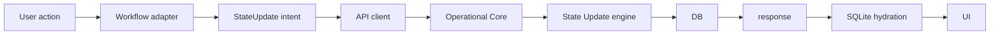
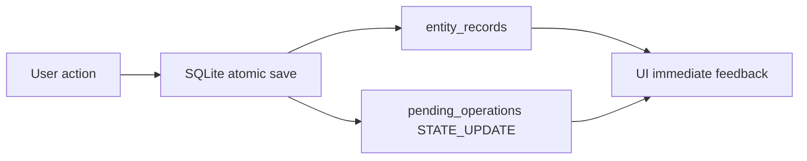
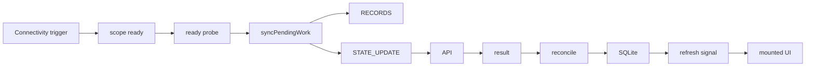
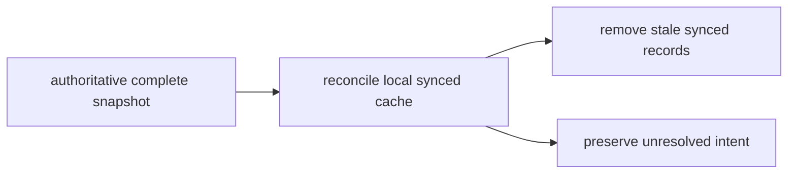

# State Update

This document is the canonical client-side reference for the current `STATE_UPDATE` architecture in Opco Client. It describes the code as it exists now, including implementation gaps against the newer Operational Core contract.

Read this before changing the state-update runtime, offline persistence, outbox, reconnect orchestration, reconciliation, conflicts, workflow adapters, or diagnostics.

## Model

Opco / Operational Core is the online source of truth. SQLite is a local cache plus durable storage for unresolved local intent. `pending_operations` is the shared outbox. `STATE_UPDATE` is the generic workflow primitive for operational state changes.

Attendance is an adapter/preset over `STATE_UPDATE`. It has workflow-specific UX, labels, status mapping, and legacy GET adaptation, but it does not own a separate sync engine, outbox, retry loop, conflict engine, or persistence engine.

Attendance day summaries and recent records are scoped by owner, contract, target entity, AppView,
and the selected attendance `date`. Local filtering uses the persisted logical attendance date in
`values_json`, never `cached_at`, creation time, or modification time. The remote Attendance endpoint
receives the same selected date. Recent results are limited (remote latest: 10; local page: 20) and
ordered newest-known first. A request that finishes after the user selects another date may finish
hydrating its own cache scope, but cannot update the visible day.

## Flow Diagrams

Online:



Offline:



Reconnect:



Timeout:


Remote deletion:



## Sources Of Truth

| Situation | Source of truth | Local behavior |
| --- | --- | --- |
| Online | Backend | Render backend response and hydrate SQLite. |
| Offline | SQLite snapshot | Render cached data and unresolved local intent. |
| Local pending | Local intent | Preserve the intent until sync, conflict, failure, or explicit user resolution. |
| Conflict | Backend remote snapshot plus local requested intent | Keep both snapshots and require explicit choice. |
| Timeout unknown | Unknown | Do not assume failure or success; verify remotely when possible. |
| Remote confirmed | Backend state | Complete the pending operation and mark local snapshot `synced`. |

Backend online state must not later be replaced by a stale or partial SQLite snapshot.

## StateUpdateIntent

A logical `StateUpdateIntent` includes:

- `appViewId`
- `subjectRecordId`
- optional `date`
- `stateValues`
- `extraValues`
- `clientRequestId`
- `overwrite`
- `expectedUpdatedAt`, when conflict resolution needs it
- `uniqueness` and `historyMode`, derived from the prepared AppView definition

The client uses `stateValues` internally. The wire payload to Operational Core uses `states` conceptually, while the current client API wrapper accepts `stateValues` and translates it at the API boundary. Do not mix internal and wire names outside that boundary.

For generic `GET workflow/state-update`, Operational Core's documented response uses `subjects` as the search result collection and `states` as the current/latest state map. The Client keeps its internal renderer model as `items` plus `stateValues`; `src/lib/opco-api.ts` is the boundary adapter that maps `subjects -> items`, `subjectEntityType -> sourceEntityType`, and `states -> stateValues`. SELECT state fields carry `optionId`; scalar state fields (`TEXT`, `INTEGER`, `DECIMAL`, `MONEY`, `DATE`, and `BOOLEAN`) carry `value`. Attendance keeps its separate endpoint and `items` response shape.

## Client Request ID

The official backend contract is that `clientRequestId` identifies one immutable intention:

- retrying the same intention uses the same ID;
- changing state uses a new ID;
- changing extra values uses a new ID;
- confirming overwrite uses a new ID;
- a new attempt after a stale conflict uses a new ID.

Current implementation:

- Online saves create a fresh `clientRequestId` for each explicit save action.
- Offline saves persist the ID in `pending_operations` and preserve it across retries.
- Repeated offline `update-current` saves for the same subject/date consolidate into the existing pending operation.
- If the consolidated payload is the same semantic intention, the existing `clientRequestId` is preserved.
- If the consolidated payload changes states, extras, overwrite, or expected version, the pending operation keeps one local row but rotates to a new `clientRequestId`.
- Confirming an online conflict calls a fresh save action and therefore creates a new `clientRequestId`.

## SQLite Persistence

Relevant tables:

- `entity_records`: renderable local snapshots, remote IDs, remote version, conflict snapshots, and `sync_status`.
- `pending_operations`: durable outbox for `CREATE`, `UPDATE`, and `STATE_UPDATE`.
- `app_metadata`: schema version, selected contract, remembered Attendance context selections, Attendance day hydration metadata, and persisted state-update diagnostics.
- `app_view_definitions`: prepared workflow/runtime metadata by `owner_key + contract_id + app_view_id`.
- `sync_telemetry`: sync phase and timestamps. `STATE_UPDATE` uses `workflow:<appViewId>` as the telemetry entity key.

Offline `STATE_UPDATE` save is atomic: the local `entity_records` snapshot and the `pending_operations` row are written in the same SQLite transaction.

Conflict persistence is also atomic: `markStateUpdateOperationConflict()` writes the pending operation error metadata and the associated local `entity_records` conflict snapshot in one SQLite transaction. The successful final shape is unchanged: pending operation has `last_error_code = CONFLICT`, and the local record has `sync_status = conflict` plus remote conflict metadata.

STATE_UPDATE uses the common per-connection SQLite coordinator described in
`CLIENT_ARCHITECTURE.md#sqlite`; it does not own a separate queue. Offline saves, remote snapshot
hydration, outbox completion/conflict, concurrent RECORDS work, prewarm metadata, and direct
telemetry/cache statements therefore cannot enter one another's transaction. Each transaction keeps
its original atomic boundary and propagates failures after SQLite rollback. The coordinator does not
retry or suppress operations, and a rejected operation does not prevent the next queued operation.

`local_id` is scoped. For `update-current` with `subject` or `subject-date` uniqueness, it is derived from `appViewId`, optional date, and `subjectRecordId`. For append/no-uniqueness records it is generated from the AppView plus time/randomness.

## Sync Statuses

| Status | Meaning for STATE_UPDATE | Auto-sync |
| --- | --- | --- |
| `pending_create` | Technical shared-infra name for pending intent. | Eligible. |
| `pending_update` | Technical shared-infra name for pending intent. | Eligible. |
| `syncing` | Operation was selected and may have been interrupted. | Eligible according to current retry/reconnect policy. |
| `synced` | Local snapshot matches last known remote state. | Not an outbox item. |
| `failed` | Non-auto-retryable failure or manual retry required. | Not automatic. |
| `conflict` | Backend returned a conflict snapshot. | Not automatic. |

`pending_create` and `pending_update` are inherited database names from the shared records infrastructure. Conceptually, both are pending state-update intent.

## Orchestration

All automatic state-update sync execution goes through `syncPendingStateUpdatesWithTelemetry()` in `SessionProvider`, which wraps the internal engine `syncPendingStateUpdatesOnce()`. Combined pending-work runs use `syncPendingWork()` to keep the global engine order as RECORDS first, then STATE_UPDATE; lifecycle decisions still belong to `SessionProvider`.

Current triggers:

- reconnect
- unknown-to-online
- startup-with-pending
- foreground/resume
- manual retry

The sync engine is single-flight. Failed and conflict rows are excluded from automatic retry by current policy; manual retry is explicit.

Each combined pending-work execution creates a local `syncRunId`. It is not sent to Operational Core. It exists to correlate lifecycle trigger, state-update sync telemetry, request diagnostics, and visible UI diagnostics.

Automatic reconnect-like triggers are gated by Operational Core readiness before POST sync begins. NetInfo `online` only says the client appears connected; it does not prove Railway/Operational Core is ready to accept authenticated business writes. For `reconnect`, `unknown-to-online`, `startup-with-pending`, and `foreground/resume`, the lifecycle hook first checks durable pending work and then probes `GET /api/v1/ready` with a short independent timeout of `2_500 ms`, at most three attempts, and bounded backoff of `500 ms` then `1_000 ms`. Each `READY_CHECK` attempt is recorded with an `attemptNumber` and the same local `syncRunId`. If readiness never confirms, the client does not send STATE_UPDATE/RECORDS POST requests, leaves pending intent durable and retryable, and records activity as `ready_failed` rather than a business sync failure. A readiness run that has been marked as `reconnecting` must later resolve to `ready_confirmed`, `sync_started`, `ready_failed`, `cancelled_scope_changed`, `interrupted`, or the terminal sync result; persisted orphan `reconnecting` activity without a matching `READY_CHECK` request is treated as `interrupted` on hydration and can be retried by the normal catch-up path.

After an exhausted readiness cycle, if connectivity is still `online`, the app is active, the same owner/contract/token scope is still current, durable pending work remains, and no run is active, the lifecycle schedules a bounded recovery catch-up. Recovery uses delays of `5_000 ms`, `15_000 ms`, `30_000 ms`, then `60_000 ms` as a maximum interval while those conditions remain true. It is cancelled when connectivity leaves `online`, when pending work disappears, when the app backgrounds, or when the session/contract scope changes. Each recovery catch-up creates a new local `syncRunId`; it does not consume business retry count, does not change `clientRequestId`, and does not send a business POST before readiness succeeds.

`GET /api/v1/ready` is public from the client perspective and must not touch session state. It does not send bearer auth, must not initiate refresh, and must not clear tokens. After readiness succeeds, the lifecycle treats auth readiness as a separate pre-business-write gate: if the local access token is expired or within the five minute refresh margin, it runs one `AUTH_REFRESH` with the same local `syncRunId` and a `30_000 ms` timeout before sending pending STATE_UPDATE/RECORDS POSTs. Opaque/unparseable tokens are not proactively refreshed; they fall through to the normal authenticated-request `401 TOKEN_EXPIRED` path. A refresh network error, timeout, `503`, or `DB_UNAVAILABLE` is not evidence of an invalid session and must leave credentials/pending intent recoverable. Automatic logout is allowed only after a backend-confirmed invalid refresh/session condition such as expired, revoked, reused, missing refresh token, inactive refresh user/app, or `TOKEN_INVALID`.

If NetInfo becomes `online` before `ownerKey`, token, and selected contract scope are ready, the scope-ready catch-up path re-checks durable pending work as soon as the missing scope becomes available. This closes the case where the online transition was consumed while `shouldSync()` was false. The catch-up is not polling; repeated renders are deduped for the active scope, and a user/session/contract change is evaluated as a new scope.

Mounted STATE_UPDATE adapters derive their visible runtime model from the canonical session connectivity, durable unresolved intent for the active scope, readiness activity, real pending-work engine activity, timeout reconciliation state, and terminal result. `PENDING` means durable unresolved work exists but no sync engine or readiness probe is currently active. `RECONNECTING` means the readiness gate is actively probing Operational Core in the mounted runtime, not merely that old telemetry says the last activity was `ready_check`. `SYNCING` is reserved for an active `syncPendingWork()`/engine run. `CONFIRMING` is reserved for an in-flight direct write or timeout reconciliation. A renderer must not show `Sin conexion` from a separate NetInfo listener, and must not show `Sincronizando con Opco...` merely because it is online with pending work.

## Connectivity

Current connectivity classification:

- `isConnected === false` or `isInternetReachable === false` means `offline`.
- `isConnected === true` means `online`, even if reachability is `null`.
- both values unknown/null means `unknown`.

The client bootstraps with `NetInfo.fetch()` and then listens to NetInfo changes.

Connectivity is an orchestration signal, not a source of truth about the result of a write. A timeout or network transition does not prove that Operational Core failed to persist a command.

## Timeout

The API client timeout is `12_000 ms`.

Timeout does not mean write failed. For state-update sync, a timed-out POST may still have been committed by Operational Core. Current sync then attempts remote verification through `getStateUpdateWorkflow({ date, subjectRecordId })`. If the remote item exactly matches the pending payload, the operation is completed locally and telemetry reports `reconciled_success`. If remote confirmation is unavailable or does not match, the pending operation remains unresolved under the retry/failure policy.

The UI should not keep a stale error once later remote verification confirms success.

A timeout from a GET refresh after a confirmed write is a view-refresh problem, not proof that the write failed. Workflow UI keeps operation feedback separate from refresh feedback so a confirmed local/remote write does not render the generic timeout as a write failure.

## Exact Reconciliation

Backend State Update 1.0 treats an intention as matching only when every submitted field matches after canonical normalization:

- `stateValues`
- `extraValues`
- omitted fields do not participate
- explicit `null` participates
- `RELATION` compares target record ID
- `SELECT` compares option ID
- `DATE` compares `YYYY-MM-DD`
- `TIME` compares `HH:mm`
- other values compare their canonical API representation

Current client implementation centralizes exact matching in the state-update offline helper. Timeout recovery, snapshot repair, and local reconciliation use the same semantic comparison:

- requested state fields compare by `fieldId` plus `optionId` for SELECT fields or `value` for scalar fields;
- requested extras compare by field key and canonical value;
- omitted extras are ignored;
- explicit `null`, `false`, `0`, and `""` are preserved as requested values;
- relation-like objects compare by target record `id`;
- labels, display names, and other visual text do not determine equality.

## UpdatedAt

Operational Core State Update 1.0 returns the real remote `updatedAt`. Client `remote_updated_at` should come from the server and must not use client time as a substitute for a remote version.

Current implementation:

- Successful remote sync requires server-provided IDs and `updatedAt`.
- Snapshot hydration stores `item.current.updatedAt`.
- Attendance latest adaptation requires `latest.updatedAt`.
- If a successful state-update response lacks a valid ISO `updatedAt`, the API wrapper raises a controlled contract error instead of inventing a version.
- `cached_at` remains local cache metadata and is distinct from `remote_updated_at`.

## Snapshot Reconciliation

`upsertStateUpdateSnapshot()` now supports complete snapshot reconciliation.

For a complete remote snapshot, the client:

1. upserts remote records that are present;
2. finds local records in the same `owner + contract + appView + date + targetEntityType` scope;
3. removes only local `synced` records absent from the remote snapshot;
4. preserves unresolved local intent.

Never delete these statuses due only to remote absence:

- `pending_create`
- `pending_update`
- `syncing`
- `failed`
- `conflict`

This handles confirmed remote deletions without creating pending operations, recreating remote records, or marking local rows failed.

## Complete Vs Partial Snapshot

Attendance GET has a backend `latest` limit of 10. The client centralizes that limit as `ATTENDANCE_LATEST_LIMIT`.

An Attendance day can be treated as complete only when:

```text
summary.totalRegistered <= ATTENDANCE_LATEST_LIMIT
AND
latest.length === summary.totalRegistered
```

Search and `personRecordId` responses are passed to SQLite with `complete=false`.

If `summary.totalRegistered > 10`, `latest` is not a complete snapshot and must not be used for destructive cleanup by absence. This heuristic depends on the current backend `latest take=10` contract.

## Remote Deletions

Confirmed remote deletion through a complete snapshot means local `synced` cache for that record should be removed. It should not create a pending operation, recreate the remote record, or mark the local snapshot `failed`.

Unresolved local intent is preserved. This guarantees that an online authoritative snapshot is reflected in later offline reads.

## Conflicts

A conflict contains:

- existing remote state;
- requested local intent;
- differences;
- `expectedUpdatedAt`;
- optional overwrite confirmation.

Backend conflict differences can distinguish state fields from extra fields through the structured difference payload. The client treats normal option/scalar differences as state diffs and preserves extra diffs when Core includes raw local/remote extra values or marks the source as extra.

Overwrite is a new semantic intention and requires a new `clientRequestId`. The original conflict probe should keep its original key if retried; the overwrite confirmation should not reuse it.

Current client representation preserves both state and extra differences when Operational Core returns them:

- state diffs remain represented as `existing.stateValues` and `requested.stateValues`, including scalar `value` where applicable;
- extra diffs can be represented as `existing.extraValues`, `requested.extraValues`, and an `extraValues[]` metadata array;
- each extra diff can carry `fieldId`, `fieldLabel`, `fieldType`, `localValue`, and `remoteValue`;
- when the prepared definition is available, SELECT and MULTISELECT extra values are rendered with option labels while retaining their technical values internally;
- unknown extra fields are still shown with a technical fallback label instead of being hidden or crashing.

Conflict resolution semantics have not changed. The user still chooses the whole local intention or the remote Opco state; there is no field-by-field merge action yet.

The generic renderer must project durable conflicts on top of a successful online read. It queries by
`ownerKey + contractId + appViewId + targetEntityTypeId + logical date`, overlays the requested local state
on matching visible subjects/latest rows, and retains the remote conflict snapshot for comparison. A GET,
snapshot refresh, search, or reconnect does not discard a differing local intention or make a conflict
eligible for automatic retry. The existing exact-match snapshot reconciliation can complete an intention
already confirmed remotely. Request-sequence invalidation prevents an older online/offline read from republishing a conflict after
an explicit resolution completes.

Both durable actions use the selected `localRecordId` and a conflict identity containing its local/remote
snapshot and outbox `clientRequestId`. Inside the shared SQLite transaction, they revalidate owner,
contract, AppView, target entity, subject and exact logical date plus that identity. A replaced selection
fails explicitly; it never falls back to the latest row for the same subject.

`Usar Opco` restores the retained remote values/version/id and deletes only the selected outbox operation
in one transaction. `Usar mi cambio` rewrites the selected row/outbox atomically as a new overwrite request,
including append workflows, and then invokes shared sync **after** the commit. No SQLite transaction waits
on network. Failed restoration or outbox rewrite rolls back all changes. The Attendance adapter carries
this same selection identity for its shared remote-resolution action.

STATE_UPDATE completion, conflict, retry and failure reread the durable operation identity in their write
transaction. A late response for a superseded request does not overwrite values or consume its successor.
New JSON metadata uses existing columns: snapshot `clientRequestId`, conflict `remoteRecordId` and overwrite
outbox `expectedRecordId`. Wire serialization is unchanged. Completion rejects a different subject or,
when the retained remote id is available, a different remote record. Historical conflicts without that id
cannot reconstruct it retroactively; the existing server id is used when available. No migration is needed.

After shared sync/refresh, `getStateUpdateResolutionOutcome` reads the selected row and outbox together.
Remote confirmation requires the matching request marker, a synced row with remote id/version and no
outbox for that row. Pending, new conflict, failed and superseded outcomes remain distinct; global sync
completion is not a receipt for the selected intent. Scoped resolution feedback is shown even when another
conflict remains, and mounted/scope guards suppress obsolete callbacks. `Usar Opco` reports local resolution,
not a new remote write. A refresh of the same remote id/version/states/extras preserves the confirmation
marker; an append row already linked to that exact remote is reused within its complete workflow scope.
This does not change the cross-AppView SQLite uniqueness constraint.

Attendance's durable `Usar mi cambio` action now reuses the same selected-conflict resolver, outcome
reader and feedback mapping. It carries localRecordId/conflictIdentity and the full workflow/date scope;
only the selected request's durable receipt permits server-confirmed feedback. Pending transport, new
conflict, failed and superseded outcomes remain explicit even when another operation succeeds.
Mounted/scope guards suppress obsolete feedback; the existing engine guards preserve a later edit.
This does not change Attendance's other save/online-conflict paths or the shared sync engine.
2026-10-03 evidence: ten actual-handler regressions fail against the previous source and pass now;
83 focused tests pass. Chrome/CDP 9361 with real OPFS and local Core/PostgreSQL verified confirmation,
blocked transport, a newer remote conflict and another successful operation while the selected one
failed. Edition/late-response races remain controlled regressions. See STATUS.md for exact provenance,
local database validation, cleanup and limits.


Evidence for 2026-10-03: four initial persistence regressions failed before correction; seven actual
renderer-handler tests also failed against the preserved initial source (including false server-confirmed
feedback for pending/conflict/failed/superseded outcomes); the final focused run passed
269 tests in ten affected files. The new Python-backed in-memory SQLite harness checks actual SQL/rollback
through production persistence; it requires `python3` and is separate from Expo testing. Chrome/CDP 9351
with a disposable profile, localhost-only synthetic API and real Expo OPFS/WASM checks both UI actions,
exact append selection, rollback after outbox deletion, displayed latest/remote id, confirmation, new
conflict and transport failure. Edition/late-response interleavings are controlled engine regressions;
not every race was injected in Chrome. No Core, API, schema, dependency or configuration changed. No full
suite, export, Playwright, commit, push or deploy. See `STATUS.md` for fixture details and remaining limits.

## Idempotency Errors

Backend idempotency errors:

- `IDEMPOTENCY_KEY_REUSED`: the same key was used with a different semantic payload. The client must not auto-retry with that same key.
- `IDEMPOTENCY_RESULT_UNAVAILABLE`: the backend has a historical or incomplete idempotency row without a durable response. The client must not silently generate a new key, especially for append-style commands where that could duplicate records.

Current implementation handles these codes explicitly:

- `IDEMPOTENCY_KEY_REUSED` fails the local operation for manual recovery and does not auto-retry with a new key.
- `IDEMPOTENCY_RESULT_UNAVAILABLE` attempts exact remote reconciliation only for `update-current` scopes where a single current record can be verified by `subject + date`. If the remote state and extras match, the operation completes as `reconciled_success`.
- Append/no-uniqueness operations do not auto-reconcile or rotate keys on `IDEMPOTENCY_RESULT_UNAVAILABLE`, because a GET snapshot cannot prove which append event was committed.

## Attendance Adapter

Attendance maps to `STATE_UPDATE` like this:

| Attendance | State Update |
| --- | --- |
| person | subject |
| status | state |
| context fields | extras |
| observation, only when `observationFieldId` exists | extra |
| date | date |
| uniqueness | `subject-date` |
| history mode | `update-current` |

Attendance uses configured `statusFieldId`, `personFieldId`, `dateFieldId`, optional `contextFieldIds`, and optional `observationFieldId`. UI/config option identity is `optionId`. SELECT context selections are remembered locally by `optionId`, but the persistible value in `extraValues` is resolved to `FieldOption.value` because that is the entity field value expected by Operational Core. Labels are display text only. If the value cannot be resolved, the client fails validation locally instead of sending an arbitrary `optionId`.

`observationFieldId` is optional. If it is absent, Attendance has no observation input, does not generate an observation extra value, and does not infer observation from arbitrary text/context `extraValues`.

Attendance may keep UX-specific text, status buttons, and the legacy GET adapter. It must not own separate sync/storage/conflict semantics.

Offline Attendance snapshots:

- remote snapshots are cached per date using the generic state-update shape in `entity_records`;
- daily hydration metadata lives in `app_metadata` with `lastSuccessfulRefreshAt`;
- local pending/failed/conflict rows overlay the remote snapshot and are never deleted by absence;
- online opening of any date hydrates that date for later offline use;
- prewarm automatically hydrates every date in the current month only, with maximum Attendance date-request concurrency of 3;
- dates outside the current month are not downloaded automatically and are hydrated only when opened online.

Monthly Home readiness uses `attendanceMonthStatus`: `complete` when all dates in the current month have complete snapshots, `partial` when at least one date is hydrated but one or more are missing, and `none` when no current-month date is hydrated. The active workflow date still uses its own daily hydration telemetry.

The compatible workflow family is named by `isStateUpdateCompatibleWorkflow()`. Current compatible keys are:

- `state-update`
- `attendance`

Known compatibility branches that still mention Attendance outside the adapter boundary:

- workflow registry resolution for `workflowKey === "attendance"`;
- app-view definition preparation/cache readiness for Attendance;
- Attendance prewarm of source Personas;
- diagnostics summarizing Attendance GET responses;
- local diagnostics that classify Attendance-derived pending rows.

These branches are current compatibility glue, not a separate Attendance engine.

## UI Refresh

`stateUpdateReconnectRefreshKey` signals mounted workflows after meaningful state-update sync. The intended flow is:

```text
sync -> local reconcile -> refresh signal -> mounted StateUpdateWorkflow/Attendance -> reload state
```

The refresh should not require remounting and should not trigger another sync loop. `shouldEmitStateUpdateRefresh()` emits only after selected or completed/conflict/failed/retriable state-update work; `shouldHandleStateUpdateRefresh()` handles each emitted key once and skips initial mount.

## Diagnostics

Diagnostics distinguish:

- current connectivity;
- last reconnect;
- last `STATE_UPDATE` activity, including snapshot reconciliation;
- last meaningful `STATE_UPDATE` sync;
- last visible UI error event;
- bounded request history for recent `STATE_UPDATE`, Attendance, readiness, and health diagnostics;
- current outbox;
- workflow local records;
- consistency;
- recovery state.

Telemetry is persisted in `app_metadata` under `state_update_sync_diagnostics:<fingerprinted ownerKey>`, avoids PII, and diagnostic observation must not change runtime behavior. The last meaningful state-update sync preserves sanitized POST request diagnostics when they exist: `syncRunId`, `requestStartedAt`, `fetchResolvedAt`, `responseBodyStartedAt`, `responseParsedAt`, `requestDurationMs`, `timeoutMs`, `abortControllerTriggered`, `httpStatus`, template path, diagnostic operation, sanitized diagnostic request id, echoed response request id, and parsed `Server-Timing` metrics. Timeout evidence is preserved even when exact remote reconciliation later completes the local operation as `reconciled_success`. Explicit operator commands from diagnostics, such as manual retry or sync now, may invoke the existing sync/recovery commands after a user action. Diagnostic event construction for manual state-update sync is shared between `SessionProvider` and `app/(app)/diagnostics/state-update.tsx`.

The dedicated `/diagnostics/state-update` route is an operational console. It renders compact health cards, last activity timeline, last request interpretation, non-zero current counters, request history, local operations, and explicit Attendance GET plus health/ready read actions. Mounting the route reads local diagnostics only. Attendance GET, health/ready latency checks, retry, and sync now require explicit button presses.

`requestHistory` keeps the recent bounded sanitized request events, currently capped at 20. It records operation class (`SAVE`, `DAY_LOAD`, `REFRESH_AFTER_SYNC`, `SEARCH`, `PERSON_LOAD`, `RECONCILE`, `READY_CHECK`, `AUTH_REFRESH`, `HEALTH`, or `OTHER`), HTTP method, path template, client timing milestones, timeout flag, HTTP status, backend error code when available, local `syncRunId` when available, sanitized request correlation id, echoed backend request id, parsed `Server-Timing`, and a derived interpretation such as `client_timeout_before_response`, `network_failure`, `http_error`, `server_slow`, or `success`. `AUTH_REFRESH` entries exist to distinguish auth readiness from business writes; a timeout there means the sync run was blocked before POST and should not be displayed as a failed record save. It must not persist payloads, raw IDs, query values, tokens, cookies, names, stack traces, or form values.

Structured backend validation errors can include field-level details such as `fieldId`, `fieldLabel`, `fieldType`, `rejectedValue`, `expectedType`, and `expectedValues`. The client persists those details on the pending operation as `lastErrorDetails`, shows a global summary (`Un cambio no pudo sincronizarse.`), and exposes `Ver detalle` for human-readable and technical detail. The primary message should use field labels and rejected values, not arbitrary `optionId`s, `undefined`, or `null`. When the failed operation is resolved or sync succeeds, the global pending-error notice disappears; telemetry/history may still retain sanitized evidence.

`Last STATE_UPDATE activity` is separate from `Last STATE_UPDATE sync`. A real sync engine run writes both, with activity `type=sync`. Readiness probes may write activity `type=ready_check` with `result=reconnecting`, `ready_confirmed`, `sync_started`, `ready_failed`, `cancelled_scope_changed`, or `interrupted`, but they do not invent `Last STATE_UPDATE sync`. The diagnostics UI labels the historical sync card as the last completed sync and shows readiness activity separately. Snapshot reconciliation through `upsertStateUpdateSnapshot()` may complete pending local intent without a POST sync run; that writes activity `type=snapshot_reconciliation` and does not invent a new `Last STATE_UPDATE sync`.

`Last visible UI error` is historical. The current visible error may disappear after success, refresh, navigation, or remount, but diagnostics keep the last sanitized event with `occurredAt`, optional `clearedAt`, `operation`, HTTP method, path template, duration, timeout flag, HTTP status, error code, optional `syncRunId`, and resolution such as `unresolved`, `cleared_after_success`, or `refresh_failed`. It must not persist user-facing messages, payloads, tokens, raw IDs, names, or form values.

`Last session termination` is also historical. Manual sign-out stores `reason=user_sign_out` and automatic invalidation stores either `reason=refresh_invalid` from `AUTH_REFRESH` or `reason=token_invalid` from an authenticated request. The event includes timestamp, source, backend error code, and sanitized request id only. It exists to distinguish confirmed invalid-session logout from recoverable reconnect/refresh failures.

Reconnect detection is persisted when connectivity transitions from `offline` or `unknown` to `online`, even if there is no pending work to sync. A transition can therefore update `Last reconnect` without producing a new `Last STATE_UPDATE sync` run.

## Recovery Invariants

- Remote exact confirmed means local state can become `synced`.
- A real pending operation is not overwritten by a remote snapshot that does not match it.
- No pending operation plus no remote record is an orphan/recovery condition.
- Timeout plus exact remote confirmation becomes `reconciled_success`.
- `outbox=0` plus local pending records is a detectable consistency mismatch.
- `failed` and `conflict` are not automatic retries.
- Interrupted `syncing` state-update rows are eligible under current retry/reconnect policy.

## Invariant Checklist

| # | Invariant | Status |
| --- | --- | --- |
| 1 | Opco is source of truth online. | IMPLEMENTED |
| 2 | SQLite is cache plus unresolved local intent. | IMPLEMENTED |
| 3 | Offline save is atomic. | IMPLEMENTED |
| 4 | `clientRequestId` represents an immutable intention. | IMPLEMENTED |
| 5 | Retries do not change `clientRequestId`. | IMPLEMENTED |
| 6 | A modified intention rotates `clientRequestId`. | IMPLEMENTED |
| 7 | No pending intent is deleted without explicit resolution. | IMPLEMENTED |
| 8 | A partial snapshot never deletes by absence. | IMPLEMENTED |
| 9 | A complete snapshot may delete only stale `synced` rows. | IMPLEMENTED |
| 10 | Snapshot reconciliation never overwrites unresolved intent. | IMPLEMENTED |
| 11 | Reconcile compares states plus extras. | IMPLEMENTED |
| 12 | `remote_updated_at` comes from the backend. | IMPLEMENTED |
| 13 | Combined pending-work sync uses one engine-order facade; state-update sync uses one telemetry wrapper. | IMPLEMENTED |
| 14 | Diagnostic observation is passive; explicit operator commands may invoke existing recovery/sync commands. | IMPLEMENTED |
| 15 | Attendance is an adapter, not an engine. | IMPLEMENTED |
| 16 | Conflict operation metadata and local conflict record are persisted atomically. | IMPLEMENTED |
| 17 | Observation is represented only when `observationFieldId` exists. | IMPLEMENTED |
| 18 | Conflict UI can present state and extra diffs when Core returns them. | IMPLEMENTED |
| 19 | Successful reads preserve scoped durable conflicts and their explicit resolution actions. | IMPLEMENTED |

## State Update 1.0 Readiness

Implemented client-side readiness for State Update 1.0:

- immutable `clientRequestId` semantics for retries vs modified intentions;
- exact reconciliation across requested SELECT/scalar states and extras;
- server-owned `updatedAt` as the only remote version;
- complete snapshot reconciliation for remote deletions;
- explicit handling for backend idempotency errors;
- centralized compatible workflow detection for `state-update` and `attendance`;
- generic conflict diff presentation for state fields and extra fields;
- structured error detail persistence and global detail UI.

Remaining limitation:

- conflict resolution remains a whole-intent decision; there is no field-by-field merge action.

## Architecture Entities For System Diagram

Stable nodes and boundaries for a later system diagram:

- `SessionProvider`: owns auth/session state, selected contract, reconnect orchestration, sync telemetry helpers, and refresh signals.
- `Connectivity`: NetInfo-derived online/offline/unknown signal.
- `AppView Definition Cache`: prepared runtime metadata by owner/contract/AppView.
- `Workflow Registry`: routes `WORKFLOW` AppViews by `workflowKey`.
- `StateUpdateWorkflow`: generic state-update UI/runtime.
- `Attendance Adapter`: Attendance-specific UX and mapping onto `STATE_UPDATE`.
- `SQLite`: local cache and outbox store.
- `entity_records`: renderable snapshots plus local state-update intent rows.
- `pending_operations`: durable outbox for unresolved writes.
- `sync orchestrator`: `syncPendingStateUpdatesWithTelemetry()` and `syncPendingStateUpdatesOnce()`.
- `API client`: authenticated `/api/v1` boundary, timeout, envelope parsing.
- `Operational Core`: authoritative backend and state-update engine.
- `telemetry`: persisted sync diagnostics and recovery summaries.
- `diagnostics`: UI/route views for non-sensitive operational inspection.
- `refresh signals`: mounted workflow refresh after sync.
- `Service Worker/PWA`: offline app shell only, not API data cache.
- `RECORDS engine`: separate generic records renderer/sync system that shares SQLite infrastructure.


## Corrección de current visible por fecha — 2026-10-04

Core GET STATE_UPDATE con unicidad subject y dateFieldId selecciona ahora subjects.current por el
DATE configurado descendente, id ascendente como latest; excluye fechas ausentes y retorna null si
no hay candidato fechado. La selección se pide explícitamente con selection=workflow-current en
findExistingStateUpdates. Sólo afecta GET visible; lookup por defecto de POST/unicidad/conflictos,
proyección REPORT, Attendance/sujeto-fecha y no-date conservan comportamiento. updatedAt continúa
siendo la versión de concurrencia; nunca sustituye fecha para el current visible de ese alcance.
No se importa el contrato REPORT LATEST_BY_RELATION ni se modifica la persistencia Client.

Tres regresiones fallaron antes; 71 pruebas focalizadas Core pasan tras corrección, incluido target de
conflicto conservado. Fixture real local devuelve R1 de Fecha 04-10 frente a R99 de Fecha 03-10 con
updatedAt posterior. Chrome exclusivo/OPFS real confirma R1 en primera apertura offline con búsqueda
tras preparar desde Inicio y en reapertura después de cerrar todos los procesos del perfil, sin servicios
locales y bajo CDP offline antes de navegar. Evidencia limitada al sujeto y fecha activa preparados;
no cobertura histórica completa, writes/conflicts, native ni incidente productivo Error finalizing statement.
Detalle, intentos descartados del arnés y limpieza en STATUS/OFFLINE_FIRST_AUDIT. V11 sigue pausado.

## Cierre v10: uniqueness normalizado, identidad remota y current offline — 2026-10-07

La discrepancia de integración anterior quedó resuelta en Client. Core conserva su contrato
workflow.uniqueness={mode:"none"|"subject"|"subject-date"}. El límite API acepta también las
cadenas históricas acreditadas, tanto en metadatos superiores como en workflow; entrega siempre
un StateUpdateUniqueness interno en forma de cadena. Un valor desconocido, objeto sin mode o
modo anidado inválido produce INVALID_STATE_UPDATE_UNIQUENESS; no existe default a subject.

La misma validación se aplica al escribir y leer app_view_definitions (get y list). Una definición
state-update antigua con objeto se normaliza al leer sin reescribir SQLite ni exigir limpieza.
Una definición con modo inválido se entrega como kind=error/status=error con el mismo código,
preservando el tratamiento de configuración inválida. Otros tipos de definición no se modifican.
No se reinterpretan identidades, payloads ni claves de intenciones/outbox ya existentes.

Esto activa la corrección anterior para subject/append/dateFieldId: IDs remotos distintos se
conservan por separado con scope owner/contrato/entidad/AppView; referencias current/latest al
mismo ID reutilizan una fila, priorizando los estados y extras completos de current. Filas synced
legacy del mismo evento conservan su local_id. Filas pendientes/conflict/failed no se sobrescriben
ni se fusionan. No hay cambio de esquema, índice UNIQUE, versión SQLite ni INSERT OR REPLACE nuevo.

Current offline selecciona por fecha configurada DESC y server_id ASC, excluyendo fecha ausente,
sin limitar historia synced a fecha consultada. El overlay no synced mantiene su scope de consulta
existente. No se usa revisión ni timestamps como criterio del evento. Tampoco se guarda la fecha
consultada como fecha del evento cuando la fecha autoritativa falta en el modo acotado.
Attendance, subject-date y workflows sin fecha conservan sus caminos existentes.

Las llamadas de preparación y carga pasan el total esperado de eventos si la respuesta declara
primera página completa. Si el contenido único persistido no coincide, no se reconcilian filas
synced ausentes y no se acredita complete. Los marcadores antiguos sin prueba de contenido se
leen partial para el modo acotado. Una referencia repetida current/latest cuenta una sola vez;
una transacción fallida no produce prueba nueva de cobertura. Páginas/search parciales siguen
sin acreditar completitud ni hacer limpieza destructiva.

Regresiones nuevas entran por createOpcoApi con el payload real {mode:"subject"}, recorren
prewarm y la caché SQLite reales, hidratan ambos IDs y comprueban el ganador R1. Incluyen lectura
de definiciones cacheadas antiguas, ambas formas para los tres modos, rechazo de configuración
inválida, campo/extra completo de current frente a latest parcial y snapshot que declara total=2
pero trae sólo un evento. Se preservan las regresiones previas de pendientes/conflictos/rollback
y reapertura en disco. Véase STATUS para checks y Chrome/OPFS.

Alcance comprobado: fixture local de dos eventos, historial completo y un procedimiento sintético.
Un snapshot parcial/ausente no acredita vigente global ni cobertura completa. El problema conocido
entre AppViews distintas queda separado. La causa exacta productiva de Error finalizing statement
no se considera demostrada por estos resultados; V11 permanece pausado.


## Cierre técnico del lote v10 — 2026-10-07

El lote publicable se delimita contra Client main 76babead92d82239fcc9ac78f3e1e1d6b3df939d:
7 archivos de implementación/prueba existente, 2 regresiones nuevas y 3 documentos con sólo
las secciones de cierre de identidad/current/uniqueness y este cierre técnico. No se publican
las notas intermedias de diagnóstico ni los demás pendientes documentales.

Checks completos con máximo dos workers: árbol de trabajo 77 archivos/927 pruebas PASS;
HEAD + lote seleccionado aislado 76 archivos/923 pruebas PASS. Los cuatro casos de diferencia
son dos caracterizaciones V10 experimentales y dos diagnósticos entre AppViews, excluidos del
lote. No se modificaron ni retiraron esos pendientes. Typecheck PASS, lint completo PASS
con 0 errores y 2 advertencias preexistentes de require() en
src/sync/records-sync.local-db-regression.test.ts:182/183, build:web/export/SW PASS, diff-check PASS.
Build realizado en copia temporal, con endpoint localhost, sin copiar .env ni sobrescribir
el dist habitual. No se cambiaron dependencias, migraciones, esquema ni Core.

Revisión: definición cacheada objeto/string se normaliza sin reset/rewrite al leer; un modo
inválido da error controlado. Una fila legacy synced del mismo evento conserva su alias.
Un evento perdido por una versión anterior exige hidratación online exitosa para recuperarlo:
no puede reconstruirse a partir de una cobertura antigua. Los marcadores antiguos sin prueba
son partial, y total de contenido insuficiente impide complete/reconciliación destructiva.
Las identidades y serialización efectiva de intenciones/outbox/idempotencia siguen intactas;
las filas no synced y conflictos no se sobrescriben. Lookups/lectura/reconciliación filtran
owner/contrato/entidad/AppView y current además sujeto. Attendance/subject-date/sin fecha
retienen sus caminos anteriores; tests completos de los consumidores pasan. El UNIQUE v10
entre AppViews distintas permanece como limitación independiente, sin corrección en este lote.

Evidencia Chrome/OPFS reutilizada: SHA256 de todos los archivos funcionales finales coincide
con el contenido validado en backups/state-update-uniqueness-close/2026-10-07. Online con
preparación concurrente, offline y reapertura sin servicios conservan R1 y dos eventos.
No hay riesgo funcional nuevo que justifique repetir navegador o fixtures. Alcance: fixture
sintético completo de dos eventos/una AppView; no datos productivos, native, múltiples tabs
ni garantía de vigente global con snapshot parcial. Error finalizing statement productivo
permanece sin correlación concluyente de sentencia/causa primaria. V11 pausado.

Parches e inventario verificables: backups/state-update-technical-close/2026-10-07,
state-update-implementation.patch y state-update-documentation.patch; ambos aplican sobre
el HEAD indicado y reproducen exactamente los archivos seleccionados. Sin secretos, .env,
configuración local, bases SQLite/PostgreSQL, logs, builds ni experimentos en el lote.
Main, índice y pendientes excluidos se conservan. Sin commit/push/deploy.


## 2026-10-07 — Consistencia Inicio/workflow y copia de cobertura STATE_UPDATE

Causa local demostrada: Inicio leía el mismo marcador diario sin dateFieldId,
historyMode ni uniqueness. Omitía la validación existente que degrada a partial los
marcadores antiguos sin contentVerified=true para subject/append/con fecha. Inicio y
workflow ahora construyen su scope con buildStateUpdateCoverageScope. El lector conserva
sus reglas; no se escribe ni promociona ningún marcador.

«Copiar State Update», en la pestaña STATE_UPDATE del diagnóstico compartido, conserva
el diagnóstico home_local_today para las AppViews con definición local. Además copia
visible_workflow para la AppView visible: fecha seleccionada y configuración efectivas
obtenidas del estado/response del workflow mediante el contexto de actividad existente.
El shell proporciona la AppView de la ruta visible. La copia toma ese contexto al pulsar;
la fecha del workflow nunca se infiere del reloj ni del marcador de Inicio. Al cambiar
fecha se actualiza el contexto en memoria; al abandonar/cambiar scope se descarta.

Cada sección incluye queriedDate (o all si no hay campo fecha), markerPresent (marcador
válido leído), status efectivo, contentVerified (null si falta), downloadedThroughPage,
pageSize, total y lastSuccessfulRefreshAt. Scope identificado por fingerprints existentes
de owner/contrato/AppView/entidades/campo fecha, más uniqueness/historyMode. No incorpora
valores de registros, nombres ni IDs crudos en las nuevas secciones. status se lee con
la validación existente: no equivale al status crudo almacenado de un marcador legacy.

homeDateSource=local_today y visibleDateSource=workflow_context; never_clock distinguen
los dos orígenes. visible_workflow exige coincidencia entre la ruta, la actividad y el
owner/contrato/AppView. Si faltan contexto o respuesta efectiva, o hay un scope anterior,
se informa availability=unavailable y visibleWarningExplanation=not_established;
expresamente el marcador de Inicio no explica el aviso visible. Si el scope es conocido
pero carece de marcador, se exporta su propia queriedDate con markerPresent=false y
status=absent, sin sustituirlo por otro día. Definiciones no cacheadas se distinguen de
marcadores ausentes. Attendance no publica este contexto ni entra en el colector de Inicio.

La prueba de latest no acredita todos los sujetos ni sus vigentes.
subjectsLastFullRefreshAt refleja únicamente la evidencia de hidratación previa de la
entidad fuente: subjectsAvailability=previous_full_refresh o unverified.
currentCompleteness=not_certified siempre, porque no existe un marcador que acredite
la totalidad de vigentes. No se infiere cobertura completa desde filas visibles.

Regresiones locales: wiring Inicio/workflow/helper, complete/partial y marcadores antiguos;
copia presente/ausente; distintas fechas de Inicio/selección con marcadores distintos;
texto del camino real del botón capturado en un destino clipboard de prueba; ausencia
de valores/PII y de escrituras al copiar; contexto ausente, fechas cambiadas, salida y
reportes tardíos; rechazo de owner/contrato/AppView/scope/type distintos; aislamiento de
Attendance y separación latest/sujetos/vigentes. SQLite real en memoria mediante harness
Python y singleton de producción. Las conexiones de componentes/botón se comprueban
estructuralmente; no se afirma una nueva prueba manual de navegador ni clipboard del SO.

La copia lee el marcador vigente al pulsar, no un marcador histórico congelado cuando
apareció el aviso. Preparación concurrente puede haberlo actualizado entre ambos instantes:
los metadatos exportados sirven para correlacionar, pero no prueban por sí solos la causa
del mensaje previo. Una definición o respuesta no disponible no se inventa ni se sustituye.

Validación final del lote aislado: 940 pruebas en 77 archivos con máximo dos workers
(17 regresiones propias); typecheck PASS; lint global PASS, 0 errores y las 2 advertencias
require preexistentes de records-sync.local-db-regression.test.ts:182/183; build web y
service worker PASS sin .env/.env.local; diff-check PASS. Árbol HEAD + 12 archivos/hunks
seleccionados, sin V11, diagnósticos independientes ni sus pruebas. Los bytes funcionales
coinciden con el workspace; las secciones documentales previas permanecen intactas.
Parche e inventario verificables conservados en
/home/dannysilver/dev2026/backups/state-update-coverage-close/2026-10-07/ fuera de /tmp.
No cambia preparación, paginación, descargas, persistencia, escrituras/outbox, conflictos,
sincronización, esquema, Core ni dependencias. El nuevo contexto sólo vive en memoria y
usa el ciclo de actividad existente. V11 pausado; sin producción, commit, push ni deploy.
La validación manual productiva tras 01b07b5 acredita lectura y persistencia tras reapertura
offline, no escrituras/sync ni cobertura completa. La causa del aviso productivo y la
causa primaria de Error finalizing statement siguen sin correlación concluyente.

## 2026-10-07 — Ajuste visual de Fecha en el estado vigente

La causa visual era formatStateValueLabel: ante label no nulo lo devolvía directamente,
incluido YYYY-MM-DD o el ISO histórico. El formateador DATE existente sólo se aplicaba
al value sin label. Ahora también se aplica a label cuando la metadata del campo es
DATE y la cadena es YYYY-MM-DD o un timestamp ISO completo; no trunca texto libre que
sólo comienza por una fecha. 2026-08-13 y 2026-08-13T00:00:00.000Z se muestran como 13-08-2026 en el subtítulo.
Se reutiliza el formateador lógico por componentes de la cadena; no se convierte UTC a
hora local. TEXT, etiquetas DATETIME y texto no reconocible permanecen intactos.
No cambia value/label persistido, API, orden de vigencia, identidad ni dato de entrada.

Regresiones: las dos representaciones pasan por el adaptador API real y por persistencia,
cierre/reapertura SQLite; presentación online/offline es 13-08-2026, y value/label siguen
idénticos. TEXT/DATETIME no se reformatean como DATE. En el ensayo visual inicial, anterior a la corrección de preparación, Chrome offline y
reapertura sólo acreditaron D0 mostrando 06-10-2026. El ensayo posterior de preparación,
documentado a continuación, acredita también V1, V115 y R1 con 13-08-2026 en ambas
aperturas offline. Las regresiones preservan ambos formatos de entrada y los valores persistidos.

Checks: 120 pruebas afectadas en 6 archivos PASS (7 nuevas), typecheck PASS, lint de
archivos afectados PASS, diff-check PASS; lint global PASS, 0 errores y 2 advertencias require preexistentes. No
suite completa ni build de cierre. Export temporal de Expo Web necesario para Chrome,
sin .env, con URL local explícita y caché Metro propia; no se publicó ningún artefacto.
Fixtures PostgreSQL propios eliminados (0 restantes); procesos propios cerrados. Perfiles
OPFS sintéticos preservados sin reset; no se borraron cachés, snapshots ni outbox habituales.
Main y pendientes ajenos intactos; Core sin cambios funcionales. V11 pausado.
Sin esquema/migraciones/dependencias, producción, commit/push/deploy. Este defecto local
de preparación no confirma la causa primaria del incidente productivo SQLite ni demuestra
qué vigentes faltan en el navegador productivo; no se accedió a su almacenamiento.

## Preparación de vigentes por sujeto — validación local 2026-10-07

Alcance: STATE_UPDATE `uniqueness=subject`, `historyMode=append`, con `dateFieldId` configurado. El ajuste visual DATE previo permanece separado e intacto. Attendance, sujeto+fecha, workflows sin fecha, outbox, escrituras y criterio de vigencia no cambian. SQLite permanece en v10: se reutiliza `app_metadata`, sin tablas, índices ni migraciones nuevas.

### Contrato y cobertura

Core obtiene los sujetos mediante `subjectRecordId` (`findSubjects`, `take: 1`) y calcula `subjects[].current` antes y separado de la paginación de latest. `pageSize=1` limita latest, **no current**. Latest continúa siendo una consulta global aun cuando se pide un sujeto: su evento no demuestra el vigente del sujeto solicitado. La preparación persiste exclusivamente `subjects[].current` de esa consulta, con `complete:false` y `latest:[]`, mediante `upsertStateUpdateSnapshot`; no descarga las páginas restantes del historial ni reconcilia destructivamente ese snapshot parcial.

Tras el refresco completo de la lista origen, se recorren todas sus páginas SQLite, no sólo las 25 filas de presentación devueltas por el refresco. Cada ID remoto preparado se consulta una vez, sin reintentos propios, reutilizando `runWithConcurrency` y `PREWARM_CONCURRENCY=4`. El límite es cuatro consultas por AppView; el pool exterior existente sigue limitando a cuatro AppViews, por lo que el máximo teórico entre AppViews es 16 consultas de vigentes. Las solicitudes conservan los timeouts existentes del API.

El marcador `state_update_current_coverage` es independiente de `state_update_snapshot_coverage` (latest). Su clave incluye usuario, contrato, AppView, entidades origen/destino, fecha consultada, campo de fecha, unicidad y modo de historial. Para cada sujeto guarda únicamente un resultado técnico:

- `verified` con ID remoto: se obtuvo y persistió el vigente; `contentVerified` y el número persistido deben acreditar exactamente ese evento.
- `verified` con `remoteRecordId:null`: el endpoint devolvió explícitamente un sujeto sin vigente. Se verifica también la persistencia del snapshot vacío.
- `failed`: falló la consulta, la validación de scope/configuración o la persistencia/verificación. No significa sujeto sin versiones.
- Sujeto ausente del mapa: consulta no acreditada, incluida una interrupción antes de persistir. No significa ausencia de versiones.

El marcador empieza en `partial`, reemplazando cualquier certificación anterior del mismo scope al comenzar esta preparación. Sólo termina `complete` si el refresco origen acredita la misma cantidad remota descargada, todos los IDs remotos y el total cacheado coinciden, y todos los sujetos tienen un resultado `verified` persistido. Una fuente incompleta/inconsistente, un pendiente local de origen sin ID remoto o una preparación interrumpida no acreditan cobertura global. La cancelación opcional es cooperativa: no inicia nuevas consultas y no acredita respuestas recibidas después de la interrupción; no agrega un mecanismo de cancelación de transporte.

Las búsquedas filtradas y la carga visible no escriben este marcador. No pueden certificar todos los sujetos ni sustituir una preparación completa. Los marcadores latest antiguos no se convierten en prueba de current: sin el marcador nuevo se mantiene `not_certified`. La copia de diagnóstico muestra por separado status de current, fuente completa, cantidad total/verificada/sin versión/fallida, solicitudes, duración y fecha de preparación; no copia IDs de sujetos/eventos ni valores de registros.

`complete` acredita la preparación de esos sujetos en ese scope y recorrido, no una transacción remota atómica, actualidad indefinida, historial completo o sincronización de escrituras. Los overlays locales y conflictos mantienen su precedencia; un vigente remoto que no pueda persistirse por protección de una fila pendiente deja su sujeto sin acreditar. La lectura y selección offline existentes no se modifican.

### Evidencia local

Fixture propio: 130 procedimientos buscables por TOLVA y 217 eventos. El procedimiento 000 concentra los primeros 20 eventos latest; V1 y V115 tienen fecha lógica 13-08-2026, anterior a la consulta 07-10-2026. Dos eventos del sujeto 116 comparten Fecha: R1 tiene menor ID remoto que R99, aunque R99 fue modificado después. Hay 13 sujetos sin versiones. Estatus obligatorio usa un SELECT sintético explícito `VALIDADO_SYNTHETIC`; el default productivo no está acreditado. Revisión es TEXT sintético. Core y PostgreSQL fueron exclusivamente locales, usando `DATABASE_URL` de Core `.env.local` pasada explícitamente y comprobada como local.

Core real respondió a `subjectRecordId&pageSize=1` con exactamente un sujeto: D0, V1, V115 y R1 coincidieron con sus vigentes esperados; el sujeto 129 devolvió `current=null`, aunque latest devolvió un evento global. Así se acredita que la página de latest no recorta el current por sujeto.

En Chrome headless mediante CDP directo (sin Playwright), perfil exclusivo nuevo, la preparación se realizó en Inicio **sin visitar antes la experiencia ni buscar**. La revisión de cierre corrigió el conteo anterior: los 262 eventos CDP no acreditan dos preparaciones. El marcador conservado registra una ejecución `home`, y Core recibió 131 GET de preparación: uno global y 130 por sujeto. La duplicación del conteo de eventos es compatible con los preflight CORS entre puertos distintos; el capturador no archivó métodos/tipos HTTP, por lo que no permite identificar individualmente los OPTIONS. El marcador de vigentes registró 4.968 ms exclusivamente en este entorno local; no es una estimación productiva. El pool se verificó además con regresión que limita la concurrencia a cuatro. No se modificaron los triggers.

Primera apertura offline: TOLVA 000, 001, 115 y 116 mostraron D0, V1, V115 y R1, respectivamente. TOLVA 129 mostró el sujeto sin estado. Se conservaron 136 eventos remotos distintos para 117 sujetos, 130 resultados verificados y 13 ausencias explícitas. Latest permaneció `partial`, página 1, pageSize 20, total 217, sin certificar historial completo. Fecha se presentó como 13-08-2026 sin desplazar la fecha lógica.

Se cerró Chrome completamente, se detuvieron Core y el servidor web propios y se reabrió el mismo perfil sin servicios disponibles y con red deshabilitada. Las mismas búsquedas y cantidades persistidas coincidieron, con OPFS real y sin `Error finalizing statement`. No se borró el almacenamiento habitual. El fixture PostgreSQL propio se eliminó; cero entidades sintéticas restantes.

Checks afectados: **168 pruebas, ocho archivos**, máximo dos workers; typecheck aprobado; lint sin errores y con las dos advertencias previas de `require()` en `records-sync.local-db-regression.test.ts`; export web temporal para el navegador aprobado; diff-check aprobado. Regresiones nuevas incluyen error intermedio, interrupción de una preparación anteriormente completa, fuente inconsistente, persistencia no verificada, repetición sin duplicados, separación de scopes, búsqueda sin alterar la prueba global, intención append/conflicto/outbox intactos y diagnóstico sin IDs de eventos/sujetos. Se conservaron las regresiones DATE YYYY-MM-DD e ISO histórico por adaptador y SQLite.

Límites: evidencia local de lectura/preparación/persistencia; no acredita escrituras o sincronización productivas ni correlaciona la sentencia original del incidente productivo. `Error finalizing statement` continúa abierto en cuanto a su causa productiva exacta. V11 y los pendientes independientes permanecen pausados/excluidos.

La regresión principal se ejecutó también contra HEAD sin la corrección, en una copia aislada: falló al esperar 131 consultas (una global y 130 por sujeto) y recibir sólo una. Con el contenido corregido pasa y verifica los vigentes y el marcador tras reabrir SQLite. Este control no modificó el repositorio de trabajo.

## Cierre técnico de preparación de vigentes y DATE — BLOQUEADO — 2026-10-07

El lote candidato combina preparación de vigentes, marcador/diagnóstico separado de latest y formato DATE. No cambió ningún archivo funcional durante este cierre. **No está listo para publicar**: la revisión adicional de cachés anteriores demuestra una divergencia entre el current autoritativo recibido y el current que se lee offline, aun con marcador completo.

### Aclaración de los 262 eventos y disparadores

La afirmación anterior de dos preparaciones era una interpretación incorrecta del contador CDP. Se consultó únicamente la copia OPFS sintética ya conservada, sin abrir navegador, y se deserializó SQLite en memoria para lectura (`query_only`); no se alteró el perfil ni su almacenamiento. El marcador `offline_preparation_diagnostics` contiene una sola ejecución `home`, `prewarm-1791375806379-1`, de 2026-10-07T12:23:26.379Z a 12:23:34.063Z, duración total local 7.684 ms. El marcador de preparación de vigentes registra 130 consultas y 4.968 ms para esa etapa, **medición del entorno local, no estimación productiva**.

El log existente de Core para este fixture contiene 137 GET STATE_UPDATE: dos globales y 135 por sujeto. El benchmark online previo emitió exactamente seis GET (uno global y cinco por sujeto). Restándolos quedan **131 GET de preparación: uno global + 130 por sujeto**, no 262 GET ni dos ejecuciones. Ningún GET de búsqueda forma parte de la preparación.

El capturador del ensayo sólo guardó booleans search/subject por `Network.requestWillBeSent`; contó también otros eventos del mismo URL sin archivar `request.method`, `type` o `requestId`. Sus 262 eventos (dos globales y 260 por sujeto) son compatibles con 131 GET y 131 preflight CORS: Client y Core estaban en puertos distintos, el API envía Authorization y Core resuelve OPTIONS en `src/proxy.ts` antes de la ruta. **No se conservó evidencia individual de los métodos OPTIONS**, por lo que el desglose de cada evento CDP permanece inferido; el conteo de GET y el disparador `home` sí tienen evidencia independiente.

El runner hizo una navegación inicial, un login y esperó la preparación; no accionó retry, selección de contrato ni una segunda preparación online. `finalizeSignIn` selecciona el contrato mediante el setter de estado; no llama al handler `setSelectedContractId` que dispara `contract-selection`. Inicio llama prewarm con `trigger:home`. El camino de reconexión puede disparar prewarm con su trigger y el handler del selector con `contract-selection`, pero no hay evidencia de otra ejecución de preparación por esos caminos en este ensayo. El single-flight existente comparte la promesa mientras la preparación del mismo usuario/contrato está activa; no es una política de deduplicación permanente y permite nuevas ejecuciones posteriores. No se modificó.

Las regresiones que llaman deliberadamente `prepare` dos veces sí comprueban repetición sin duplicados y recuperación tras fallo: son ensayos unitarios independientes y no explican los 262 eventos del recorrido Chrome. No se demostró duplicación automática; no se añadieron mecanismos de deduplicación, triggers ni cambios de transporte.

### Revisión de cobertura y bloqueo de caché anterior

La implementación sí condiciona el marcador completo a fuente remota/cacheada coincidente y completa, todos los IDs consultados, ninguna consulta fallida/interrupción y `contentVerified` con número persistido exacto. Incluye en el mapa los sujetos con `current=null`; los scopes incluyen usuario, contrato, AppView, origen/destino, fecha consultada y configuración. Las pruebas existentes acreditan protección de pendientes/conflictos, outbox intacto y latest parcial independiente.

Sin embargo, esas verificaciones sólo prueban el contenido recibido/persistido, no que el lector ignore eventos synced anteriores que ya no representan el current remoto:

1. Se precachea un evento synced del sujeto que ahora recibe `current=null`. La preparación resuelve/persiste el resultado vacío, guarda `verified` con ID nulo y termina `complete`. Offline sigue devolviendo el evento anterior, antes y después de reabrir el archivo SQLite.
2. Se precachea para otro sujeto un evento synced con Fecha mayor que la del current autoritativo actual. La preparación persiste el current correcto y su ID en el marcador completo. Offline sigue eligiendo el evento anterior de mayor Fecha, también tras reapertura.

Los dos casos se reprodujeron con adaptador API real y SQLite real en una copia de revisión aislada; **dos regresiones fallan**, sin modificar implementación, Core o datos productivos. Son escenarios de caché anterior frente a una respuesta remota actual diferente; no demuestran un cambio particular en producción.

Causa concreta: `upsertStateUpdateSnapshot` con `complete:false` conserva apropiadamente las filas synced no recibidas y omite current nulo al construir eventos. El marcador conserva el resultado autoritativo por sujeto. `searchStateUpdateSubjects`/`findStateUpdateRecordForSubject` no consultan ese marcador: después del overlay pendiente seleccionan entre todo el historial synced cacheado por Fecha DESC/ID remoto ASC. Por eso una fila anterior puede sustituir el resultado autoritativo, o reaparecer donde ese resultado es nulo. Descargar y persistir current no garantiza por sí solo la equivalencia del lector sobre un cache previo.

Propuesta mínima **sin implementar**: utilizar el resultado por sujeto ya persistido para delimitar la selección remota de current en su scope, respetando el overlay pendiente/conflicto existente. Un resultado verified con ID permitiría únicamente ese evento para current; verified con ID nulo acreditaría ausencia de vigente remoto. Un resultado fallido/ausente o marcador incompatible no acreditaría esa autoridad. Conservar los eventos de historial, sus identidades, latest parcial y outbox; no borrar filas ni descargar todo el historial. La implementación y sus regresiones requieren una etapa posterior autorizada.

### Lote candidato exacto, checks y límites

Doce archivos; implementación/pruebas completas de los diez paths TS enumerados, y únicamente las secciones documentales propias indicadas:

- `src/lib/app-view-prewarm.ts`: consultas por sujeto tras refresco completo, pool existente, inicio del marcador, cancelación cooperativa opcional.
- `src/lib/state-update-current-prewarm.ts`: helper nuevo, persistencia/proof por sujeto y cierre del marcador.
- `src/lib/local-db.ts`: acceso al marcador mediante app_metadata, sin cambios de esquema.
- `src/lib/state-update-offline.ts`: tipos e interfaces de cobertura de current.
- `src/state/state-update-coverage-copy.ts`: diagnóstico de current separado de latest, sólo cantidades/metadatos.
- `src/lib/state-update-prewarm-current-investigation.test.ts`: archivo nuevo del lote DATE/preparación, nueve regresiones.
- `src/lib/state-update-snapshot-date.test.ts`: adaptación del fixture existente para subjectRecordId; sus expectativas se conservan.
- `src/lib/state-update-coverage-consistency.test.ts`: regresión de diagnóstico current/latest y privacidad.
- `src/renderers/workflows/state-update/state-update-workflow-logic.ts`: hunk DATE de formatStateValueLabel, reutilizando el formateador lógico.
- `src/renderers/workflows/state-update/state-update-workflow-logic.test.ts`: bloque DATE con tres regresiones, dos entradas de fecha y protección TEXT/DATETIME/texto libre.
- `docs/STATE_UPDATE.md`: sólo secciones «Ajuste visual de Fecha en el estado vigente», «Preparación de vigentes por sujeto» y este cierre; excluida la investigación previa y todo el resto pendiente.
- `docs/STATUS.md`: sólo «Preparación de vigentes STATE_UPDATE, sin historial completo» y su cierre correspondiente; excluida la sección previa mixta de investigación/DATE y el resto pendiente.

El lote aislado sobre HEAD: **953 pruebas aprobadas / 78 archivos**, máximo dos workers; typecheck aprobado; lint aprobado (0 errores, dos warnings require anteriores); `npm run build` web aprobado, incluyendo service worker; diff-check aprobado. Las dos regresiones adicionales de revisión quedan fuera del candidato y se conservan como evidencia del bloqueo, sin ocultarlas en el total aprobado. No se repitió la suite por cambios posteriores exclusivamente documentales.

Chrome/OPFS se reutiliza porque los archivos funcionales coinciden con el contenido anterior: primera apertura sin visita previa y reapertura con servicios detenidos acreditan el fixture limpio, no los dos escenarios de caché anterior que ahora bloquean el cierre. El ajuste DATE sigue aprobado e independiente del bloqueo de selección. No se repitió navegador ni se crearon fixtures Core nuevos.

Parche candidato, inventario de hunks/hashes, evidencia sanitizada de disparadores y bloqueos, y reproducción separada de revisión en `backups/state-update-current-preparation-date-close/2026-10-07/`. El inventario declara `readyToPublish:false`. Sin secretos, .env, bases, logs, configuración local o artefactos en el candidato. Se conservaron byte a byte V11, pruebas/diagnósticos independientes y las secciones documentales excluidas. Main, HEAD e índice intactos; Core limpio. Sin commit/push/deploy. La causa exacta del incidente productivo SQLite permanece sin correlación concluyente.


## 2026-10-07 — Cierre completado: autoridad de current offline, preparación y DATE

Este cierre sustituye el bloqueo de la revisión anterior; conserva su evidencia histórica. Las dos regresiones antes fallidas forman ahora parte del lote y pasan antes/después de reabrir SQLite real.

El lector visible consulta la autoridad persistida por sujeto únicamente para `subject + append + dateFieldId`, dentro del mismo usuario, contrato, AppView, entidades origen/destino, fecha consultada y configuración. Primero mantiene el overlay pendiente/conflicto existente y su identidad durable. Después, un resultado verified con ID selecciona exclusivamente ese evento synced; verified con ID explícitamente null devuelve ausencia de vigente remoto aunque exista historial antiguo. Un resultado fallido, no consultado, incompleto o incompatible conserva la selección conservadora cacheada por Fecha descendente e ID remoto ascendente, excluyendo fechas ausentes, sin acreditar cobertura completa.

La lectura valida la forma del marcador, sus metadatos, las referencias sujeto/evento y la existencia del evento fechado en el scope; un ID ausente o perteneciente a otro sujeto no acredita autoridad. La completitud global exige además la lista origen coincidente y todos sus resultados acreditados. Un resultado individual válido sigue siendo utilizable con marcador global parcial. Un marcador antiguo/malformado no se convierte en complete. Estas comprobaciones derivan el resultado de lectura sin reescribir el marcador físico, borrar historial, snapshots, outbox ni conflictos. Los errores SQLite se propagan: sólo se trata la incompatibilidad de JSON/configuración como falta de evidencia. No se alteran escrituras, Attendance, flujos sujeto+fecha, esquema v10, sincronización ni criterios de Core. El ajuste DATE permanece idéntico.

Regresiones: null remoto frente a evento antiguo; current autoritativo frente a evento cacheado de Fecha mayor; resultado fallido/no consultado, ID omitido, marcador antiguo/malformado, otra fecha, referencia ausente/cruzada, marcador global parcial con resultado válido y overlays pending_create/conflict con outbox intacto. Verifican reapertura del archivo SQLite y conservación del marcador/historial. El fixture de diagnóstico current/latest ahora contiene las filas reales que su marcador acredita.

### Chrome/OPFS con caché previa y Core local

Fixture propio de 130 sujetos y 217 eventos, Core/PostgreSQL exclusivamente locales con DATABASE_URL explícita de .env.local y guardia local. Antes de responder al primer GET de preparación de Inicio se persistieron dos eventos synced anteriores mediante el mecanismo de snapshot existente: sujetos 115 y 129, con Fecha mayor que el current remoto o frente a current remoto null. La exposición del singleton para automatizar este paso existió únicamente en el export temporal, fuera del lote. No se visitó la experiencia antes de preparar y no se borraron cachés.

La preparación única home produjo **131 GET: uno global y 130 por sujeto**. En esta nueva captura se archivaron métodos: 262 eventos corresponden a 131 GET y 131 OPTIONS; cero GET de búsqueda en esa preparación. Esto no recupera los métodos individuales que faltaban en el ensayo anterior: sus 262 eventos por sí solos no demostraban dos preparaciones. Las repeticiones unitarias deliberadas son independientes. No se añadieron triggers o deduplicación. La etapa current midió 9.485 ms en este entorno local; los 4.968 ms del ensayo anterior también son locales, no estimaciones productivas.

Core online confirmó D0, V1, V115 y R1 (empate Fecha/ID), y null para el sujeto 129. Tras cerrar Chrome completamente, con Core y servidor web detenidos y red deshabilitada, la primera apertura fría del mismo perfil conservó estos resultados y DATE 13-08-2026. Un segundo cierre completo/reapertura repitió las mismas comprobaciones. V115 no fue sustituido por la fila cacheada de Fecha mayor y el sujeto 129 no recuperó su evento antiguo. OPFS conservó los **138 eventos distintos**, incluidos ambos antiguos, para 118 sujetos con historial; esto no implica 118 vigentes. Current: 130 resultados verificados, 13 null confirmados, marcador completo. Latest: parcial, página 1, pageSize 20, total 217, sin certificar historial completo. No apareció Error finalizing statement en estos recorridos.

Limitación del ensayo: el intento previo de navegación dura desde Inicio offline encontró una guardia de arranque y luego `OPEN_FAILED / SQLITE_UNAVAILABLE / Invalid VFS state`, antes de disponer del lector. No se corrigió ese arranque ni se cambió el worker; cerrar completamente Chrome y reabrir el mismo perfil intacto permitió las dos validaciones frías. La causa exacta de ese impedimento no se investigó en este alcance y no se atribuye al incidente productivo. Evidencia automatizada DOM/CDP, sin revisión manual nueva de navegador ni validación de escrituras/sincronización productivas. Fixture PostgreSQL propio eliminado: cero recursos restantes; procesos propios cerrados y perfiles preservados.

### Lote aislado final

Los doce paths del inventario anterior se mantienen, incorporando en local-db el lector autoritativo y su validación, y en las pruebas las dos regresiones bloqueantes más las de compatibilidad/overlays. Las secciones documentales históricas propias y este cierre se incluyen; los demás hunks documentales, V11 y diagnósticos independientes quedan excluidos y conservados byte a byte.

**966 pruebas / 78 archivos PASS**, máximo dos workers; typecheck PASS; lint PASS, cero errores y dos warnings require preexistentes; build web y service worker PASS; diff-check PASS. Checks ejecutados sobre copia aislada de HEAD más el lote, sin experimentos independientes. No se repiten por esta actualización exclusivamente documental. El export validado usa API https://web.opco.cl y no incorpora la exposición temporal usada por el runner.

Parche final, inventario de archivos/hunks/hashes, resultados y evidencia sanitizada en `backups/state-update-current-authority-close/2026-10-07/`. No contiene secretos, configuración local, logs, bases o artefactos. Main/HEAD e índice intactos, Core sin cambios, pendientes ajenos conservados. V11 pausado. Sin producción, commit, push o deploy. La causa exacta del incidente productivo Error finalizing statement sigue sin correlación concluyente.

## 2026-10-09 — Attendance: reemplazo offline confirmado

Attendance reutiliza su modal de confirmación antes de guardar un cambio de estado offline cuando la asistencia seleccionada tiene una fila **synced**, vinculada a un remoto, con la misma versión visible y scope usuario/contrato/entidad/AppView/persona/fecha. No se infiere autorización de serverId o expectedUpdatedAt por sí solos. Una configuración/base incompatible sigue el recorrido conservador sin autorización automática.

Abrir/cancelar el modal no escribe entity_records ni pending_operations. El diálogo conserva una copia de la asistencia, la intención/contexto/observación y su scope/secuencia. Aceptar usa exactamente la versión de esa copia, incluso si la selección se actualizó después. Cambiar persona/fecha/scope, desmontar o recibir una respuesta de lectura tardía invalida la confirmación. La selección offline incrementa también la secuencia que protege las respuestas tardías.

saveEntry da prioridad a entry.expectedUpdatedAt explícito sobre la versión de la selección. La persistencia compartida existente guarda atómicamente estados/extras, overwrite=true, expectedUpdatedAt y clientRequestId junto con la fila/outbox. No se modifica el sincronizador: transmite esos valores persistidos sin refrescar la base para evitar conflictos. Core exige la autorización y que la versión siga coincidiendo; si cambió, permanecen intención local y snapshot remoto en conflicto.

Creación y guardado del mismo estado siguen el recorrido ordinario. Los pendientes/failed/conflict no se autorizan al leerlos: conservan su edición/resolución explícita existente y el outbox durable. No se migran ni autorizan operaciones anteriores, incluido el conflicto productivo recibido. No se alteran Core/API, esquema SQLite v10, identidad remota, claves idempotentes, sincronización genérica ni otros workflows. Evidencia y limitaciones en ATTENDANCE_OFFLINE_CONFLICT_DIAGNOSIS.md, sección de corrección.


## 2026-10-10 — Cierre técnico de reemplazo Attendance: bloqueado

El candidato aislado comprende el renderer Attendance, sus dos archivos nuevos de regresiones y las secciones documentales de este reemplazo. No se modificó código funcional durante el cierre. Se añadieron tres regresiones de selección/persona y respuestas tardías. Suite completa aislada: 990 pruebas en 80 archivos, máximo dos workers; typecheck correcto, lint sin errores (dos advertencias preexistentes), build web correcto y diff-check correcto. El build emitió una advertencia no fatal de escritura del caché Metro temporal.

La revisión adicional detectó un bloqueo: después de confirmar offline un cambio remoto y reabrir SQLite, guardar otra vez el mismo valor pendiente pasa por saveStatus/saveEntry sin overwrite. La consolidación pierde overwrite=true y cambia la identidad idempotente, conservando fila y expectedUpdatedAt. Una regresión separada ejecuta los handlers reales y persistencia SQLite real con reapertura; falla al exigir que sobreviva la autorización de la misma intención. No forma parte de las 990 pruebas aprobadas. No se corrigió durante este cierre. El lote NO está listo para publicar. Falta preservar la autorización ya confirmada de una intención semánticamente idéntica, sin autorizar operaciones antiguas ni cambios diferentes.

Se reutiliza la evidencia previa Chrome/OPFS porque el renderer funcional es idéntico: Core local comprobó cancelación sin escritura, aceptación offline durable tras cierre/reapertura, sincronización en la misma fila sin duplicados y conflicto ante modificación remota posterior. Guards de persona/scope/respuestas tardías, rollback y operaciones antiguas se comprueban mediante pruebas automatizadas; el nuevo bloqueo sólo mediante handlers reales y SQLite, sin nuevo recorrido Chrome/Core. No acredita resolución del conflicto productivo ni cierre de la auditoría general. V11 continúa pausado.

Respaldo delimitado: /home/dannysilver/dev2026/backups/attendance-offline-replacement-close/2026-10-10/. Incluye parche candidato, inventario/hashes y regresión bloqueante separada. Pendientes ajenos conservados byte a byte. Sin cambios Core/API/esquema/dependencias/configuración, producción, commit, push o deploy.


## 2026-10-11 — Attendance: repetición de intención confirmada

Resuelto únicamente el bloqueo del cierre anterior. La regresión archivada se incorporó a src/lib/attendance-pending-authorization-review.test.ts y falló antes del cambio ejecutando saveStatus/saveEntry reales y SQLite con reapertura: overwrite desaparecía al consolidar un guardado ordinario; la comparación de identidad consideraba ese cambio una intención nueva.

Attendance lee la operación durable del registro dentro del usuario/contrato/entidad/AppView/persona/fecha. Compara todos los estados y extras con el normalizador de intenciones existente. Una intención confirmada idéntica vuelve a guardar con su base original; la persistencia comprueba nuevamente la equivalencia dentro de la transacción y retorna sin escribir fila/outbox. Conserva clientRequestId, overwrite, expectedUpdatedAt, intentos, errores y estado de envío. La opción interna preserveIdenticalConfirmedIntent se utiliza sólo en Attendance, update-current/subject-date, sin modificar contratos API ni otros workflows. No concede autorización a operaciones antiguas que carecen de ella.

Un cambio de estado o extras de un pendiente confirmado requiere nuevamente el modal existente, conservando la base de la intención anterior. Cancelar no escribe; aceptar crea una intención distinta explícitamente autorizada. Se mantienen guardias de scope/persona/secuencia/desmontaje y protección frente a respuestas tardías. No se refresca la base contra Core para evitar conflictos. El respaldo candidato de 2026-10-10 permanece intacto y describe el estado anterior bloqueado.

Evidencia automática: 180 pruebas afectadas / 6 archivos, máximo dos workers, PASS (50 handlers/persistencia/sync más 130 local-db/intenciones). La regresión integrada utiliza los handlers reales y SQLite en disco; verifica reapertura, comparación de extras, cancelación sin tocar ambas tablas, base e identidad, autorización explícita para contenido distinto, no reiniciar un envío en curso, operaciones antiguas y envío/conflicto posteriores. Typecheck PASS, lint sin errores con dos advertencias require preexistentes, diff-check PASS. Sin suite completa.

Evidencia Chrome/CDP automatizada, sin revisión manual: perfil exclusivo nuevo, SQLite OPFS real y Core/PostgreSQL exclusivamente locales; DATABASE_URL de .env.local validada como 127.0.0.1:5432/opco_development/opco_dev y pasada explícitamente. CAPACITACIÓN online → confirmar PRESENTE offline → cerrar Chrome y detener servicios → reabrir mismo perfil offline → volver a guardar PRESENTE: misma identidad/autorización/base, cero intentos. Cambiar a CAPACITACIÓN abre confirmación y cancelar conserva fila/outbox. Reiniciar servicios/reconectar devuelve UPDATED con la autorización/base originales, una sola fila remota con identidad inicial y cero pendientes. Control separado con consulta fresca: confirmar CAPACITACIÓN, cambiar después el remoto sintético y reconectar conserva CONFLICT, base/identidad local y ambas versiones. PostgreSQL confirma una sola fila remota.

Cambios de extras/cancelación, envío en curso y guardias de scope/respuestas tardías se acreditan por pruebas automatizadas, no por el recorrido Chrome nuevo. No se acreditan los intentos iniciales de login (CSP del servidor temporal sin API local), bloqueo de acceso exclusivo tras reintentos ni control que utilizaba selección antigua; se preservaron sus perfiles. No se amplió implementación a esos recorridos. Evidencia sanitizada: /tmp/opco-attendance-identical/evidence.json. Recursos PostgreSQL propios eliminados (cero restantes), procesos propios cerrados; perfiles sintéticos conservados, almacenamiento habitual intacto.

Archivos de esta corrección incremental: AttendanceWorkflow.tsx, local-db.ts, state-update-offline.ts, attendance-existing-offline-diagnosis.test.ts, nuevo attendance-pending-authorization-review.test.ts y estas secciones de ATTENDANCE_OFFLINE_CONFLICT_DIAGNOSIS.md/STATE_UPDATE.md/STATUS.md. El archivo attendance-offline-replacement.test.ts anterior sigue intacto. Pendientes excluidos preservados byte a byte. Main intacto, Core sin cambios. V11 pausado; conflicto productivo no autorizado/resuelto y auditoría general abierta. Sin producción, cambios de esquema/API/dependencias/configuración, commit, push o deploy.


## 2026-10-11 — Cierre técnico final Attendance

Candidato aislado desde main/HEAD 50937aff0d4abf27faf887dd2823e36c58039b4b: nueve archivos (tres de implementación, tres regresiones y tres documentos). Se incluye la confirmación offline y la conservación de intención idéntica tras reapertura; en STATE_UPDATE.md y STATUS.md sólo las secciones Attendance desde 2026-10-09. Se excluyen V11, OFFLINE_FIRST_AUDIT, caracterización independiente de conflictos, pruebas experimentales/diagnóstico de cobertura y los prefijos ajenos de los documentos compartidos. Todos conservados byte a byte, índice y HEAD intactos.

Suite completa aislada final: **998 pruebas / 81 archivos PASS**, máximo dos workers, 24,30 s. Typecheck PASS, lint cero errores y dos warnings require preexistentes, build web/SW PASS, diff-check PASS. Primera corrida conjunta con build: 977 PASS/21 timeouts en state-update-prewarm-current-investigation.test.ts y un EPIPE; reejecución focalizada 22/22 PASS y suite completa posterior 998/998 PASS, sin cambios de código/pruebas/timeouts/configuración entre corridas. La causa del fallo inicial no se demuestra; no se lo atribuye a Attendance ni se oculta ese límite.

Implementación idéntica byte a byte al export Chrome/OPFS del ensayo 2026-10-11 en los tres archivos funcionales; no se repitió navegador ni se crearon fixtures. Se reutiliza CDP automatizado con Core real/PostgreSQL local: cancelar sin escritura, aceptación durable, cierre completo con servicios detenidos, reapertura offline, guardado idéntico con identidad/autorización/base conservadas, cambio distinto y cancelación, reconexión UPDATED en misma fila sin duplicados/pendientes y control con lectura fresca/modificación remota posterior que conserva conflicto. Extras cambiados, envío en curso, rollback, scopes y respuestas tardías se acreditan con pruebas automatizadas, no con nueva revisión manual de navegador.

Diagnóstico productivo separado: una operación Attendance del 09-10-2026 en conflicto, retryCount=1; cero operaciones elegibles para autosync. Resumen global: dos conflictos; diferencia no explicada, sin prueba de duplicación. No se autoriza ni resuelve el conflicto productivo; no se investiga ese conteo en este cierre. Auditoría general abierta, V11 pausado.

Parche/inventario/hashes y evidencia sanitizada en /home/dannysilver/dev2026/backups/attendance-offline-replacement-close/2026-10-11/. Respaldo bloqueado anterior del 2026-10-10 intacto; este nuevo cierre lo sucede. El lote no contiene secretos, configuración local, logs, export/build, bases ni perfiles. Core/API/esquema/dependencias/configuración sin modificaciones. Sin producción, commit, push o deploy.

## Requiere atención: problemas locales vinculados (2026-10-11)

El agregado anterior podía contar dos veces un solo conflicto STATE_UPDATE: el resumen de RECORDS incluía su fila de `entity_records` y la cabecera sumaba además el máximo de operaciones/conflictos locales STATE_UPDATE. Una regresión con SQLite real reproduce 2 en ese agregado y 1 en la nueva proyección. Además, el diagnóstico STATE_UPDATE es por propietario y el resumen RECORDS por propietario/contrato: no eran scopes intercambiables. Esto demuestra un defecto local de presentación; no correlaciona de forma concluyente los dos valores productivos recibidos ni demuestra operaciones duplicadas.

`getSyncAttentionProblems` es una lectura sin escrituras, por propietario y contrato, que vincula fila/outbox por entidad e identidad local. Una fila con su operación vinculada constituye un problema; filas distintas permanecen separadas. Incluye operaciones huérfanas conservadoramente. Los contadores técnicos originales permanecen disponibles en Diagnóstico. La cabecera usa la proyección y abre Problemas dentro del modal existente, con estado, motivo genérico, experiencia/persona y fecha solamente cuando existen metadatos cacheados. No hace solicitudes para obtener etiquetas. Configuración ausente/incompatible o fecha desconocida impiden inventar un destino de resolución.

Revisar conflicto navega al renderer/resolución existente. Attendance y STATE_UPDATE reciben fecha lógica e identidad local, priorizan el conflicto correspondiente y conservan sus handlers. Abrir, navegar y cambiar el viewport no reenvían, autorizan, descartan ni modifican intenciones. La lista se relee ante cambios de caché/resumen y apertura del modal, con protección contra resultados de scopes anteriores. No se modifican sincronización, persistencia, esquema ni API.

Validación focalizada: 179 pruebas en 8 archivos; typecheck correcto; lint sin errores (dos advertencias `require` preexistentes); diff-check correcto. Las regresiones cubren vinculación, dos problemas distintos, aislamiento propietario/contrato, destino/fecha, metadatos incompletos y lectura después de resolución simulada. Se comprobó mediante CDP, Chrome y SQLite OPFS real, con Core/PostgreSQL exclusivamente locales y fixture sintético: escritorio 1440×900 y viewport móvil 390×844, cabecera → Problemas → conflicto Attendance del 09-10-2026; botones existentes disponibles, fila/outbox idénticos antes/después y cero POST de workflow al navegar. No se accionó la resolución desde este recorrido. La actualización tras resolver se verificó automáticamente en SQLite, no mediante resolución manual en navegador. El viewport móvil no equivale a dispositivo físico.

Límites: un primer intento de reapertura mostró bloqueo exclusivo OPFS; se conservó la evidencia y no se cambió el worker ni almacenamiento. La navegación satisfactoria se verificó en un perfil exclusivo nuevo en una misma sesión. No hay diagnóstico concluyente del desfase productivo, intervención de otro usuario ni auditoría general cerrada. Core permanece intacto y V11 pausado.

### 2026-10-12 — Runtime local: identidad compartida y proyecciones por AppView en v10

**Candidato integrado exclusivamente en Client local; publicación bloqueada.** Sustituye el
prototipo de prueba por funciones reales, sin modificar SCHEMA_VERSION=10, tablas ni el UNIQUE
existente. No se ha publicado ni resuelto la coexistencia con el último runtime publicado
`49913c3e84aeaa0c15138508269b70b9c408caac`. La autorización posterior del usuario permite validar
este runtime nuevo; no levanta ese bloqueo de publicación ni activa V11.

Representación y lectura:

- `state_update_v10_remote:` identifica una vez el remoto por owner/contrato/entidad destino/ID.
  Las proyecciones `state_update_v10_snapshot:` son independientes por AppView y configuración
  (origen, relación, campo fecha, campos de estado/extras, unicidad e historial). El registro de
  identidad no contiene estados ni fusiona intenciones.
- Un evento distinto conserva su ID; current/latest del mismo evento reutilizan la proyección.
  La fecha propia se conserva separada de la fecha consultada. El lector usa el current
  autoritativo persistido, incluido null confirmado, y conserva el criterio de Core cuando
  corresponde la lectura conservadora: fecha de evento descendente e ID remoto ascendente.
- Las filas físicas existentes permanecen legibles. Los snapshots nuevos no insertan otra fila
  física con server_id repetido. Una intención/recibo nuevo tiene referencia lógica tipada
  `__opcoStateUpdateRemote`, sin ocupar un segundo server_id. Se conserva el local_id existente,
  outbox, clientRequestId, overwrite y versión base. Sólo una nueva intención cuyo local_id
  heredado colisiona con otro scope usa una identidad local scoped; no se reescriben las anteriores.
- Resolver un ID remoto para Attendance exige su AppView/fecha; no toma la fila física de otra
  experiencia. RECORDS conserva su identidad canónica y no enumera los nuevos alias de workflow.
  Los overlays pendientes/conflictos se mantienen aislados y no se consumen por hidratación.
- Guardar con current=null confirmado no revive un recibo antiguo. Antes de editar un slot
  legado sincronizado se conserva su evento como proyección no certificada si aún no existe.

Hidratación, recibos y protección:

- Snapshot, contenido y autoridad se escriben en la transacción compartida. La definición de
  campos procede de la misma respuesta/configuración existente; no hay nuevas peticiones ni
  descarga de todos los históricos. Datos anteriores sin definición completa se revalidan al
  disponer de ella; no se inventan campos ni valores null.
- Attendance pasa a hidratación cada ID de latest por separado y conserva el current de items.
  No agrupa snapshots distintos por persona ni reemplaza el current recibido con otro ID del
  resumen. Cuando no hay item para un sujeto, conserva la primera representación de latest
  ordenada por Core, sin agregar un criterio de selección nuevo.
- Una repetición sparse del mismo evento/versión no descarta contenido efectivamente recibido.
  Attendance conserva la Observación recibida en current aunque latest la omita. Si sólo llegó
  el resumen sparse, no se acredita hidratación completa de ese día.
- `verified` requiere presencia de los campos configurados, extras y fecha propia cuando aplica.
  Complete se acredita después de verificar contenido persistido y cardinalidad, conservando
  la separación entre cobertura de latest, sujetos y vigentes. Los manifiestos de reconciliación
  sólo ocultan cache sincronizada obsoleta del scope; no borran filas/intenciones/outbox ajenas.
- Confirmación HTTP y “Usar Opco” usan el mismo recibo transaccional y consumen únicamente la
  operación seleccionada. Un ACK no demuestra un snapshot completo: el recibo es no certificado
  hasta hidratar contenido real, e invalida las autoridades/cobertura afectadas. No basta un ACK
  simulado para acreditar sincronización.
- La reclamación de envío comprueba atómicamente fila, owner/contrato/entidad, AppView, sujeto e
  identidad actual de la intención. Respuestas antiguas no consumen una nueva edición. La versión
  base/autorización no se refresca para evitar conflictos. Append y los demás conflictos siguen
  siendo intenciones distintas.

Pruebas y ensayo OPFS: véase el inventario y evidencia sanitizada en
`design/validation/state-update-v10-runtime-local-2026-10-12/README.md`. Hay comprobación real con
Core/PostgreSQL locales y Chrome, incluyendo una fila v10 anterior ligada al remoto en una
AppView de control. Ambos órdenes, confirmación, cambio remoto posterior y “Usar Opco” funcionan
sin UNIQUE; el conflicto ajeno se conserva byte a byte y hay reapertura offline de la misma base.
Rollback, append, respuestas tardías y preservación de autorización también tienen regresiones
contra funciones reales con SQLite y reapertura; no todos esos controles se repitieron como
interacciones de navegador.

Límites nuevos: el ensayo prolongado de navegación/reintentos llegó a una cola de 28.391 lecturas
con ocho pantallas Attendance retenidas; su causa no está demostrada ni corregida. Tras interrumpirlo
la definición generic cacheada era kind=error, por lo que no se acreditó esa lectura; una preparación
existente exitosa restableció una definición válida. Se conserva este dato sin atribuirlo al UNIQUE,
a código antiguo o a producción. ACCESS_HANDLE_BUSY al restaurar dos páginas es una limitación
operativa observada, nunca una barrera de seguridad/compatibilidad. La auditoría offline y la causa
exacta del incidente productivo Error finalizing statement permanecen abiertas.

Límite SQL de definiciones anteriores (13-10): stateUpdateV10Scope reutiliza el normalizador canónico
normalizePreparedAppViewDefinition al leer definition_json. Acepta la representación histórica
uniqueness={mode:"subject-date"}, mantiene aislamiento de fecha y conserva kind=error para valores
no reconocidos. No reescribe la definición ni snapshots al leer. Prueba real SQLite/reapertura y
OPFS final con datos cacheados sintéticos; sin API/Core ni ACK simulado en ese control. Esto acredita
compatibilidad de datos cacheados, NO coexistencia con código antiguo ni aptitud para publicar.

#### Cierre aislado v10 — 13-10-2026

Este cierre no modifica la representación o los handlers integrados. Identidad compartida,
snapshots por AppView/configuración, intenciones/recibos durables, autorización y guardas
contra respuestas tardías permanecen como en la evidencia Core/OPFS anterior. La
coexistencia con código anterior continúa como bloqueo de publicación independiente.

La suite completa del candidato reconstruido no está verde: repetición con máximo dos
workers, 1037 PASS/15 FAIL (1052), sólo local-db.test.ts; HEAD pasa sus 96 casos. Las
aserciones fallidas incluyen SQL/filas de snapshot anteriores, limpieza física, mocks
de intención/versionado y paginación. Deben revisarse contra garantías observables,
sin ocultar casos ni cambiar el runtime sólo para satisfacer SQL antiguo. Primera
ejecución: 36 fallos incluidos 21 timeouts de preparación y EPIPE; prewarm aislado
pasa 22/22 y repetición completa pasa ese archivo. La causa de los timeouts no se afirma.

Las sondas de cierre verifican que la preparación existente de 130 sujetos/217 eventos
retorna sin operaciones SQLite activas/en espera, tanto repetida como interrumpida;
la cobertura interrumpida sigue parcial. Un backlog finito de 500 lecturas también
drena, sin generación autónoma en la espera observada. Son pruebas SQLite reales con
API sintética, no navegación Chrome. La preparación Core/OPFS archivada terminó con
cola cero. No prueban que el ensayo anterior de 28.391 lecturas/ocho pantallas retenidas
drenara: se interrumpió y falta serie temporal de productor, active.id, tiempos y
waitingTotal al terminar esa preparación, sin reintentos ni navegación manual. No se
confunde volumen transitorio demostrado con un bucle o bloqueo permanente no demostrado.

Typecheck/lint/build/diff-check pasan; lint conserva dos helpers sin uso nuevos y
dos warnings require preexistentes. Inventario/parche/hashes y resumen sanitizado
están en design/validation/state-update-v10-technical-close-2026-10-13/. No publicación,
no V11 ni modificación de esquema; causa productiva exacta sigue abierta.

#### Recuperación exacta conservada en v10 — 13-10-2026

La revisión de local-db.test.ts detectó que el traslado de snapshots había omitido
dos comportamientos públicos de HEAD: reparar la huérfana coincidente sin outbox y
reconciliar una intención update-current exactamente confirmada por current, incluida
actividad reconciled_success sin inventar una nueva ejecución de sync. Se restituye
la recuperación dentro de la misma transacción SQLite de hidratación; recibo/proyección
y consumo exacto de outbox conservan local_id/clientRequestId. No se hace desde un
evento latest histórico. La telemetría sigue el mecanismo post-transacción existente.

La recuperación exige mismo usuario/contrato/entidad/AppView/configuración/sujeto/fecha
y comparación semántica existente de valores/extras. Para outbox se verifican la fila
y request seleccionados, historia update-current, unicidad existente e ID remoto
conocido compatible. Append/none no se infiere; conflict no se resuelve; identidad
diferente, nueva edición o contenido distinto conserva su intención. Snapshot tampoco
autoriza overwrite o renueva versión base. Una huérfana coincidente se marca synced
sin crear una nueva outbox; server_id físico sólo se conserva si ya era ese mismo ID.
Los eventos siguen en proyecciones por AppView, no se fusionan filas de dos vistas.

Los otros trece fallos pertenecían al resultado ampliado, SQL/modelo físico anterior
o mocks incompletos para las guardas actuales. Los 15 casos originales permanecen.
Limpieza se prueba por ausencia pública de synced obsoletos con pendientes/conflictos/
otra vista/fecha intactos y reapertura; ACK por recibo visible, request/versión/estados
SELECT y escalares false/0 conservados; conflictos por ambas versiones, error durable
y rollback real de todas las tablas; latest por orden/paginación real y fecha lógica.
No se reemplazó una garantía de integridad por un mero assert PASS o por SQL flexible.

Detalle grupo por grupo, HEAD, prueba before/after y checks en el respaldo final
design/validation/state-update-v10-local-db-failures-close-2026-10-13/. Chrome/OPFS nuevo
usa funciones reales con DTO sintético, sin nuevo Core/ACK; verifica reparación,
reconciliación, rollback, conflicto ajeno y reapertura offline. La coexistencia antigua
sigue bloqueando publicación; cola de 28.391 e incidente productivo permanecen separados.

#### 2026-10-13 — Corte controlado sin transferencia: un usuario, computador e iPhone

El usuario confirmó que es el único usuario, tiene un computador y una PWA iPhone y
renuncia voluntariamente a TODOS los cambios/conflictos/snapshots/pendientes locales de
ambos. NO renuncia a datos remotos de Core. Esto elimina el requisito de handoff/importación
antigua que bloqueaba el plan anterior, sólo para este corte conocido. No declara
compatibilidad general con runtimes antiguos ni soporte multi-tab.

Cambio mínimo: LOCAL_DATABASE_NAME=opco-client-v10-epoch2.db para apertura, recuperación
y reset confirmado. Schema/version10/índice/runtime integrado sin cambios. No abre,
copia, reconcilia, sincroniza o elimina opco-client.db. La base anterior queda abandonada
en disco; tampoco se borra ahora almacenamiento real de ningún dispositivo. Mantener
constante el nombre nuevo en builds compatibles. Cambio de generación requiere documento
nuevo/cierre completo, no Fast Refresh con una conexión anterior retenida.

Identificación de sólo lectura en Diagnóstico > PWA y en ingreso web antes de autenticarse:
Base local del runtime y Bundle de esta pagina. El nombre de entrada se lee del documento,
no del service worker; URL query/valores de registros no se muestran. Si no existe o es
ambiguo se declara no disponible. No hay peticiones, auth, nuevas conexiones o handlers
de negocio por esas etiquetas. Ingreso web muestra metadatos para verificar antes de
permitir API; login/selección de organización/acciones permanecen como estaban.

Core/PostgreSQL sólo local: DATABASE_URL de .env.local validada explícitamente como
127.0.0.1:5432/opco_development/opco_dev y pasada a procesos. Fixture propio con una persona
TOLVA, dos WORKFLOW (Attendance y STATE_UPDATE append/subject con Fecha) compartiendo
un evento CAPACITACIÓN; status/fecha/relation configurados, sin Observación opcional.
Prisma sólo para fixture, POST real para evento y sync; sin cambios/migraciones Core.
Diferencias respecto de producción: 1 sujeto/1 evento, datos sintéticos y defaultPRESENTE
conocido; producción no se infiere. Token nativo/Bearer del arnés, no login PWA real de iPhone.

Chrome/OPFS mismo perfil exclusivo:
- Old49913c3 usa ./opco-client.db, marcador y pendiente sintético abandonable.
- Tras cerrar TODOS los contextos, candidato usa ./opco-client-v10-epoch2.db; antes de
  preparación: filas=0,outbox=0,marcador anterior ausente. Prewarm existente desde Core
  prepara ambas vistas, ~3104 ms locales, sin visita previa a experiencias. Snapshot
  genérico conserva estado/versión semilla Core; identidad se verifica mediante serverId,
  no comparando alias local de current con ID remoto. Latest/cobertura mantienen políticas.
- Lectura offline, guardado confirmado mediante store real (autorización explícita del
  arnés, no nuevo clic UI), cierre/reapertura: PRESENTE, request/base/overwrite conservados.
- Control secuencial antiguo, carga explícita del bundle499 con SW bypass/API bloqueada:
  escribe sólo base antigua. Al reabrir candidato offline, fingerprint lógico de TODOS
  filas/outbox/metadatos de base nueva idéntico. Es control de aislamiento, NO rollback
  ni ruta normal de actualización.
- Reconexión con motor/API/Core reales: attempted1/completed1/failed0/conflicts0, misma
  fila remota, total1,sin outbox. Última reapertura offline conserva PRESENTE, integrity=ok,
  schema10,marcador legacy ausente. Ambas bases sólo sintéticas propias de prueba.
- Intento concurrente old/new produjo ACCESS_HANDLE_BUSY; no cuenta como protección.
  Corte manual exige un contexto a la vez y cierre completo. Invalid VFS state no se usa.
- Export limpio sin hook: a390×844, API bloqueada/Core detenido, etiquetas de identidad
  visibles antes de login, bundle real correcto, sin overflow. NO iPhone físico/Safari probado.

Errores de arnés conservados: seed leyó data.results en respuesta cruda single result;
el POST sí creó el evento y luego se leyó/renovó sólo auth, sin duplicar. Comparación
inicial de ID usó alias local y dio false; serverId y versión/estado Core se verificaron
después. Arranque de inspección redundante produjo EADDRINUSE, sin nuevos servicios.
No se presentan esos intentos como validaciones exitosas ni como defectos nuevos de Core.

Checks finales: 1059/1059 en89 archivos del candidato aislado,maxWorkers2; typecheck/lint/
build/diff-check PASS, dos warnings require RECORDS preexistentes. Parche anterior
22/81 preservado; nuevo candidato e incremento de corte guardados aparte con inventario/
hashes en design/validation/state-update-v10-controlled-cut-2026-10-13/.

Procedimiento futuro detallado en PROCEDURE.md: cerrar old en ambos; bloquear TODOS los
requests a APIweb.opco.cl mientras se permite descargar Client; comprobar labels/bundle
REAL en computador Y PWA instalada; sólo después liberar API, recargar/entrar y preparar
fresco desde Core. No basta shellCacheVersion/icono/Safari externo. Sin bloqueo API
verificado, no abrir una versión desconocida online: podría autosincronizar work viejo
antes de revisar su build. La barrera de red es una condición operativa aún no aplicada
ni acreditada en los dispositivos reales. No es un nuevo guard o motor de sincronización.

No publicación ni borrado real autorizado por esta etapa. No hay transferencia/puente/
reconciliación entre generaciones/V11. Rollback sólo build compatible con esta representación
y filename; nunca49913c3. Cola28.391, incidente productivo exacto y auditoría general abiertos.
Limpieza únicamente fixture/perfil/instrumentación/procesos propios, Core tracked intacto
y pendientes del repositorio preservados.

## 2026-10-13 — Attendance: aviso de cobertura y límite de fecha (LOCAL, SIN PUBLICAR)

### Reporte manual productivo, recibido del usuario

Sobre Client publicado cc29c95b1fdc97d69053907c67da406b1330b81e, el usuario reporta
PRESENTE visible junto a aviso de datos del día no disponibles y total «-». Confirmó
que guardó offline, cerró/reabrió y luego sincronizó correctamente con Core. Se registra
como prueba manual productiva de esa lectura/persistencia/escritura/sincronización reportada;
NO como certificación del snapshot completo del día, ni reproducción local del navegador real.
No se accedió a producción o a su almacenamiento para esta investigación.

### Evidencia local y corrección acotada

Regresión con funciones reales, SQLite de archivo y reapertura: un snapshot Attendance
completo acredita markAttendanceDaySnapshotHydrated. Una intención offline confirmada
se conserva al reabrir. El sincronizador recibe un UPDATED simulado y persiste el recibo
PRESENTE; persistStateUpdateReceipt invalida el marcador de día y autoridades, conservando
registro e identidad y consumiendo sólo su outbox. Tras otra reapertura hay datos legibles,
pero marcador ausente. Una respuesta completa posterior, persistida mediante
cacheAttendanceRemoteSnapshot, restaura el marcador. El ACK simulado prueba la rama local,
no una nueva sincronización con Core real. No se modifica ese comportamiento de persistencia:
una respuesta de escritura individual no acredita contenido completo del día.

Esto demuestra una explicación local de la combinación observada, NO demuestra que ése
fue el recorrido exacto del navegador productivo. No hay fallo demostrado de reconocimiento
ni pérdida del registro. Para distinguir en producción se necesita fecha efectiva, scope
owner/contrato/AppView/entidad (fingerprints), existencia/lastSuccessfulRefreshAt del marcador,
resultado y completitud del último refresh y secuencia temporal del ACK/refresh.

Defecto de presentación: el texto absoluto «Datos ... no disponibles» contradice la
existencia de registros locales. Attendance ahora distingue «Hay registros locales de
este dia, pero su cobertura completa aun no esta verificada. El total no esta disponible
sin conexion.» del caso sin registros. Conserva el aviso y «-», y nunca acredita cobertura
por un registro, búsqueda parcial o recibo. No amplía descargas ni modifica marcas.

Fechas: se limita la fecha efectiva de Attendance antes de usarla en lectores/handlers,
incluidas rutas y selección retenida. Fechas futuras/invalidas se llevan a hoy; hoy y
anteriores se conservan. Siguiente queda disabled/aria-disabled y su handler no cambia
fecha ni limpia el formulario al llegar a hoy. Se usa formatLocalDateInput y calendario
local existentes, sin ISO UTC. La derivación usa useMemo para conservar las garantías
del React Compiler; no se cambian handlers de guardado/confirmación/resolución. No se
borra ningún registro futuro, ni se modifican otros workflows o la preparación mensual.

### Validación y límites

78 pruebas focalizadas PASS / cinco archivos / máximo dos workers: lógica Attendance,
reemplazo offline/reapertura/ACK, revisión de autorizaciones, snapshots y runtime v10.
Typecheck PASS; lint PASS con dos warnings require RECORDS preexistentes; diff-check PASS.
Sin suite completa ni build de cierre. Export temporal indispensable para comprobación
visual; sin cambios de dependencias/configuración del repositorio.

Chrome local con perfil exclusivo, renderer real y sesión/datos/cobertura SIMULADOS:
1440x900, 1024x768 y 390x844; aviso parcial y persona PRESENTE con total «-», día completo
con total1 sin aviso, día ausente con aviso; ruta attentionDate=2099-01-01 usa hoy local,
Siguiente disabled sin lectura extra, Anterior y retorno hasta hoy funcionan. Sin overflow
horizontal. Capturas inspeccionadas: desktop y móvil. No es OPFS ni Core real ni Safari/iPhone
físico: persistencia/reapertura se acreditan sólo mediante SQLite automatizado en esta etapa.
Dominios productivos bloqueados durante el ensayo. Primeros intentos de arnés fallaron
por esperar título desktop móvil y seleccionar Anterior por role inexistente; corregidos
sólo en el arnés. Lint inicial detectó derivación no memoizada; corregida y checks repetidos.

Archivos propios: AttendanceWorkflow.tsx, attendance-workflow-logic.ts y su prueba,
attendance-offline-replacement.test.ts; sólo esta sección en STATE_UPDATE.md y STATUS.md.
Evidencia sintética en design/validation/attendance-day-coverage-and-date-2026-10-13/.
Pendientes anteriores byte a byte preservados; limpieza sólo de servidor/perfil/exports
propios. Core/API/esquema/outbox/sync intactos; sin commit/push/deploy. V11 pausado y
la auditoría general abierta.

## Attendance: recuperación del día después del ACK — 2026-10-14 (sin cierre técnico)

La prueba manual productiva reportada acredita guardado offline, cierre/reapertura y
sincronización posterior con Core. No acredita un snapshot completo del día. Esta etapa
corrige causas reproducidas localmente; no correlaciona por sí sola el navegador productivo.

El ACK invalida correctamente el marcador del día: el recibo no contiene todos los campos
configurados ni el snapshot completo. La recuperación existente se activa después de la
sincronización. Antes dependía además de refrescar definición y lista de personas: un fallo
en esa lectura impedía persistir una respuesta del día ya obtenida correctamente. Ahora
recupera el día sin esa dependencia, usando el mismo endpoint y persistencia existentes.

Se comprobó además que latest de Core omite Observación; el current de la consulta por
persona sí contiene el campo, incluido null. Cuando la respuesta global contiene todo el
día (límite existente de 10) pero falta ese contenido requerido, se consulta current por
cada persona representada, serialmente y como máximo diez veces. Sólo se certifica tras
persistir y verificar todo el contenido. Días mayores que el límite conservan cobertura
parcial: no se descargó todo el historial ni se certificó un ACK o una fila local.

En Chrome se reprodujo otra causa: una carga concurrente del mismo scope incrementaba
el identificador de presentación y cancelaba la hidratación, incluso después de recibir
current completo. La persistencia ahora valida usuario/contrato/AppView/entidad/fecha y
configuración semántica; la presentación conserva su guard contra respuestas antiguas.
Cambiar persona/búsqueda no descarta una recuperación válida del mismo día. Cambiar de
scope/configuración sí la descarta. El error primario se publica antes del fallback local,
que conserva los datos; no se sustituye por un total inventado ni se oculta el fallo.

Evidencia nueva: Core/PostgreSQL locales, DATABASE_URL explícita de .env.local validada
como opco_dev en 127.0.0.1:5432/opco_development, sesión web real, Chrome exclusivo y OPFS.
Fixture sintético: una persona, un registro por día, CAPACITACIÓN/PRESENTE; caso inicial
sin Observación y segundo con Observación opcional TEXTAREA. El primer caso parte del día
preparado. El segundo parte de cobertura no verificada y reproduce la omisión de contenido.
Cambio offline confirmado → cierre/reapertura con intención conservada → reconexión:
Core UPDATED, misma fila, total1, overwrite y base confirmada conservados. Después del GET
completo y current requerido, marcador verdadero; cierre completo y reapertura sin Core:
PRESENTE, total1, un evento, cero pendientes/conflictos/fallos, sin aviso de cobertura.
Las cuatro fuentes funcionales exportadas son idénticas a las del repositorio; bundle local
entry-20a9a944e060bea1b1324500908262b5.js. Capturas reales desktop y móvil conservadas.

El límite de fecha usa calendario local; reloj de medianoche y retorno del segundo plano
actualizan hoy. Pruebas de reloj y rutas/estado restaurado; en Chrome se simuló avance de
fecha mediante Date/visibilitychange: límite actualizado sin perder búsqueda ni generar
lecturas Attendance adicionales. Ruta futura vuelve a hoy y Siguiente queda deshabilitado.
No se borran registros futuros. No es una prueba física de paso de medianoche en iPhone.

127 pruebas focalizadas PASS (11 archivos, máximo dos workers), typecheck PASS, lint sin
errores y dos warnings require preexistentes en records-sync.local-db-regression.test.ts
182/183; diff-check PASS. No suite completa ni build de cierre: sólo export temporal
indispensable para OPFS. Pruebas incluyen fallo de recuperación, reapertura SQLite,
pendiente de otra AppView preservado, autorización/conflictos y contenido no verificable.

Separado: una regresión de once AppViews RECORDS, una fallida y diez exitosas, produce
11/11 procesadas y un fallo sin ninguna consulta Attendance. Procesadas incluye fallidas.
NO se identifica ni corrige el incidente productivo «Preparación incompleta · 1 fallo,
11/11 procesadas». Faltan runId/scopeKey/trigger, contadores, etapa/AppView/error del fallo
y respuesta primaria. lastAppView puede no ser la que falló; el resumen actual sólo
conserva error.name, sin causa HTTP. No se amplía telemetría en este lote.

Controles excluidos de éxito: reutilizar una base tras modificar remotamente su fixture
produjo CONFLICT real y lo conservó; no se presenta como sincronización completada.
ACCESS_HANDLE_BUSY en un intento de navegación repetida sigue separado; cierre completo
permitió el ensayo final sin reset. Errores iniciales del arnés (payload/field TEXT en vez
de TEXTAREA) fueron corregidos sólo en fixtures. No son defectos demostrados de Core.

Sin cambios de Core, esquema, outbox ni motor de sincronización, commit/push/deploy.
Pendientes ajenos preservados. Se detienen procesos propios; no se borran almacenamiento,
perfiles ni fixtures en esta etapa. V11 pausado; auditoría general e incidente productivo
sin correlación permanecen abiertos. Esto es evidencia funcional, no cierre publicable.

## Cierre técnico Attendance — recuperación ACK, cobertura y fecha — 2026-10-14

Candidato aislado desde HEAD cc29c95b1fdc97d69053907c67da406b1330b81e, main:
11 archivos propios; sólo las secciones Attendance 2026-10-13/14 en estos documentos.
Los 402 pendientes excluidos permanecen byte a byte, incluidos los experimentos y el
rediseño independiente de indicadores de carga. Índice vacío; sin commit/push/deploy.

Revisión: recuperaciones concurrentes del mismo scope pueden persistir aunque una búsqueda
reemplace su presentación. Respuestas de otro usuario/contrato/AppView/entidad/fecha o
configuración no activan esa recuperación. No se usa la secuencia visual para cancelar
contenido válido. Marcador sólo después de persistencia con contentVerified, incluida
Observación recibida en current; ACK/fila local/página parcial no certifican el día.
Consulta de Observación interrumpida no certifica; una invocación posterior recupera sin
bucle automático. Fallo de GET/persistencia conserva recibos y pendientes. La regresión
SQLite reabre después del ACK y del fallo y conserva una intención de otra AppView.
Confirmaciones, autorización, conflictos e identidad siguen usando el runtime existente.
No se cambiaron outbox, sincronización, SQLite, Core ni esquema.

Dos regresiones adicionales de concurrencia/interrupción PASS. Ningún cambio funcional
desde Chrome/OPFS: se reutiliza la evidencia de día preparado → cambio offline confirmado
→ cierre/reapertura → reconexión → UPDATED en misma fila → snapshot verificado → cierre y
reapertura offline, PRESENTE/total1, un evento y cero pendientes/conflictos. Caso adicional
con Observación opcional obtiene su current por persona antes de verificar. Capturas
reales desktop/móvil y reporte sanitizado incluidos como evidencia, no como código del lote.
Calendario local: hoy/anterior válidos, ruta futura acotada, Siguiente deshabilitado en hoy;
reloj de medianoche y segundo plano probados. La prueba de avance de día en navegador fue
simulada; no se acredita un iPhone físico ni paso real de medianoche.

Suite completa del candidato: 90 archivos, 1075 pruebas PASS con un worker (máximo dos),
70,41 segundos. Se conservan los resultados iniciales: con dos workers, primera ejecución
21 timeouts y un EPIPE; segunda, 14 timeouts y un EPIPE, ambos en el archivo preexistente
state-update-prewarm-current-investigation.test.ts. Sus 22 pruebas aisladas pasaron. No se
atribuye causa a esos fallos, no se aumentaron timeouts ni se omitieron/debilitaron pruebas.
Un lanzamiento inicial accidental desde el árbol de trabajo fue interrumpido y no cuenta
como validación del candidato.
Typecheck PASS; lint PASS, cero errores y dos warnings require preexistentes en
src/sync/records-sync.local-db-regression.test.ts:182/183. Build web PASS con API pública
https://web.opco.cl; export sólo en /tmp, sin solicitudes a producción. Bundle generado
entry-6ea725dc52333ccc2252cc07e52390ab.js y service worker 3b87b49380218079.
Diff-check PASS. No secretos, configuración local, exports, logs o bases en el parche.
El parche preliminar tenía un error de serialización de fin de línea: el parche final usa
Git, se reconstruye íntegramente y verifica hashes de cada archivo.

Inventario, parche, SHA256SUMS y evidencia en
 design/validation/attendance-day-recovery-close-2026-10-14/.
Lote cerrado técnicamente para revisión; no publicado ni autorizado para publicar.
«11/11 procesadas, 1 fallo» sigue independiente y sin causa productiva confirmada: este
lote NO lo corrige. Tampoco cierra la auditoría offline ni los problemas OPFS históricos.
V11 pausado. No se borró almacenamiento ni datos; sin cambios Core/esquema/configuración.
